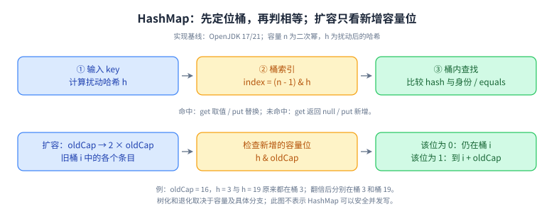
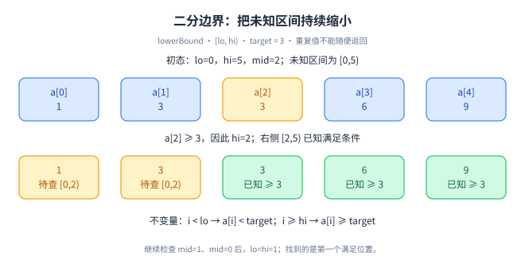
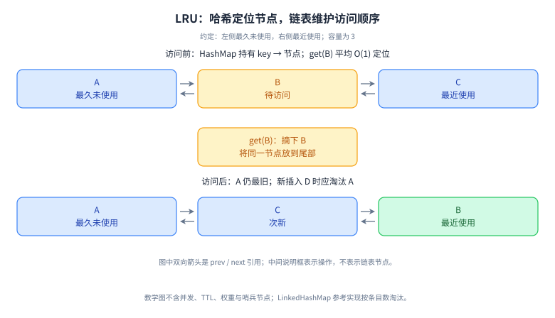
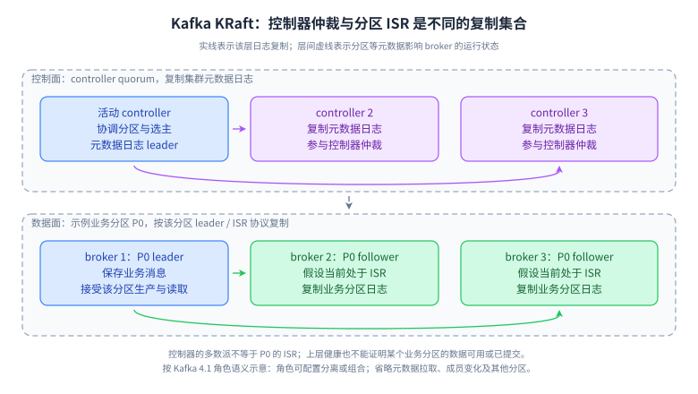
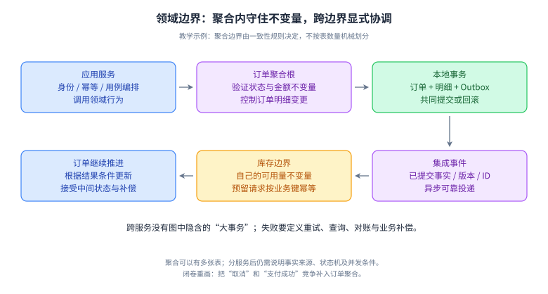
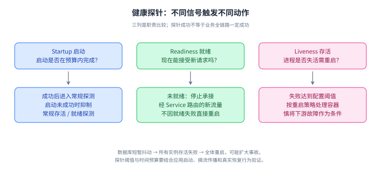
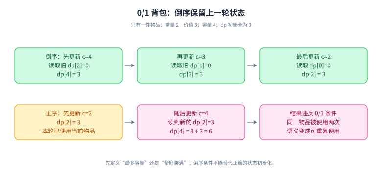
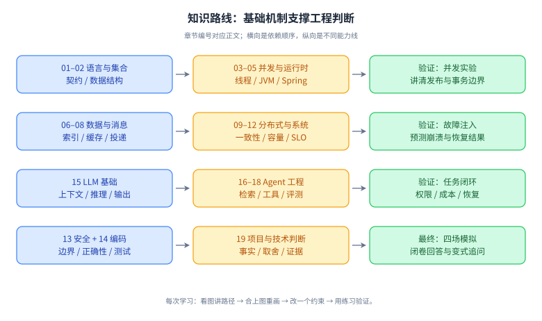

# 机制图谱：先看、再讲、最后闭卷重画

所有 SVG 都已放在对应讲义旁的 assets 目录，阅读器中可点击放大、缩放和下载。图是本项目原创教学示意；其前提、简化和官方来源写在对应章节，不是厂商生产架构声明。

使用方法：先回正文读图说明，再沿箭头口述；合上图后重画，最后改变一个条件解释结果。不要只记节点颜色。本页由 `tools/make_atlas.py` 生成，内容解释请在对应章节维护。

## 值传递：复制的是引用值，对象可以继续共享

左侧修改共享对象内容，调用方可以观察到；右侧只让形参指向新对象，调用方引用仍指向原对象。 [返回讲义](../modules/01-java-language.md)。

## HashMap：先定位桶，再判相等；扩容只看新增容量位

上方是查找主线，下方是容量翻倍时的桶拆分。适用于常见 OpenJDK 17/21 实现。 [返回讲义](../modules/02-collections.md)。

## happens-before：用一条同步边发布普通数据

线程 A 先写普通字段 data=42，再写 volatile ready=true；线程 B 读到该 true 后读取 data，程序顺序与 volatile 同步边传递保证读取结果。 [返回讲义](../modules/03-concurrency.md)。

## ThreadPoolExecutor：一次 execute 的接纳路径

主线依次尝试核心线程、入队、最大线程，最终拒绝；入队成功还需二次检查运行状态和 worker 数。 [返回讲义](../modules/03-concurrency.md)。

## G1 周期：并发标记与暂停疏散承担不同任务

示意一次 G1 周期的年轻代收集、并发启动、并发标记、Remark、Cleanup 以及 Mixed 回收；STW 阶段明确标记。 [返回讲义](../modules/04-jvm.md)。

## GC 可达性：保留对象的是引用路径，不是业务意图

GC Roots 经强引用保留缓存与对象 A；缓存强引用 WeakReference，但到对象 B 只有弱引用；独立的 U V 循环没有根路径。 [返回讲义](../modules/04-jvm.md)。

## JVM 内存：线程执行状态、Java 堆与本地开销

线程私有的执行状态可持有指向共享堆的引用；HotSpot 进程还包含元空间、代码缓存、直接内存等，不受 Xmx 统一限制。 [返回讲义](../modules/04-jvm.md)。

## Spring Bean 生命周期：定义、实例、代理与销毁

展示典型应用单例从 BeanDefinition 处理到实例化、依赖填充、初始化、后置代理、使用与销毁的主要路径。 [返回讲义](../modules/05-spring.md)。

## Spring 事务代理：边界取决于调用是否穿过拦截器

外部调用穿过代理进入 outer，内部 this.inner 不再次触发事务拦截；同线程 DAO 可参与已有事务，最终由外层拦截器完成事务。 [返回讲义](../modules/05-spring.md)。

## B+ 树：二级索引定位与回表是两次树查找

B+ 树：二级索引定位与回表是两次树查找 [返回讲义](../modules/06-mysql.md)。

## MVCC：沿 undo 版本链寻找本次读视图可见的版本

MVCC：沿 undo 版本链寻找本次读视图可见的版本 [返回讲义](../modules/06-mysql.md)。

## Cache-aside 反例：删除成功后仍可回填旧值

Cache-aside 反例：删除成功后仍可回填旧值 [返回讲义](../modules/07-redis.md)。

## 租约过期后，随机 token 与 fencing 保护的是不同边界

租约过期后，随机 token 与 fencing 保护的是不同边界 [返回讲义](../modules/07-redis.md)。

## 消费确认：业务已提交，才允许推进连续完成边界

消费确认：业务已提交，才允许推进连续完成边界 [返回讲义](../modules/08-messaging.md)。

## Outbox：两个本地事务，中间允许重复投递

Outbox：两个本地事务，中间允许重复投递 [返回讲义](../modules/09-distributed.md)。

## Raft 网络分区：多数派可以推进，旧 leader 不能独自承诺

Raft 网络分区：多数派可以推进，旧 leader 不能独自承诺 [返回讲义](../modules/09-distributed.md)。

## 一次请求：链路、等待与总时间预算

请求依次经过客户端、入口、业务执行与下游；底部另用800ms预算展示串行耗时相加。 [返回讲义](../modules/10-network-os.md)。

## 容量设计：先满足丢失一个故障域后的安全吞吐

容量设计：先满足丢失一个故障域后的安全吞吐 [返回讲义](../modules/11-system-design.md)。

## 订单设计：同步受理与异步履约使用不同事务边界

订单设计：同步受理与异步履约使用不同事务边界 [返回讲义](../modules/11-system-design.md)。

## 接口 P99 激增：用证据区分计算、等待与 GC 压力

接口 P99 激增：用证据区分计算、等待与 GC 压力 [返回讲义](../modules/12-reliability.md)。

## 服务端授权：身份、对象、动作三者相交

不可信输入经认证变为可信身份，业务授权决定可操作对象范围，数据层收窄查询和输出。 [返回讲义](../modules/13-security-delivery.md)。

## 数据库演进：扩展、迁移、切换、收缩

六步兼容迁移，直到验证旧版本不再使用后才收缩旧字段。 [返回讲义](../modules/13-security-delivery.md)。

## 二分边界：把未知区间持续缩小

数组1、3、3、6、9中查找第一个大于等于3的位置。首次mid=2，hi收缩为2，再用不变量推到答案1。 [返回讲义](../modules/14-algorithms.md)。

## LRU：哈希定位节点，链表维护访问顺序

get B先用哈希表定位B，再把B从A-B-C链表摘下移到尾部，得到A-C-B。表里保存节点引用，移动不需扫描链表。 [返回讲义](../modules/14-algorithms.md)。

## Prefill、首 token 与 Decode：缓存复用的位置

Prefill 处理已有输入，并由末位结果预测首个新 token。后续 decode 读取历史 KV 和最近生成的 token，追加新 KV 并预测下一个 token。 [返回讲义](../modules/15-llm-foundations.md)。

## 从 token 到下一个 token：因果注意力做了什么

编号经过嵌入和各层投影形成 Q、K、V。因果掩码挡住未来位置，权重加权 V，最终通过词表预测下一个 token。 [返回讲义](../modules/15-llm-foundations.md)。

## 检索命中、断言支持与业务成功：三个不同分母

教学例子需要文档 A、B，实际召回 A、C、D。四个断言中三个有依据，但遗漏 B 的必要条件，业务仍然失败。 [返回讲义](../modules/16-rag.md)。

## RAG 双链路：建库更新与带权限的在线回答

上排为离线解析建库，下两排为在线查询与生成。可信身份约束召回，原文权限和生效版本在重排与生成前检查。 [返回讲义](../modules/16-rag.md)。

## Agent 工具循环：模型提议，运行时执行与记账

上面六个节点构成工具循环，状态持久化后重建上下文。下面区分对话、长期记忆和外部资料，所有输入按来源和权限治理。 [返回讲义](../modules/17-agent-architecture.md)。

## 副作用结果不确定：UNKNOWN 不是 FAILED

已授权且意图持久化后提交。明确成功可落为 SUCCEEDED；超时进入 UNKNOWN，按稳定业务键查流水。未查到不自动代表没有执行。 [返回讲义](../modules/17-agent-architecture.md)。

## 评测数据流：从固定任务到发布门禁与成本

固定任务输入与标签，用冻结版本执行并记录 trace，分别评估组件、业务不变量和成本时延，再做发布门禁。 [返回讲义](../modules/18-agent-production.md)。

## Agent 信任边界：外部文本不能直接获得执行权

外部资料经过模型变成候选动作，动作必须跨过可信执行门禁。凭据仅在可信层使用，业务服务限制对象、幂等与出站目标。 [返回讲义](../modules/18-agent-production.md)。

## 项目回答：从背景到可验证的判断

项目叙事六个相连部分：约束、备选方案、个人决策、验证证据、结果边界、复盘。 [返回讲义](../modules/19-project-interview.md)。

## Kafka KRaft：控制器仲裁与分区 ISR 是不同的复制集合

Kafka KRaft：控制器仲裁与分区 ISR 是不同的复制集合 [返回讲义](../modules/24-cache-messaging-deep.md)。

## 搜索索引：从词项找到文档，再按相关性返回

搜索索引：从词项找到文档，再按相关性返回 [返回讲义](../modules/25-governance-search-deep.md)。

## Elasticsearch：搜索可见与崩溃可恢复是两道边界

Elasticsearch：搜索可见与崩溃可恢复是两道边界 [返回讲义](../modules/25-governance-search-deep.md)。

## ZooKeeper 锁配方：监听前驱，醒来后重新判断资格

ZooKeeper 锁配方：监听前驱，醒来后重新判断资格 [返回讲义](../modules/25-governance-search-deep.md)。

## 领域边界：聚合内守住不变量，跨边界显式协调

订单应用服务调用订单聚合，聚合内事务保存订单与明细及Outbox，独立库存服务消费事件并回复结果。 [返回讲义](../modules/30-design-domain.md)。

## 健康探针：不同信号触发不同动作

启动探针保护慢启动，就绪探针决定服务流量，存活探针决定是否重启。 [返回讲义](../modules/31-security-cloud-delivery.md)。

## 0/1 背包：倒序保留上一轮状态

单件重量2价值3容量4，正序会复用当前件得到6，倒序结果为3。 [返回讲义](../modules/32-algorithm-coding-deep.md)。

## 知识路线：基础机制支撑工程判断

四条学习路线及其验证产物，最后汇合到项目与模拟面试。 [返回讲义](00-start.md)。
