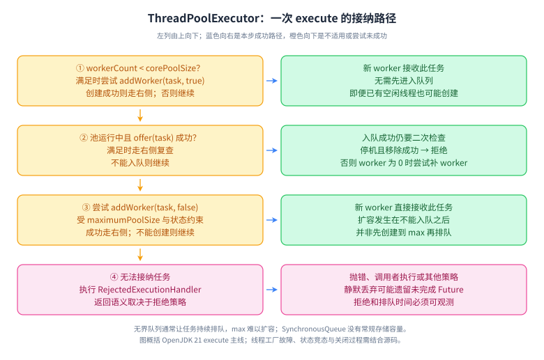

# 03 Java 并发与异步执行

> 优先级：P0；虚拟线程版本细节 P1，AQS 源码拓展 P2。基线：Java 17/21。L1～L4 是学习深度，不对应职级。前置：线程、集合、异常。

## 学习目标

能说明共享状态如何保证正确，能为任务设计超时、取消和容量边界，能排查“线程很多但吞吐很低”。本章不是锁名词清单：每遇到一个共享变量，都问谁读写、什么必须一起发生、如何建立可见性、失败时谁收尾。

## L1 必会：原子性、可见性、有序性

原子性指一个操作不可被外部观察为中间状态；可见性指线程间读写的观察保证；有序性讨论哪些重排不得改变规定的可观察结果。`volatile int n; n++` 是读、加、写，volatile 不能把三步变成原子操作。互斥锁可以把多个字段的业务不变量放在同一边界内；AtomicInteger 适合独立状态的原子更新。

`synchronized` 会在异常退出时释放监视器；ReentrantLock 要在成功获取后用 finally 解锁，提供可中断获取、限时获取和多个 Condition 等能力。锁越多不代表越快，持锁做 RPC 会把外部延迟传播给所有竞争者。先减少共享和缩小临界区，再讨论锁优化。

等待条件使用循环检查，防止虚假唤醒及条件已被其他线程改变。`sleep` 不释放已经持有的监视器；`wait` 要先持有相应监视器，并在等待时释放它。中断是协作取消信号，不能安全地强制杀死任意业务代码。

## L2 原理：从 happens-before 到任务生命周期

happens-before 是推理可见性与顺序的规则，不是现实时间先后。关键边包括：同线程程序顺序；同一监视器的解锁到后续加锁；volatile 写到后续读；线程 start 到启动线程中的动作；线程中的动作到其他线程确认它已终止（例如等待结束的 join）；规则还可传递。有超时的 join 正常返回不一定意味着目标线程已经结束，不能据此直接推导终止关系。发布一个配置快照可先构造不可变对象，再写入 volatile 引用，读取方读取该引用后使用快照。[JLS 17](https://docs.oracle.com/javase/specs/jls/se21/html/jls-17.html)

CAS 比较预期值再更新，失败可以重试；它不意味着零成本或所有算法都无等待。高竞争会产生重试开销，ABA 要看业务是否关心“期间发生过变化”，必要时引入版本号。AQS 用同步状态和等待队列支撑锁与同步器；入队、阻塞、唤醒、重新争抢是理解框架的主线，唤醒并不直接等于获得锁。

ThreadPoolExecutor 的主要接纳路径是：线程数少于 core 时尝试建线程；否则先入队；队列不接受时尝试扩到 max；仍不能接受则拒绝，关闭等状态还会影响接纳。无界队列会使 max 在通常负载增长中难以起到扩容作用，并把过载转为堆积与超时。[线程池 API](https://docs.oracle.com/en/java/javase/21/docs/api/java.base/java/util/concurrent/ThreadPoolExecutor.html)

## L3 工程：把并发当作容量和故障问题

线程池大小要基于任务性质、CPU 配额、等待比例、下游容量和目标延迟测量。`线程数≈核心数×(1+等待/计算)` 只能当估算起点。按稳态 Little 定律，系统内平均在途量 L≈到达率 λ×平均停留时间 W；一旦持续过载，排队增长，稳态假设就不成立。队列长度应由允许等待时间与消费速度约束，不是内存装得下就可以。

拒绝策略要和业务契约一致：抛错便于明确失败；CallerRuns 可对提交方施加背压，但会阻塞请求线程或事件循环；静默丢弃可能让 Future 永远不完成。任务异常必须有人观察，submit 的异常通常存入 Future，不能只依赖线程未捕获异常处理器。监控运行数、排队时间、队列长度、拒绝数及任务失败，而不只看线程总数。

CompletableFuture 的非 Async 阶段可能由完成前序任务的线程等执行；Async 阶段未指定执行器时通常用公共池。慢阻塞任务要有明确的执行资源，禁止在同一个受限池里让父任务占着线程等待排队的子任务。`orTimeout` 改变 future 的完成状态，并不自动保证底层 HTTP/SQL 已停止；取消必须贯通客户端超时、取消句柄与资源释放。

ThreadLocal 解决线程内数据隔离，不解决跨线程上下文传递。线程池复用会让未清理的数据串请求，所以 set 后 finally remove；嵌套作用域还要恢复此前上下文。异步提交时应显式捕获并恢复必要的 trace、用户等上下文，不能传播不应跨线程共享的数据库连接。

## L4 拓展：虚拟线程的版本边界

Java 21 的虚拟线程适合大量等待 I/O 的任务，不增加 CPU 核数，也不提高下游吞吐上限。通常每任务一个虚拟线程，限制稀缺资源用连接池、信号量、入口限流与等待超时；不要仅因为线程便宜就无限接收请求。[Java 21 指南](https://docs.oracle.com/en/java/javase/21/core/virtual-threads.html)

JDK 21 中在 synchronized 内阻塞可能使虚拟线程 pin 到 carrier；JDK 24 引入的相关改进消除了 synchronized 导致的这类主要限制，native/foreign 调用仍存在无法卸载的边界。因此“用虚拟线程必须把 synchronized 全换成 ReentrantLock”不是跨版本结论。迁移应核对运行时、驱动、阻塞路径并采样 JFR，不能只编译成功就上线。[Java 24 指南](https://docs.oracle.com/en/java/javase/24/core/virtual-threads.html)

## 机制图解与推理训练

### happens-before：画出跨线程的那条边

**读图顺序：** 左列写 `data` 再写 `ready`，右列先确认读到 `ready == true` 再读 `data`；中间紫色箭头连接同一个 volatile 变量的写读。两条程序顺序边加一条同步边，通过传递性得到普通数据写到读的 happens-before。不要把这条证明简化为“刷新 CPU 缓存”，因为规范约束的是合法观察结果，并不要求特定硬件实现。

**记忆点：** 先完成状态，再发布入口；先获取入口，再使用状态。题设必须完整：初始 `data = 0`、`ready = false`，只有一个写线程写一次 42，发布后不再修改 data。读线程可能尚未看到 true；但在本例读到 true 后，后续 data 不能还是 0。

**图中未覆盖的边界：** volatile 不是互斥锁，不能让 `n++` 或两个字段的一致更新自动原子化。复用同一个布尔标记、多个写线程轮流更新、发布后继续修改对象，都需要另外证明。`sleep`、日志输出以及“看起来先执行”不应当被用来代替明确同步。

**闭卷重画：** 把 volatile 标记换成同一个监视器的 unlock / lock，重新连接四个动作；再把读方换成另一把锁，指出证明在哪里断开。进一步解释为何把引用设为 volatile 不能保护对象内后续的 `list.add`。

### 线程池：按任务接纳顺序推演过载

**读图顺序：** 沿左列逐步尝试，右侧是该步成功后的处理。`corePoolSize` 是 worker 数量判断，不是“当前忙线程数”；不足 core 时，即使已经存在空闲 worker，也可能为新任务创建线程。入队成功后仍可能与 shutdown 竞争，所以实现会复查状态，尝试移除并拒绝；没有 worker 时还要尝试补充消费者。[ThreadPoolExecutor API](https://docs.oracle.com/en/java/javase/21/docs/api/java.base/java/util/concurrent/ThreadPoolExecutor.html)

**记忆点：** core → queue → max → reject，外加状态复查；不要背成 core → max → queue。无界队列隐藏过载为等待时间和内存增长，`SynchronousQueue` 不存放常规待执行队列元素，接纳行为因此不同。

**图中未覆盖的边界：** 线程工厂失败、停机竞态、队列具体实现和拒绝策略都有独立语义。`CallerRunsPolicy` 在池未关闭时由提交线程执行任务；池已关闭时会丢弃，不能当成“一定完成”的保证。图中的成功表示接纳路径成功，不保证任务的业务结果成功。精确分支可对照 [OpenJDK 21 execute 实现](https://github.com/openjdk/jdk21u/blob/master/src/java.base/share/classes/java/util/concurrent/ThreadPoolExecutor.java)。

**闭卷重画：** 假设 core=2、max=4、队列容量=2，任务都被闩锁阻塞而不会完成，连续提交 7 个任务且使用 AbortPolicy。画出每一步的 worker 数、队列长度和拒绝结果。自检：前 2 个建线程，接下来 2 个入队，再 2 个扩容，第 7 个被拒绝；新建的 worker 直接拿到本次任务，不能据此声称执行严格遵守提交顺序。

### 容易漏答的取消、关闭和条件队列

| 机制 | 提供什么 | 不提供什么 |
| --- | --- | --- |
| `shutdown()` | 不再接纳新任务，已接纳任务按协议继续处理 | 不等待所有任务结束，不强杀运行中任务 |
| `shutdownNow()` | 尝试中断工作线程，并返回未开始的排队任务 | 不保证不合作的任务停止，也不会自动完成所有对应 Future 的取消收尾 |
| `awaitTermination(...)` | 等待池终止，超时返回相应结果 | 超时不会自动强制终止池 |
| `Condition.signal()` | 使等待者有机会重新竞争相关锁 | 不直接把锁交给它，不保证条件保持成立 |

AQS 的同步队列与 Condition 的条件等待队列职责不同：`await` 在满足调用约束时释放关联锁并等待，被唤醒后还要重新获取锁，才能返回并重新检查条件。因此用 `while (!condition) await()`；只用 `if` 可能在虚假唤醒或其他线程抢先消费后越过错误状态。排查死锁还要看固定的多锁获取顺序、锁内远端调用和同池父子任务等待，不能只统计线程数量。[Condition API](https://docs.oracle.com/en/java/javase/21/docs/api/java.base/java/util/concurrent/locks/Condition.html)

## 六道核心题与追问

### 1. volatile 能解决什么，不能解决什么？

**60～90 秒参考答案：** volatile 用于线程间共享变量的可见性与相关顺序保证，典型用途是状态标记或发布不可变配置快照。对 volatile 的写与后续读取建立同步关系，但递增、检查再更新或多个字段的一致更新仍是复合操作。计数可以用原子类，账户余额和流水状态一起变化则要扩大同步边界。选择前先明确要保护的不变量，不能看到共享变量就全部加 volatile，也不能用机器上多跑几次没出错证明线程安全。

**追问：** 双重检查单例为什么需要 volatile？**要点：** 保证正确发布初始化结果；同步块之外的读取也需要对应内存语义；更简单时可选静态内部类。

### 2. synchronized 和 ReentrantLock 怎么选？

**60～90 秒参考答案：** 两者都能提供互斥和可见性。简单词法作用域优先考虑 synchronized，退出时自动释放，代码不容易漏解锁。需要限时获取、中断等待、多条件队列或显式公平策略时可考虑 ReentrantLock，并确保成功获取后 finally 释放。性能要看竞争、持锁时间和 JDK，不能一概说某个更快。通常更大的收益来自减少共享、避免锁内 I/O、固定多锁获取顺序，而不是机械替换锁类型。

**追问：** 公平锁是否绝对按时间先后？**要点：** 公平策略针对获取竞争，线程调度不保证公平；某些 tryLock 用法有自身语义，且公平可能降低吞吐。

### 3. 如何给业务设计线程池？

**60～90 秒参考答案：** 先区分 CPU 计算与阻塞等待，再确认峰值流量、处理时间、CPU 配额、下游连接数及请求期限。然后给线程数、有界队列和拒绝策略设初值，通过压测观察吞吐和尾延迟。线程池通常先 core、后队列、再 max，所以无界队列可能只会积压。不同故障域可以隔离执行资源，但不要为每个方法随意建池。上线必须观察排队时间、拒绝与任务异常，并有降级和关闭过程。

**追问：** 队列积压时直接加线程行不行？**要点：** 如果瓶颈是下游数据库或 CPU，加线程可能更糟；先识别任务等待位置与资源饱和点。

### 4. CompletableFuture 超时为什么还有后台流量？

**60～90 秒参考答案：** Future 表达结果完成状态，超时不等于远端操作已终止。例如请求等待一秒后返回失败，但底层客户端仍可能等待三十秒，重试会进一步放大流量。需要统一请求截止时间，向下游传递剩余预算，配置连接与读取超时，并在客户端支持时主动取消。并行分支失败后还要决定其他分支是否继续，聚合异常不能吞成成功。即使调用 cancel，也要确认具体实现是否把中断或取消传播到底层。

**追问：** 为什么父任务等待子任务会卡死？**要点：** 同一有限线程池的线程都被父任务占用，子任务在队列里无法执行；采用组合回调、分离执行资源或改变任务结构。

### 5. ThreadLocal 为什么可能导致内存与数据问题？

**60～90 秒参考答案：** ThreadLocal 的值属于线程生命周期。业务线程池长期存活，如果请求结束不清理，大对象会持续被引用，也可能被下一次请求误用。内部弱引用键不意味着值会立即被回收，清理有触发条件。因此我在明确作用域内设置，在 finally 中 remove 或恢复旧值；异步任务显式传递最小上下文。更重要的是区分逻辑请求与物理线程，不能假设切线程后 trace、权限与事务自然跟随。

**追问：** InheritableThreadLocal 能解决线程池传播吗？**要点：** 继承发生在线程创建，不是每次任务提交；复用线程时可能旧值残留，不能作为通用传播方案。

### 6. 虚拟线程适合直接替代所有线程池吗？

**60～90 秒参考答案：** 它适合高并发阻塞 I/O，能让等待时的 carrier 执行其他虚拟线程，但 CPU 计算仍受核心数约束。迁移时保留数据库连接池、下游并发上限、入口接纳与超时，避免把线程限制解除后压力全部推给数据库。还要检查 ThreadLocal 内的大对象和版本相关 pinning：JDK 21 的 synchronized 阻塞边界与 JDK 24 以后不同。我会用相同业务负载比较吞吐、P99、内存与错误率，再决定收益。

**追问：** 创建十万个虚拟线程是否等于系统能承受十万个请求？**要点：** 每个请求还有堆对象、缓冲、连接、下游配额；等待也消耗内存，需要背压与接纳边界。

## 常见误区

- 用 sleep 控制测试先后；它不建立可靠的业务同步条件。
- 丢弃中断、吞掉 Future 异常、把超时等同底层取消。
- 把 CAS、AQS、无锁当性能保证，忽略竞争与工作负载。

## 练习与参考验证

完成 [Java 并发实验](../labs/01-java-concurrency.md)：确定性复现丢失更新、验证原子计数、让有界线程池触发拒绝，并观察 Future 超时后任务仍继续。对每项写“预期—输出—原因—工程修复”，再自行把线程池耗时采样扩展为排队时间与执行时间。

## 过关标准

能画出 volatile 发布或锁保护下的 happens-before 链；能现场设计有界线程池并解释拒绝；能定位一次任务等待或上下文泄漏；虚拟线程答案必须包含运行时版本和下游限制。

## 官方来源

1. [JLS 21：Threads and Locks](https://docs.oracle.com/javase/specs/jls/se21/html/jls-17.html)
2. [ThreadPoolExecutor](https://docs.oracle.com/en/java/javase/21/docs/api/java.base/java/util/concurrent/ThreadPoolExecutor.html)
3. [CompletableFuture](https://docs.oracle.com/en/java/javase/21/docs/api/java.base/java/util/concurrent/CompletableFuture.html)
4. [Java 21 Virtual Threads](https://docs.oracle.com/en/java/javase/21/core/virtual-threads.html)
5. [Java 24 Virtual Threads：pinning 边界](https://docs.oracle.com/en/java/javase/24/core/virtual-threads.html)
