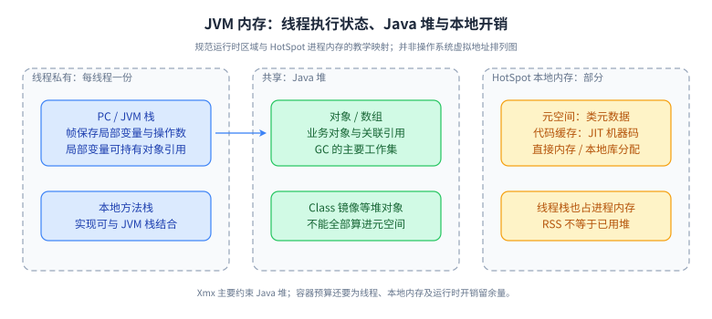
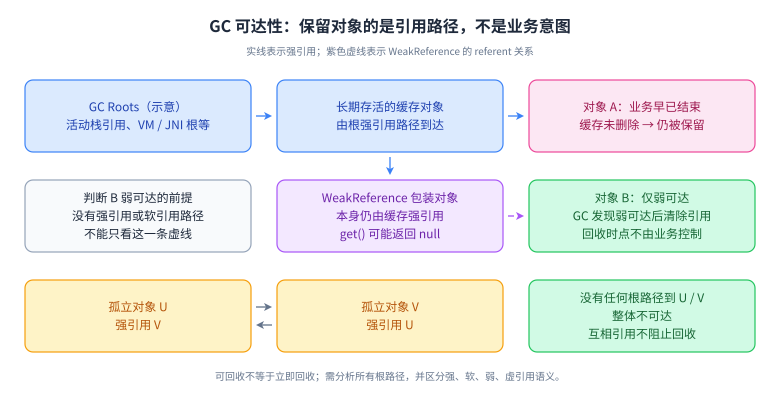

# 04 JVM、垃圾回收与线上诊断

> 优先级：P0；收集器迁移与性能实验 P1，编译器内部优化 P2。基线：HotSpot JDK 17/21。L1～L4 是掌握深度，不对应职级。

## 学习目标与前置

能从延迟、CPU、内存和错误现象提出可验证假设，而不是看到 Full GC 就背参数。前置：对象引用、线程、进程内存的基本概念。学习输出是一份自己的故障排查记录，必须包含时间范围、证据、假设、操作风险和验证结果。

## L1 必会：规范区域与实际内存

JVM 规范描述堆、方法区、虚拟机栈、程序计数器及本地方法栈等运行时区域。线程栈包含栈帧，记录局部变量、操作数栈及调用相关信息；堆是对象主要分配和回收区域。方法区是规范概念，HotSpot 的元空间是类元数据的实现安排之一，不能把二者及所有静态数据简单等同。[JVMS 运行时结构](https://docs.oracle.com/javase/specs/jvms/se21/html/jvms-2.html)

进程内存不等于 Java 堆：还包括线程栈、元空间、代码缓存、直接内存、本地库和其他运行时开销。容器总内存限制不能全给 Xmx；堆未满但 RSS 持续增长，要检查堆外分配、线程数、native 组件及映射等。操作系统杀进程可能没有 Java OOM 堆栈，需结合容器退出信息判断。

垃圾回收从可达性出发：从 GC Roots 沿强引用链强可达的对象保持存活；软、弱、虚引用按各自语义处理，不能把任何引用路径都视为强可达。循环引用本身不会阻止基于可达性的回收。内存泄漏在 Java 中通常是“业务已经不用，但引用链仍可达”，如无界缓存、静态集合或长期任务。内存溢出也可能只是瞬时工作集超过容量，并不必然存在泄漏。

## L2 原理：分配、收集和类加载

对象分配通常经过快速分配路径，例如线程本地分配缓冲；缓冲不够、对象过大或分配策略不同会走其他路径。逃逸分析可能支持标量替换等优化，因此不能把源码中的每个 new 都机械理解为最终保留一个堆对象，也不能把“对象都分配在栈上”作为普遍结论。

G1 把堆划成 Region，按代管理，在部分阶段与应用并发工作，但对象疏散等阶段仍需停顿。Remembered Set 帮助找到跨 Region 引用，避免每次年轻代收集都扫描整个老年代；它本身也有维护成本。Mixed GC 会选择部分老年代 Region 和年轻代一起回收。暂停目标是启发式目标，不是实时硬保证；存活对象多、分配快或疏散空间不足都可能增加压力。[G1 官方说明](https://docs.oracle.com/en/java/javase/21/gctuning/garbage-first-g1-garbage-collector1.html)

类加载大体经历加载、链接、初始化，链接含验证、准备、解析，解析时机可具有灵活性。类身份由类名与定义它的类加载器共同决定，同名类由不同加载器定义仍可不兼容。父委派是常见类加载设计，不是无法改变的 JVM 铁律；插件、容器需要隔离时会有不同策略，也带来类型转换与类加载器泄漏问题。

## L3 工程：按证据排查三类故障

**CPU 高：** 先看是否单实例、单核或全体，核对流量、发布和容器 CPU 限额。采样线程 CPU 与堆栈，判断业务热循环、锁竞争、自旋、GC、序列化还是加密压缩。一次 thread dump 只能看到一个瞬间，连续采样或 JFR 更能显示热点。不要看到 RUNNABLE 就认定线程正在消耗大量 CPU。

**延迟高但 CPU 不高：** 看线程池排队、连接池等待、锁等待、下游网络与磁盘，以及超时重试。把接口分段耗时与 trace 关联，区分执行慢和排队久。若 GC 暂停时间不足以解释 P99，就不要继续只调 GC；容器 CPU throttling、系统调度等也可能使墙钟时间变长。

**内存持续升高：** 比较多次 GC 后的存活量、分配速率和类直方图；若存活量随业务持续增长，沿支配树和到 GC Roots 的路径找保留者。若只是高分配率、回收后恢复，重点减少临时对象或扩展容量。堆转储可能触发停顿并含业务数据，先确认容量和存储位置，在代表性实例收集，不把线上 dump 当无成本命令。

诊断常用 `jcmd <pid> VM.flags`、`Thread.print`、`GC.heap_info` 和 JFR。命令可用性及影响以对应 JDK 的 `jcmd <pid> help` 为准。Native Memory Tracking 需启动时启用才能获得对应跟踪信息，且不能保证覆盖第三方本地库所有分配。[jcmd 手册](https://docs.oracle.com/en/java/javase/21/docs/specs/man/jcmd.html)

## L4 拓展：版本与调优实验

P1：JDK 17/21 常见服务端配置使用 G1，但默认选择仍应检查 JVM 发行版和运行参数。JDK 21 支持分代 ZGC，需区分该版本启用方式与后续版本的演进，不能把新版本默认行为倒推到旧版本。选择收集器时比较暂停、吞吐、CPU 与内存余量，不能只比较一张平均暂停图。

P2：理解预热、分层编译、去优化、内联与逃逸分析。微基准需防止死代码消除、常量折叠和测量噪音；有意义的结论应来自适当基准与业务负载。调优遵循一次改变一类因素，保留基线、固定负载、观察 P95/P99 与错误率。CMS、PermGen 等历史知识须分别核对版本：Java 8 已移除 PermGen，CMS 也不再是 Java 17/21 中可选的收集器，不能混成同一时期的默认现状。[GC 调优指南](https://docs.oracle.com/en/java/javase/21/gctuning/)

## 机制图解：内存、可达性与回收周期

### 内存区域：先定位哪一类预算被耗尽

**读图顺序：** 左侧看线程私有的执行状态，中间看它持有引用的共享对象，右侧看堆以外的进程开销。JVM 栈里的局部变量可以是引用，不能由此推断对象就分配在栈里。方法区是规范中的逻辑区域；元空间承载类元数据，Class 镜像和关联静态字段等不能一概被画进元空间。

**记忆点：** 堆外还有内存，线程也有成本；Xmx 不是进程上限。容器预算需要结合实际 RSS、计费口径、线程数和 native 使用留出余量，不能机械按某个固定百分比配置。[JVMS 运行时数据区域](https://docs.oracle.com/javase/specs/jvms/se21/html/jvms-2.html#jvms-2.5)

**图中未覆盖的边界：** 图混合规范区域与 HotSpot 工程分类，是对应关系而非精确虚拟地址图。保留地址空间、已提交内存与驻留物理内存不是同一个指标；NMT 也不保证覆盖所有第三方库分配。JIT 优化和不同 JVM 实现可能改变实际分配方式。

**闭卷重画：** 在图上标出“线程数量持续增加”“动态生成类不断增加”“直接缓冲未及时释放”各自首先应检查的区域，并给出堆占用不高仍可能被容器杀死的解释。

### 可达性：为什么对象业务结束却仍不释放

**读图顺序：** 第一行沿强引用从根到缓存再到 A；A 已无业务价值，但依然活着。第二行缓存强引用 WeakReference 包装对象，包装对象到 B 的 referent 关系是弱引用，不能和第一行等同。第三行 U、V 互相引用但没有根路径，循环本身不阻止可达性回收。

**记忆点：** 内存泄漏要找到“谁还保留它”，不能只说“GC 没工作”。反过来，可回收不等于立即回收，程序不应依赖某次 GC 正好在某个时刻发生。

| 引用类型 | 关键语义 | 工程边界 |
| --- | --- | --- |
| 强引用 | 从根经强引用可达会保留对象 | 无界缓存、线程上下文和监听器可能误保留业务数据 |
| SoftReference | 仅软可达对象由收集器按内存需要决定清除 | 不是可预测的容量或过期策略，不能替代受控缓存 |
| WeakReference | GC 判定对象弱可达时清除相关弱引用 | `get()` 要处理 null；清除与排队、物理内存回收时点要区分 |
| PhantomReference | `get()` 永远返回 null，可结合引用队列接收通知 | 不能借它重新取回对象；资源释放仍优先显式 close |

**图中未覆盖的边界：** 判断强度必须检查所有路径：另有一条强引用指向 B 时，画出的弱引用不会使 B 可回收。`WeakHashMap` 的值若强引用自己的键，也可能通过 Map → value → key 把键保留下来。图未画软引用、虚引用、终结机制和具体收集器的保守存活策略。[java.lang.ref 官方语义](https://docs.oracle.com/en/java/javase/21/docs/api/java.base/java/lang/ref/package-summary.html)、[WeakHashMap 注意事项](https://docs.oracle.com/en/java/javase/21/docs/api/java.base/java/util/WeakHashMap.html)

**闭卷重画：** 给弱引用对象 B 再增加一条来自静态集合的强引用，重新标注哪些对象能回收；然后设计一个不依赖 `System.gc()` 必然生效的泄漏验证办法。

### G1：标记不等于立即清空老年代

**读图顺序：** 先按编号走一遍周期，再只看 STW 标识。并发标记确定存活信息，为选择老年代候选 Region 提供依据；Mixed 阶段在多次暂停中回收年轻代和部分老年代。疏散把存活对象复制到其他 Region，因此目标空间不足也会成为失败原因。

**记忆点：** Region 是管理单位，标记决定谁活着，Collection Set 决定本次收哪部分，疏散完成存活对象搬迁。Remembered Set 帮助查找来自收集集合之外的引用；不是“每次年轻代 GC 都扫描整个老年代”。SATB 保守保留标记开始时的存活对象，可能产生本轮尚未释放的浮动垃圾。

**图中未覆盖的边界：** 图仅示意正常周期，省略根扫描、引用处理细分阶段、提前结束标记及 Full GC 后备路径；并非每次启动标记都进入 Mixed，也不是老年代一次全部收完。G1 的暂停目标是预测模型的目标，CPU 限额、对象存活率与疏散空间都会影响实际暂停。[JDK 21 G1 机制](https://docs.oracle.com/en/java/javase/21/gctuning/garbage-first-g1-garbage-collector1.html)

**闭卷重画：** 标出应用可以继续执行和必须暂停的阶段，再解释“暂停目标设为 50ms 后出现 150ms 暂停”为什么不一定是 JVM 违反承诺；列出要采集的 GC 阶段日志、CPU 配额和存活量证据。

## 六道核心题与追问

### 1. 堆、栈和元空间有什么区别？

**60～90 秒参考答案：** 栈服务于线程调用，栈帧承载局部变量与执行状态；堆主要存放对象，是垃圾回收重点；元空间是 HotSpot 存储类元数据的本地内存区域。对象引用可能在栈帧中，对象本身通常在堆中，但优化实现不能只凭源码判断。线上容量规划还要算线程栈、代码缓存、直接内存与本地库，因此 Xmx 不是进程内存上限。判断故障先看具体错误与内存类别，再选择证据工具。

**追问：** 堆不大为什么容器仍被杀？**要点：** 总 RSS 或容器计费内存可能超过限制；结合容器退出原因、native 开销、线程及直接缓冲判断，不直接断言堆泄漏。

### 2. GC 怎样判断对象是否可回收？

**60～90 秒参考答案：** 常见 JVM 收集器从一组根引用出发追踪对象，沿强引用链强可达的对象保持存活，软、弱、虚引用则按各自语义处理。互相引用但整体不再被根强可达的对象，也不因循环引用本身而永久存活。Java 泄漏往往不是没人释放内存，而是长期容器或线程仍持有业务已经不用的数据。排查时看多次收集后的存活趋势，再从占用大的对象沿引用链找到保留者。仅看堆使用率曾达到百分之九十，不能区分正常分配、容量不足与泄漏。

**追问：** 加大堆能解决泄漏吗？**要点：** 可能延迟暴露并换取处置时间，但不能切断错误引用链，还可能改变停顿与故障恢复成本。

### 3. G1 为什么能控制停顿，却仍有长暂停？

**60～90 秒参考答案：** G1 用 Region 组织堆，结合历史成本选择本次回收集合，把部分昂贵工作并发执行，并通过疏散整理空间。暂停目标帮助它控制一次做多少工作，但目标不是硬保证。若对象存活率高、分配过快、跨区引用维护重、CPU 受限或疏散空间不足，仍可能出现长暂停甚至 Full GC。我会先读 GC 日志确认阶段与频率，结合分配速率、存活量和系统资源解释原因，再选择调参或改代码。

**追问：** 大对象为什么值得关注？**要点：** G1 对约半个 Region 及以上对象有特殊处理，可能需要连续 Region 并浪费尾部空间；阈值精确边界和回收行为核对所用 JDK。

### 4. CPU 飙升怎么排查？

**60～90 秒参考答案：** 先确定发生时间、影响实例、流量与发布变化，区分 CPU 使用与配额限制。然后采样高 CPU 线程与调用栈，判断是在业务循环、序列化、加密、CAS 重试还是 GC。把多次样本与请求链路、GC 日志结合，避免单次堆栈误导。临时处置可以限流、回滚或扩容，但要说明它缓解的资源瓶颈；最终修复后用同等负载比较 CPU、吞吐、尾延迟和错误率，不能只看 CPU 下降。

**追问：** 线程状态是 RUNNABLE 就说明忙吗？**要点：** JVM 状态不是精确 CPU 计时；某些 native 等待也可能呈现该状态，需要采样或系统线程指标支持。

### 5. 如何证明是内存泄漏？

**60～90 秒参考答案：** 我先建立时间序列，观察相似负载下 GC 后存活量是否持续增长，再看增长集中在哪些类或集合。必要时采集堆转储，分析 retained size、支配关系和到根的引用路径，确认谁在长期持有已完成业务的数据。然后设计复现：停止新增请求或清除相关容器后是否释放，修复后在相同负载下存活量是否稳定。高水位或一次 OOM 只是症状，不能直接证明泄漏；也可能是工作集超过配额。

**追问：** shallow size 与 retained size 区别？**要点：** 前者是对象自身大小；后者是该对象不再保留时可随之释放的关联对象总量，不能把共享引用重复简单相加。

### 6. 为什么同名类会发生类型转换失败？

**60～90 秒参考答案：** 运行时类身份不仅看全限定名，还看定义它的类加载器。插件系统或应用容器中，两份同名接口分别由不同加载器加载，彼此就是不同类型，因此看起来名字一样仍可能 ClassCastException。排查时打印两端类加载器及来源，检查依赖重复与父子加载策略。公共 API 通常由双方共享的加载器定义，插件私有依赖在明确边界隔离。同时要防止线程、缓存或 ThreadLocal 长期引用旧插件加载器，导致卸载失败。

**追问：** 父委派解决什么，能否打破？**要点：** 帮助共享基础类型与降低重复加载冲突；是加载器设计模式，可以定制，但要承担隔离、类型一致与安全边界复杂度。

## 常见误区

- “Full GC 就是泄漏”“堆外不受任何限制”“G1 完全没有 STW”。
- 未保留 GC 日志就先复制网上几十个 JVM 参数。
- 将一次微基准、单次截图或测试环境结果直接外推到生产。

## 练习与参考验证

本地写两个受限进程：A 循环分配临时 byte 数组后丢弃；B 持续把数组加入静态 List。设置较小 Xmx，开启 `-Xlog:gc*:file=gc.log:time,uptime,level,tags`，观察 A 的回收后占用趋于稳定、B 的存活量增长并可能 OOM。只在本地运行，B 必须有迭代上限。分别说明高分配率和长期保留的差别，不能用某次暂停毫秒数作为固定正确答案。此练习需你执行并记录；本章不宣称已运行堆溢出实验。

## 过关标准

能把三个故障症状各拆成至少三种可验证原因；读懂一段 GC 日志而不只认关键字；说清采样、堆转储的收益与开销；能从自己项目给出一次包含前后指标的诊断过程。

## 官方来源

1. [JVMS 21：运行时结构](https://docs.oracle.com/javase/specs/jvms/se21/html/jvms-2.html)
2. [JDK 21 GC 调优指南](https://docs.oracle.com/en/java/javase/21/gctuning/)
3. [JDK 21 G1 机制](https://docs.oracle.com/en/java/javase/21/gctuning/garbage-first-g1-garbage-collector1.html)
4. [JDK 21 jcmd](https://docs.oracle.com/en/java/javase/21/docs/specs/man/jcmd.html)
5. [JDK 21 收集器选择与分代 ZGC](https://docs.oracle.com/en/java/javase/21/gctuning/available-collectors.html)

关于引用强度，参见 [Java 21 java.lang.ref](https://docs.oracle.com/en/java/javase/21/docs/api/java.base/java/lang/ref/package-summary.html)。
