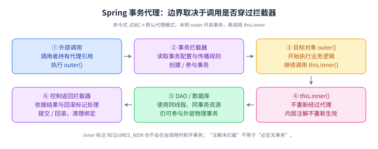
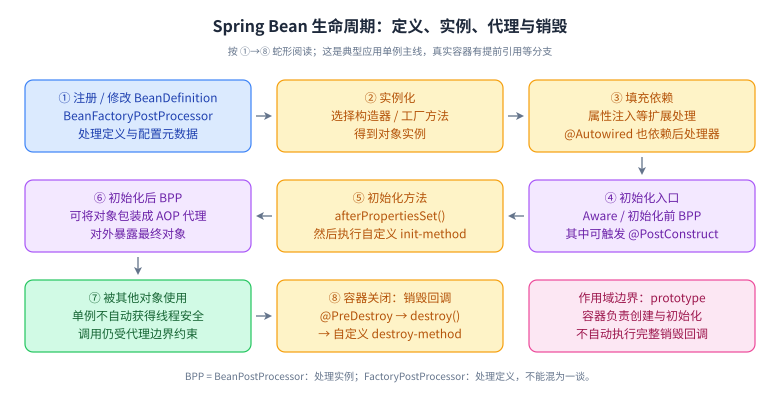

# 05 Spring、Spring Boot 与事务边界

> 优先级：P0；容器扩展与版本迁移 P1，织入机制 P2。学习基线：Spring Framework 6.x / Spring Boot 3.x 配合 Java 17/21；旧系统需另外核对版本。L1～L4 不对应公司职级。

## 学习目标与前置

能解释一个 Bean 如何被创建，一次代理调用如何开启并结束事务，以及异步、异常和传播如何改变结果。前置：Java 反射、接口、异常、数据库本地事务。学习结果不是记住注解名，而是能够画出“调用方—代理—目标对象—数据库连接”的路径。

## L1 必会：容器与代理

IoC 容器维护对象定义及其依赖关系，DI 把依赖交给容器组装。构造器注入让必要依赖显式，便于直接实例化测试，也更早暴露循环设计。Bean 的 singleton 指每个容器、每个定义的共享实例，不等于 JVM 唯一，更不等于线程安全；请求状态不要随意放进单例成员变量。

Bean 创建的教学主线是：定义注册与处理、实例化、依赖填充、初始化回调、后处理器可能包装为代理、供其他 Bean 使用。真实流程包含扩展点和提前引用等分支，不要把这条主线当所有情况下严格不变的逐行顺序。初始化期间调用自己被 AOP 增强的方法，通常不能假设已经经过完整代理。

Spring AOP 常通过 JDK 接口代理或基于类的代理执行拦截器链。类代理依赖可覆盖的方法，因此 final/private 等边界需注意；接口代理只暴露接口约定的方法。选择何种代理还受实际框架配置影响，不能简单把 Spring Framework 默认值等同 Spring Boot 项目配置。[代理机制](https://docs.spring.io/spring-framework/reference/core/aop/proxying.html)

## L2 原理：事务拦截器的执行路径

外部调用进入代理后，事务拦截器读取元数据，依据事务管理器和传播规则获取或创建事务，再调用目标方法；正常返回时提交，异常向外抛时按回滚规则决定回滚或提交，最后清理资源绑定。本地 JDBC 事务通常通过与线程绑定的连接资源参与执行；必须确认 DAO 使用相同的数据源与事务资源。

默认代理模式下，`this.inner()` 不经过代理，因此 inner 上的事务配置不会重新生效。如果 outer 已通过代理开启事务，inner 内使用同一事务资源的数据库操作仍可能参与 outer 的事务；准确说法是“内部方法的注解没有被拦截”，不是“一律没有事务”。常见修复是把边界拆到另一个协作 Bean，或用 TransactionTemplate 明确包裹操作。[注解事务规则](https://docs.spring.io/spring-framework/reference/6.2/data-access/transaction/declarative/annotations.html)

默认未定制规则时，RuntimeException 和 Error 触发回滚，受检异常通常不触发。方法内部 catch 后正常返回，拦截器可能根本看不到异常；但底层或内层事务若已经标记 rollback-only，catch 并不能把它变回可提交状态。必要时配置 `rollbackFor`，而不是为了回滚把所有异常都转换成含糊的 RuntimeException。Spring 6.2 可配置全局 ALL_EXCEPTIONS 默认，回答必须说明项目是否启用。[回滚规则](https://docs.spring.io/spring-framework/reference/6.2/data-access/transaction/declarative/rolling-back.html)

## L3 工程：传播、异步与可靠消息

REQUIRED 在存在事务时参与它，否则新建；多个逻辑事务作用域可能对应同一物理事务。内层标记 rollback-only 后，外层即便捕获异常继续执行，最终提交也可能得到 UnexpectedRollbackException。REQUIRES_NEW 暂挂外层事务并使用独立物理事务，内层提交不随外层回滚；外层占用连接期间内层还可能需要另一连接，连接池耗尽是实际风险。NESTED 通常通过同一物理事务中的保存点局部回滚，支持情况取决于事务管理器与数据库，不能当通用分布式子事务。[事务传播](https://docs.spring.io/spring-framework/reference/6.2/data-access/transaction/declarative/tx-propagation.html)

典型命令式事务绑定线程，`@Async` 或手动创建新线程不会自动继承调用者事务。异步方法若从代理进入并正确配置，可以在异步执行线程开启自己的事务，但不是与原线程共享一个原子提交。Reactive 事务使用 Reactor context 等不同模型，不能用 ThreadLocal 解释全部事务管理方式。[Transactional API](https://docs.spring.io/spring-framework/docs/6.2.x/javadoc-api/org/springframework/transaction/annotation/Transactional.html)

“先写库再发消息”可能遇到库成功、消息失败；把发送放在提交后回调可避免未提交就发出，却不能保证进程崩溃后不丢消息。需要可靠投递时，可把业务修改与 outbox 记录放进同一本地事务，再由异步任务投递并重试，消费者幂等。长事务中调用远端模型或支付接口会占连接、延长锁持有时间；应缩短事务边界，用状态机描述跨系统流程。

Spring Boot 自动配置根据类路径、配置和已有 Bean 等条件提供默认装配；很多配置会在用户提供特定 Bean 时退让，但不是所有条件都一样。排查“为什么没装配”时查看条件评估报告、配置来源、依赖版本与 Bean 定义，不能只盲目扩大组件扫描。

## L4 拓展：版本与边界

P1：Spring 6.0 起，类代理默认可支持 protected、包可见事务方法；接口代理的事务方法仍须 public 并在接口定义。private/final 和 self-invocation 的代理边界仍要区分；团队可统一 public 服务边界减少歧义。Spring Boot 3 的 jakarta 迁移、Java 基线与依赖兼容要按实际版本核对，不把旧 javax 示例直接复制到新项目。

P2：AspectJ 织入能够改变自调用的拦截边界，但带来构建与运行复杂度，不是修复职责不清的首选。构造器循环依赖应先改设计，事件、接口或拆分职责可能解除循环；不要把循环引用的某种容器支持当必须依赖的业务能力。性能排查同样要区分 AOP 开销、数据库时间和连接等待，不能因为调用栈有代理就归因给反射。

## 机制图解：把注解还原为对象和调用

### 事务代理：自调用到底丢失了什么

**读图顺序：** 沿 ① 到 ⑥ 看一次完整调用：代理建立事务上下文，目标对象运行，DAO 参与相同资源，控制返回后拦截器决定结束方式。重点是 ③→④：`this.inner()` 没有重新经过 ②，所以 inner 上的传播级别、超时和回滚配置不会被当作一次新的事务方法拦截。

**记忆点：** 判断事务先画调用路径，再看传播和异常；注解是元数据，不会自行拦截方法。outer 已开启的事务仍可能覆盖 inner 使用的同线程、同数据源操作，所以不能把自调用统一答成“没有事务”。

**图中未覆盖的边界：** 图是命令式 JDBC 默认代理模式，不适用于直接套解释 Reactive context 或 AspectJ 织入。它没有保证异步线程继承事务，也没有把远端 RPC 变成本地事务的一部分。多个数据源要检查具体事务管理器和连接获取方式。若内层已经把共享事务标记为 rollback-only，外层 catch 异常也未必能提交。[Spring 6.2 注解事务](https://docs.spring.io/spring-framework/reference/6.2/data-access/transaction/declarative/annotations.html)

**闭卷重画：** 将 inner 改为另一个 Bean 的 `REQUIRES_NEW` 方法，画出第二次代理调用、外层事务挂起和内层独立连接；分别推演内层失败、外层失败和连接池不足三种结果。

### Bean 生命周期：两个后处理器处理的对象不同

**读图顺序：** 先区分 ① 的定义与 ② 之后的实例，再顺着初始化到最终暴露对象。BeanFactoryPostProcessor 修改 BeanDefinition 等配置；BeanPostProcessor 作用于实例，依赖注入、生命周期注解和自动代理还涉及它的不同扩展接口。不要把所有扩展都背成初始化之后才执行。

**记忆点：** 定义 → 实例 → 依赖 → 初始化 → 可能代理 → 使用 → 销毁。常规情况下，同时配置且对应不同方法的初始化回调按 `@PostConstruct`、`afterPropertiesSet()`、自定义 init-method 执行；销毁主线对应 `@PreDestroy`、`DisposableBean.destroy()`、自定义 destroy-method。初始化方法在原始对象上执行时，不能期待自调用已经得到完整的 AOP 增强。[Bean 生命周期回调](https://docs.spring.io/spring-framework/reference/6.2/core/beans/factory-nature.html)

**图中未覆盖的边界：** 这是典型应用单例主线，FactoryBean 产品、实例化前后处理、提前引用、异常中断创建、特殊作用域均有分支。prototype 创建后通常交给调用方管理，容器不会自动完成其销毁；实现多个回调却把同一方法重复指定时，也不能机械把它算成多次不同调用。构造器循环依赖通常无法仅靠提前暴露来解决，不应以“三级缓存”替代对依赖设计的解释。[容器扩展点](https://docs.spring.io/spring-framework/reference/6.2/core/beans/factory-extension.html)

**闭卷重画：** 把“替换一个配置属性”“给所有服务包装耗时统计代理”“打开并关闭一个文件句柄”放到合适阶段；说明为什么在初始化回调里调用自己的事务方法存在边界问题。

### 用一条实验链验证容器认知

写一个独立 Bean，分别在构造器、依赖注入完成后、`@PostConstruct`、`afterPropertiesSet`、自定义初始化和销毁回调记录事件；再用一个简单 BPP 记录初始化前后事件。启动上下文后调用最终获取的 Bean，关闭上下文并比较事件顺序。验收重点是能分清定义处理、对象创建与代理调用，不能把一次具体处理器排序外推成所有框架扩展的固定顺序。若记录初始化期间对象类型与运行期间暴露类型，还可以直接观察“原始对象”和“代理对象”的差异；未亲自运行前只把它当实验设计。

## 六道核心题与追问

### 1. Spring 单例 Bean 为什么不一定线程安全？

**60～90 秒参考答案：** 单例描述作用域，表示容器为这个定义共享一个实例，它并未自动串行化方法。多个请求可能同时读写成员变量，若成员保存当前用户、临时集合或处理中间结果就会竞争。服务 Bean 通常保持无状态，把请求数据留在方法参数或局部变量中；必要的共享状态用明确同步或并发容器保护，而且原子范围应覆盖业务操作。依赖本身也要看线程安全契约，不能因为被注入容器就默认安全。

**追问：** prototype 注入 singleton 是否每次调用都新建？**要点：** 普通注入是在创建单例时解析依赖；需要逐次获取时用 provider 等机制，并说明生命周期责任。

### 2. AOP 的代理如何影响方法调用？

**60～90 秒参考答案：** 调用方通常持有代理，代理先执行拦截器链，再调用目标对象，因此可以统一加入事务、指标等逻辑。JDK 代理面向接口，类代理通过子类方式增强可覆盖方法；private、final 和自调用有边界。方法内部 this 调另一个方法仍在目标对象内，不会自动绕回代理。排查增强失效时，我会检查对象是否由容器管理、调用是否穿过代理、方法是否可增强以及配置是否生效，而不只检查注解存在。

**追问：** 给自调用方法加 REQUIRES_NEW 有用吗？**要点：** 默认代理模式下没有经过该事务拦截，传播配置不生效；拆分协作 Bean 或用程序式事务。

### 3. 事务注解有哪些常见失效或误判场景？

**60～90 秒参考答案：** 常见原因是手动 new 对象、自调用绕过代理、方法不满足代理限制、事务管理器或数据源选错，以及异常被捕获后正常返回。还要区分受检异常的默认提交规则、已有事务继续参与和内层 rollback-only。验证不能只看日志打印了方法，而要执行可回滚操作、制造故障、通过独立连接检查最终数据。如果使用异步或响应式流程，还需确认事务上下文在哪个执行范围有效。

**追问：** outer 有事务，this.inner() 就完全没事务吗？**要点：** inner 注解不被处理，但同线程同事务资源上的操作仍可参与 outer 事务；inner 的独立传播需求不会因此实现。

### 4. REQUIRED、REQUIRES_NEW、NESTED 怎么选？

**60～90 秒参考答案：** REQUIRED 让相关业务操作共享事务，适合一起成功或失败。REQUIRES_NEW 开独立物理事务，适合明确允许独立提交的记录，但要承担外层回滚后内层仍存在、额外连接和可能锁冲突的代价。NESTED 常用保存点在同一物理事务内局部回滚，外层最终回滚时整体仍回滚，且依赖管理器支持。我会先写清业务原子边界，再选传播级别，而不是用 REQUIRES_NEW 来压住所有回滚报错。

**追问：** catch 内层异常为什么仍提交失败？**要点：** 共享事务可能已标记 rollback-only；吞异常没有清除标记，外层提交时以 UnexpectedRollbackException 暴露整体未提交。

### 5. 异步任务和事务怎么配合？

**60～90 秒参考答案：** 命令式本地事务通常与执行线程绑定，主线程开启事务后提交异步任务，不会自动把连接和提交边界传过去。异步线程可以通过正确代理入口建立自己的事务，但它与主线程是独立结果，可能先于主事务提交就读不到数据，也可能在主事务回滚后已经产生副作用。对必须在提交后处理的任务，可用提交后触发；对不能丢的任务，应持久化 outbox 或任务记录，再异步执行并幂等重试。

**追问：** 提交后事件监听器能保证消息可靠吗？**要点：** 只解决时机问题；提交后到投递之间进程崩溃仍可能丢失，需要持久化和补偿扫描等可靠机制。

### 6. Spring Boot 自动配置如何排错？

**60～90 秒参考答案：** 自动配置不是无条件扫描全部类，而是依据依赖、属性、已有 Bean 等条件提供配置。发现某个组件缺失或重复时，我先确定实际 Boot 版本和依赖树，再看条件评估报告及配置来源，确认哪个条件不匹配、哪个用户 Bean 触发了退让。然后检查扫描与导入边界，写最小上下文验证预期 Bean。这样能解释“为什么出现”，也便于升级时识别条件变化，而不是不断加注解碰运气。

**追问：** 自己定义 Bean 后框架的一定消失吗？**要点：** 取决于具体条件注解、类型与名称匹配及装配顺序，不能把常见的 missing-bean 策略推广到全部配置。

## 常见误区

- “所有异常都回滚”“catch 后肯定能提交”“自调用必定完全无事务”。
- “加 @Async 自动继承事务”“REQUIRES_NEW 不耗额外连接”。
- 用 readOnly 当权限拦截；它通常是事务系统提示，具体强制行为要看实现。

## 练习与参考验证

在独立本地测试工程中用实际数据库与同一事务管理器建两张表。使用默认回滚规则且不配置 noRollbackFor：外层写订单，再通过另一个 Bean 写日志并抛出 IllegalStateException；外层在调用点 catch 该异常后正常返回。分别测试 REQUIRED、REQUIRES_NEW、NESTED，以及把调用改为 this。记录订单行、日志行、异常和实际线程名；查询结果必须在受测事务结束后用独立连接完成，避免测试框架自动回滚掩盖行为。

参考：REQUIRED 内层异常标记共享事务后被外层捕获，外层提交仍应失败并整体回滚；REQUIRES_NEW 内层回滚、外层捕获后可提交；支持保存点的 NESTED 可回滚内层、外层继续。自调用时应按外层实际事务与异常是否越过代理判断，不能套内层注解。这里提供验收设计，未启动数据库运行此实验。

## 过关标准

能画出代理事务调用链；预测异常、传播、自调用、异步四种组合的提交结果；能解释连接池与长事务风险；至少完成一次真实数据库回滚验证后再把经验写进项目回答。

## 官方来源

1. [Spring AOP 代理机制](https://docs.spring.io/spring-framework/reference/core/aop/proxying.html)
2. [Spring 6.2 注解事务](https://docs.spring.io/spring-framework/reference/6.2/data-access/transaction/declarative/annotations.html)
3. [Spring 6.2 回滚规则](https://docs.spring.io/spring-framework/reference/6.2/data-access/transaction/declarative/rolling-back.html)
4. [Spring 6.2 事务传播](https://docs.spring.io/spring-framework/reference/6.2/data-access/transaction/declarative/tx-propagation.html)
5. [Spring Boot 自动配置](https://docs.spring.io/spring-boot/reference/using/auto-configuration.html)
