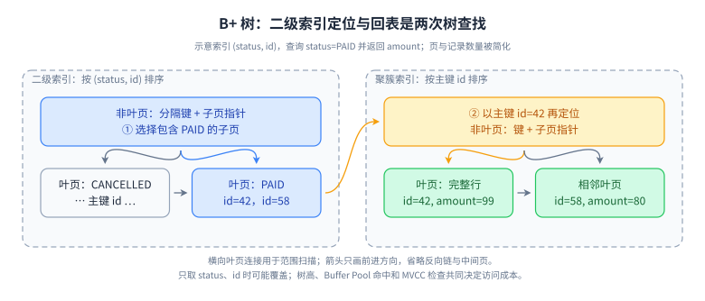
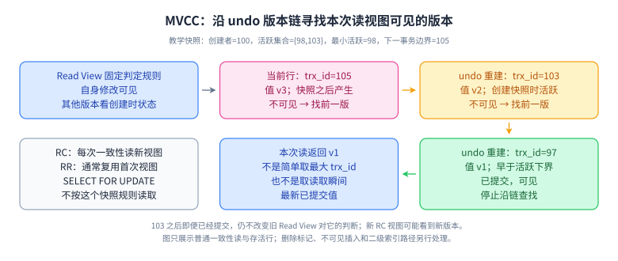

# 06 · MySQL：索引、事务与故障证据

## 目标、前置与优先级

前置：SQL、事务边界、Java JDBC/Spring 事务。完成后应能解释一条查询怎样找到记录、一次修改怎样提交，以及并发为什么出现等待。以 MySQL 8.4 / InnoDB 为核对基线；公司使用其他版本时重新查默认参数。L1—L4 表示理解深度，不代表职级。P0：索引、MVCC、锁、慢查；P1：日志与复制；P2：在线变更、分片迁移。

## L1 · 必会口述（P0）

InnoDB 的聚簇索引叶子存放行数据，二级索引记录包含主键值；经二级索引找到主键，再访问聚簇索引称为回表。覆盖索引是在索引中取得本次查询所需信息，减少回表；它不是一种独立索引类型。主键过宽会扩大二级索引，因此主键选择同时影响写入和存储。[官方：索引结构](https://dev.mysql.com/doc/refman/8.4/en/innodb-index-types.html)

联合索引 `(tenant_id,status,created_at,id)` 按这些列逐级排序。先等值限制前两列，后续时间范围和排序通常更容易利用连续区间。所谓最左前缀描述常见访问路径，不能代替执行计划：索引条件下推、跳跃扫描、覆盖扫描以及成本估计都可能改变实际方案。给索引列套函数、发生不合适的隐式转换或低选择性条件，也不能统一判定“绝对不走索引”。要看参数类型、比较语义和具体计划。

事务的原子性是同一事务的修改一起提交或回滚；隔离性规定并发可观察行为；持久性受落盘、复制和硬件保证共同影响。ACID 的一致性指业务约束得到维护，不等同于分布式副本的线性一致性。事务开启并不自动保护“先查后写”的所有业务条件。

### 看图：为什么 B+ 树适合索引，回表又贵在哪里

**读图顺序：**从左上非叶页定位到二级叶页，拿到 `id=42`，沿橙色箭头在右侧聚簇索引再次查找行；横向叶页连接用于继续范围扫描。非叶节点保存导航信息，分支多能降低树高；范围查询定位起点后顺序访问相邻叶页，不必每条记录都从根重新找。真实索引以页组织，默认页大小常见为 16KB，但可配置，不能把“三层能存固定多少行”背成数据库承诺。[官方：索引物理结构](https://dev.mysql.com/doc/refman/8.4/en/innodb-physical-structure.html)

**记忆锚点：**“非叶导航、叶页有序、二级带主键、回表再查树”。索引选择性差时，即使走了索引，大量候选行仍可能带来随机页访问和回表；Buffer Pool 命中会改变真实 I/O，树高不等于每次磁盘读取次数。覆盖索引减少获取列的回表需求，但不能不加条件地声称永远不会访问聚簇记录；InnoDB 的 MVCC 可见性判断在部分二级索引场景仍需回查。[官方：多版本与二级索引](https://dev.mysql.com/doc/refman/8.4/en/innodb-multi-versioning.html)

**适用限制：**图省略了中间层、页内查找、删除标记与变长列外部存储；它用于解释普通 B+ 树索引，不代表 FULLTEXT 或空间索引。

**闭卷重画：**把查询改为只返回 `status,id`，标出哪个访问可省；再改为返回 `amount` 且命中 10 万行，解释为什么“用了索引”仍然可能慢。

## L2 · 机制推导（P0/P1）

MVCC 通过版本信息、undo 和读视图判断历史版本是否可见。RR 中普通一致性读通常复用首次一致性读建立的快照；RC 每次一致性读建立新快照。`SELECT ... FOR UPDATE` 和修改语句不能按普通快照读推理。一个事务可以看到自己的修改，因此不要把 RR 描述成数据库时间被冻结。[官方：隔离级别](https://dev.mysql.com/doc/refman/8.4/en/innodb-transaction-isolation-levels.html)

### 看图：Read View 怎样选择一个历史版本

**读图顺序：**先读顶端的快照参数，再沿 `105 → 103 → 97` 版本链判断。简化判定顺序是：自己的版本可见；比创建视图时最小活跃事务更早的版本可见；达到或超过当时下一事务边界的版本不可见；中间范围看是否在当时活跃集合内，集合中不可见、集合外可见。这里比较的是事务 ID 与读视图中的快照信息，不是拿提交时间或事务 ID 大小直接排序。命中删除标记的可见版本可能意味着这行不存在。[官方源码：ReadView::changes_visible](https://github.com/mysql/mysql-server/blob/mysql-8.4.0/storage/innobase/include/read0types.h)

**记忆锚点：**“先看是否自己，再看上下界，中间查活跃集合”。undo 保存重建历史版本所需信息，不是把每版完整行都永久复制一份。长快照会让仍可能被访问的历史版本难以及时清理；版本链越长，访问成本可能越高。RR 的旧快照不能自动保护跨行约束，例如两个值班医生都先看见另一人在岗，再分别把自己改为离岗。需要锁定共同约束对象、条件写、合适的串行化方案或重新建模。[官方：一致性读](https://dev.mysql.com/doc/refman/8.4/en/innodb-consistent-read.html)

**适用限制：**只适用于普通一致性读的核心推理；锁定读、写语句、自己的写入以及不同引擎不能直接套用。图中 103 在快照创建后提交，旧快照仍视它不可见。

**闭卷重画：**先让 103 提交，再让 RC 创建新读视图；预测 RC 与原 RR 读到什么。接着用两会话实验核验，保留事务 ID、SQL、提交时序，避免仅凭隔离级别名称下结论。

记录锁锁索引记录；间隙锁抑制区间内插入；next-key lock 组合记录与前方间隙。RR 下范围锁定查询通常涉及 next-key；命中已有行的唯一索引等值查找通常只锁记录。不存在的键、非唯一索引和不同执行计划会改变锁范围。RC 通常减少间隙锁，但外键、唯一性检查仍有例外。[官方：锁](https://dev.mysql.com/doc/refman/8.4/en/innodb-locking.html)

redo 支持崩溃后的已记录修改恢复，undo 用于回滚并支持历史版本，binlog 是服务层复制与时间点恢复的重要输入。WAL 的重点是相应日志持久化早于脏页落盘，不是每次提交立刻写所有数据页。redo 与 binlog 的内部提交协调，不能被混同成业务跨库事务；必须结合 `innodb_flush_log_at_trx_commit`、`sync_binlog`、备份与恢复演练讨论丢失窗口。[官方：redo](https://dev.mysql.com/doc/refman/8.4/en/innodb-redo-log.html)

## L3 · 工程情境与取舍（P0）

订单列表从 50ms 变为 2s，先分解连接池等待、数据库执行、网络传输和应用映射。采集脱敏后的实际 SQL、绑定参数、发生时段和调用量，查看扫描行、返回行、排序、临时表、锁等待。低频单条慢查与高频中等慢查的优化收益不同。

对于 `tenant_id=? AND status=? ORDER BY created_at DESC,id DESC LIMIT 20`，先尝试匹配过滤和排序的联合索引，而不是给每列分别加索引。对深分页使用带 `(created_at,id)` 的游标条件，说明翻页期间新增、更新导致的可见性规则。新增索引要评估写放大、磁盘、DDL 的元数据锁和回滚方案。

库存扣减优先把不变量放入单条条件更新：`UPDATE stock SET available=available-1 WHERE sku_id=? AND available>0`，检查影响行数；再把订单及库存变更放入合适事务。跨库时该原子性范围不再成立。死锁可以由合法并发产生，应统一加锁顺序、缩短事务并对被回滚事务有限重试；不能只把锁超时调大。

## L4 · 拓展边界（P2）

分库分表之前先确认瓶颈是存储、写入还是单键热点。分片带来路由、跨分片查询、唯一性、迁移和扩容成本。主从读写分离会引入复制延迟，刚写后读可路由主库或使用满足业务语义的进度等待。读副本不会解决主库写热点。长事务既延长锁生命周期，也可能阻碍历史版本回收；“查询不加锁所以没有成本”是错误判断。

## 六道核心题：60～90 秒参考回答与追问

### 1. 为什么建了索引仍然慢？

**参考回答：**我会先确认慢发生在哪里，而不是立即加索引。执行计划需要结合真实参数和数据分布，看估计行数、实际扫描行数、循环次数以及是否大量回表。索引可能选中了，但过滤能力弱；也可能排序、返回大字段或锁等待占主要时间。随后比较小范围索引调整、减少返回列、游标分页等方案，在接近真实分布的数据上验证延迟和写入代价。上线后对比调用量相同条件下的 P95/P99 和资源消耗。例如同一租户过去只有一千条订单，如今有一百万条，原索引仍被使用却需扫描大量记录，问题是访问代价变化。我会保留优化前后的计划与参数，确认不是缓存预热差异制造的提升，再观察线上回归和撤销条件。

**追问：`EXPLAIN ANALYZE` 有什么风险？**它会实际执行受支持的语句并给出运行统计；在生产不能把它当纯元数据查询。先评估扫描量、锁及资源风险，在受控环境运行。[官方：EXPLAIN](https://dev.mysql.com/doc/refman/8.4/en/explain.html)

### 2. RR 能否防止所有“幻读”？

**参考回答：**需要先约定观察方式。InnoDB RR 的普通一致性读通过复用快照，通常不会因为其他事务提交而在第二次快照读多出记录；锁定范围读则通过相应范围锁约束插入。这两种机制不同。如果把普通查询、当前读和自身写入混在一个事务里，结果不能用“所有读取都是同一快照”解释。面试中我会用两条连接写出具体 SQL 和时间线，再判断是否阻塞、看到哪一版数据，以及业务不变量是否成立。例如先普通查询看到没有待发订单，再用修改语句操作当前记录，两个动作依据的可见状态可能不同。若业务要求在整个区间禁止新订单插入，就应明确锁定范围及合适索引，而不是仅依赖隔离级别名称。

**追问：首次 `BEGIN` 就一定建立读视图吗？**通常不是；普通事务通常在首次一致性读建立，显式一致性快照启动方式另论。

### 3. 怎样定位和处理死锁？

**参考回答：**先取死锁现场，识别两个事务执行的 SQL、持有的锁、申请的锁以及访问索引，画出等待环。常见原因是加锁顺序相反、范围锁与插入交错，或者缺索引放大扫描锁范围。修复顺序是缩短事务、统一访问顺序、优化访问路径，必要时减少事务内操作。应用必须能够处理事务被回滚，并在总超时和次数限制内重试。重试整个业务事务前要确认外部副作用不会重复发生。例如转账时两个事务分别先锁账户甲和账户乙，再申请另一账户就可能成环。我会把账户按稳定顺序加锁，并验证其他入口也遵循相同约定；若重试引起新的热点，还要加退避和并发控制，不让重试成为第二次故障。

**追问：锁等待超时等于死锁吗？**不是；等待可能没有环。两者回滚语义和配置也应核对，不能假定异常发生后整个连接事务必然已经清空。

### 4. redo、undo、binlog 各解决什么？

**参考回答：**我按恢复目标区分：undo 让未提交修改可撤销，并帮助读取历史版本；redo 让崩溃后可以恢复已记录的数据页修改；binlog 面向复制及配合备份做时间点恢复。它们不能互相替代。提交成功后的数据安全还取决于日志刷盘策略、操作系统和设备行为以及故障域。我会根据可接受的数据丢失量和恢复时长选配置，再用断电类故障模拟和备份恢复演练验证，而不是只背参数。例如数据库进程崩溃与整台宿主机掉电，对操作系统缓存的影响并不相同；主库不可用与磁盘永久损坏的恢复方式也不同。我会把这些故障分开验收，并证明日志归档连续且备份可恢复，而不是仅检查配置文件。

**追问：有 binlog 就不用备份吗？**不行。恢复要有可用基线及完整连续日志，且需要证明恢复时间满足目标。

### 5. 怎样防止库存超卖？

**参考回答：**先定义库存不可为负、同一业务请求只生效一次两条不变量。在单库场景，用库存大于零的条件更新并检查影响行数，再把订单创建和库存更新放进同一事务；对请求号建立唯一约束处理重试。缓存库存只能作为流量筛选，最终约束放在权威存储。高竞争时再考虑排队、库存分桶或预约模型，但要补足归还、过期和对账逻辑。不能用先查库存再无条件更新来推断并发安全。例如请求实际扣减成功但客户端超时，重试若换了请求号就会再次扣减；因此请求身份应由业务发起方稳定保存。对取消归还库存也应记录唯一释放动作，并用订单状态机协调付款回调，避免重复释放制造虚假库存。

**追问：失败后是否直接重试？**只有能够区分未执行、结果未知和明确失败，并具备幂等键及预算时才安全；超时应允许查询原请求结果。

### 6. 什么时候需要分库分表？

**参考回答：**我先用容量增长和压测证明单库在优化后仍不满足目标，再按核心访问模式选择分片键。订单按用户分片利于用户列表，却不利于商家报表；因此需要辅助索引或异步分析链路。设计必须覆盖全局标识、跨片事务取舍、热点、历史迁移、增量追平、双读校验和回退。只有 SQL 改写而没有数据迁移方案，不能算完整设计。小规模系统通常先用归档、合理索引和读副本降低复杂度。例如按用户分片后运营要求按商家查询全部订单，就要判断异步搜索索引是否能接受延迟，或是否需要独立聚合数据。迁移期间我会保留版本和对账结果，按小范围切流验证，再扩大范围，避免一次性全量切换。

**追问：租户分片发生超级租户怎么办？**预留大租户独立路由或二级拆分能力，避免路由规则散落在业务代码中。

## 易错点

- “索引失效”经常只是成本选择；用计划和实际统计举证。
- “有事务就不会超卖”遗漏了隔离级别、写法和事务范围。
- “RR 所有读取都固定”混淆快照读、锁定读和自身修改。
- “加索引没有副作用”忽视空间、写放大、DDL 与锁竞争。

## 练习、参考思路与验证

建立 10 万行订单，包含少量热门租户和倾斜状态分布。对列表查询依次测试无索引、单列索引、联合索引和游标分页。记录计划、扫描行、返回行、P95 和写入耗时，不预设联合索引必胜。随后用两条连接在 RC/RR 下分别执行普通读、范围 `FOR UPDATE` 和区间插入，记录读值与阻塞点。参考判断：访问路径决定锁范围；要证明结论，必须保留 SQL、隔离级别、提交顺序和观察结果。

## 过关标准

闭卷画出回表、版本可见性和两个事务等待关系；六题均能在 90 秒内先给结论再说边界；完成上述双连接实验，能展示一次预期之外的结果并解释。能把一个真实慢查从现象追踪到证据、修改和回归验证。

## 官方来源与版本核对

核对日期：2026-10-04。文内 MySQL 8.4 官方文档与对应源码支持索引、版本、隔离、锁、日志和执行计划；以它们为继续阅读入口，不把其他版本的默认值直接套用。
