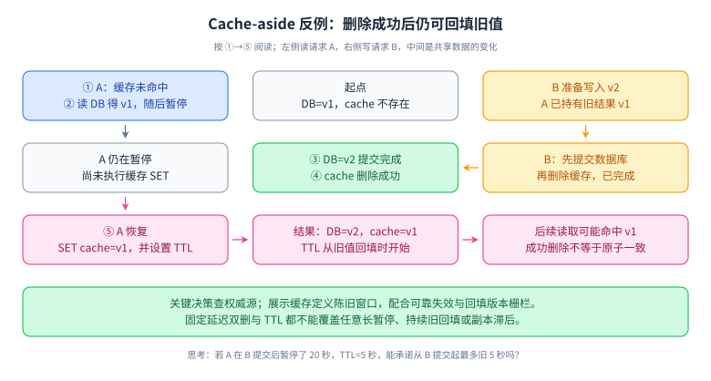
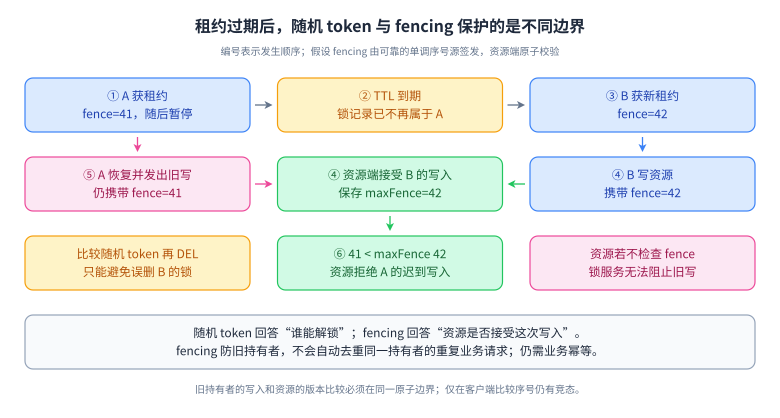

# 07 · Redis：缓存、租约与一致性边界

## 目标、前置与优先级

前置：MySQL 事务、超时与重试。目标：能为缓存命中率、数据新鲜度和失败恢复给出可验证设计。P0：缓存读写策略、穿透/击穿/雪崩、租约失效；P1：持久化、复制、热点；P2：集群迁移与一致性协议。L1—L4 是学习深度，不是职级。在线文档可能随版本更新，命令可用性需按部署版本核对。

## L1 · 必会口述（P0）

缓存是权威数据的派生视图，先说明权威源、允许多旧、丢失后如何重建。Cache-aside 的读路径是查缓存、未命中查数据库并回填；写路径常用提交数据库后删除缓存。这缩小常见不一致窗口，却不构成跨存储原子提交。读者可能先读到旧数据库值，等写者更新并删缓存后才把旧值填回。因此还要定义 TTL、重试、事件失效、版本校验或绕过缓存的规则。

穿透是持续请求不存在的数据；击穿是热点键失效造成大量回源；雪崩是大量缓存同刻失效或缓存服务故障造成回源洪峰。对应措施是输入校验、短期空值、布隆过滤器、请求合并、预热、过期抖动以及回源限流。布隆过滤器可能误判存在，不能替代权限与数据库校验；删除和重建策略也要设计。

### 看图：提交后删缓存仍然存在旧值回填窗口

**读图顺序：**按 ①—⑤ 读取，而不是把每行当一次完整请求。A 已从数据库取到 v1 后暂停，B 提交 v2 并成功删缓存，A 最后恢复回填 v1。没有任何单条 Redis 命令执行错，错误来自跨存储、跨请求的合法交错。

**记忆锚点：**“写库删缓存只处理失效，不约束正在飞行的旧回填”。TTL 从实际回填时开始，因此 `TTL=5s` 并不等于“从业务提交起最多陈旧 5 秒”；若读请求可任意长暂停、旧副本持续回填或刷新不断延寿，就没有这样的绝对上界。需要严格承诺时，写明读源延迟、回填生命周期、版本栅栏、失效时效与失败降级的前提。

**适用限制：**这是单权威数据库、Cache-aside 的原创反例，不证明所有缓存策略都必然如此。版本方案必须保证拒绝旧值的比较与写入原子，并让用于比较的版本记录在缓存缺失/驱逐后仍可信。

**闭卷重画：**分别把 A 暂停时间设为 1 秒、20 秒，再加上读副本落后 30 秒，指出 TTL 和延迟双删各能覆盖什么、不能覆盖什么。

## L2 · 机制推导（P0/P1）

Redis 命令的原子性不等于“多个客户端连续发几个命令”有原子性。`GET` 后 `SET` 之间可以被其他客户端插入；复杂检查更新可用合适原子命令或短 Lua 脚本。脚本执行时间要受控，否则原子执行反而扩大延迟。集群模式下多键操作还受槽位约束。

租约型锁常用 `SET lock token NX PX ttl`，释放时原子地比较 token 再删除。直接 `DEL` 会误删过期后别人取得的锁。但 token 校验只保护释放，无法阻止旧持有者暂停超过 TTL 后继续访问数据库。续期也会因进程暂停或网络隔离失败；关键资源需要原子版本条件或由资源端强制校验 fencing token。[官方：分布式锁](https://redis.io/docs/latest/develop/clients/patterns/distributed-locks/)

### 看图：锁所有权与资源写入权限是两道边界

**读图顺序：**先看 A 暂停与租约过期，再看 B 的 fence=42 写入资源，最后看 A 的 fence=41 迟到写被资源端拒绝。锁服务只知道租约记录，真正的数据库、对象存储或下游业务系统必须执行版本约束。

**记忆锚点：**“随机 token 防误解锁，单调 fence 防旧持有者”。fencing 序号需要在声明的故障模型下仍保持单调与可比较；不能直接假定一个可能回滚的异步复制计数器永远不会发出旧序号。资源端原子检查并更新 `maxFence`；同一 fence 内是否允许多次操作由协议决定，重复扣款等业务效果仍另需请求幂等。

**适用限制：**如果目标 API 不提供原子版本判断，就不能仅通过本地代理检查获得同样保证。此时采用权威状态机、数据库约束或明确接受重复风险。

**闭卷重画：**删掉资源端 fence 判断，仅保留原子解锁脚本，找出仍会成功的错误写；再说明为什么“续期成功过一次”不能证明后续永远拥有锁。

默认异步复制意味着主节点确认写入后，数据可能还没有到副本；故障提升可能丢掉这次写入。`WAIT` 等机制能改善确认范围，但不能把所有部署都变成强一致系统。缓存可容忍丢失与余额、唯一执行权限的正确性要求不同。[官方：复制](https://redis.io/docs/latest/operate/oss_and_stack/management/replication/)

RDB 保存某时点快照，AOF 记录写入操作；恢复点和持久化开销受策略影响。选择不能只比较文件大小，还要测恢复时间、fork 和写时复制带来的内存压力。过期由访问时检查和后台处理共同完成，不能把 TTL 到期当成精确调度通知。[官方：持久化](https://redis.io/docs/latest/operate/oss_and_stack/management/persistence/) · [官方：EXPIRE](https://redis.io/docs/latest/commands/expire/)

### 结构与原子性：面试要能从访问方式选择

| 需求 | 常用类型 | 必须继续说明的边界 |
| --- | --- | --- |
| 简单值、计数、业务版本 | String | 读改写用原子命令；数值范围、过期与幂等另看业务 |
| 对象的部分字段 | Hash | 字段更新便捷，不代表跨字段/外部存储事务 |
| 成员去重与集合运算 | Set | 全量返回和大集合运算可能阻塞或放大响应体 |
| 排名、按分数范围查询 | Sorted Set | 分数相同仍有排序规则，范围返回量也影响成本 |
| 有方向的序列 | List | 简单弹出不等于持久、可确认的可靠消息系统 |
| 事件流与消费组 | Stream | pending、确认、认领与保留策略仍需设计 |

类型是逻辑接口，底层编码会随元素数量、大小与版本变化，不要把所有 Hash 永久等同哈希表、所有 ZSet 永久等同跳表。[官方：数据类型](https://redis.io/docs/latest/develop/data-types/)

Pipeline 主要节省网络往返，不提供整批事务隔离；`MULTI/EXEC` 将队列中的命令顺序执行且不被别的客户端命令插入，但运行期某条命令错误并不会自动撤销此前命令；`WATCH` 是提交前的乐观冲突检测，失败后客户端要按预算重试。Lua 将服务端检查和修改组合成原子执行，也不等于关系数据库式错误回滚，应先验证参数再修改。[官方：事务语义](https://redis.io/docs/latest/develop/using-commands/transactions/) · [官方：Lua 脚本](https://redis.io/docs/latest/develop/programmability/eval-intro/)

排查“Redis 很慢”要分解客户端池等待、网络、命令本身与服务器停顿。Lua、全量大 key 操作以及大响应体都会扩大延迟；`SCAN` 只是分批迭代，可能返回重复元素，`COUNT` 是提示，不能把一轮扫描当一致性快照。[官方：SCAN](https://redis.io/docs/latest/commands/scan/)

## L3 · 工程情境与取舍（P0）

商品详情允许短暂陈旧，可以提交数据库后发可靠失效事件，消费者重试删除缓存，TTL 作为最终兜底。事件延迟和删除失败应可观测。价格确认、扣库存等关键动作仍访问权威状态。若需要更强的新鲜度保证，考虑带版本的缓存写入和读校验，但要处理乱序事件、缓存丢失以及版本记录自身的生命周期；只给 value 加一个时间戳没有自动获得一致性。

单热点商品每秒 5 万次查询，即使总数据很小也可能压满单分片。先测热点键、响应体和网络带宽，再使用进程内短缓存、热点多副本键或请求合并。多层缓存要接受更复杂的失效传播；若数据是权限撤销结果，要特别明确最长生效时间。

内存接近上限时，LRU/LFU 等驱逐策略影响哪些缓存被保留，但不能保证业务关键键永不丢。缓存与需要持久保留的工作队列、幂等记录、锁最好按风险隔离实例和策略。[官方：驱逐](https://redis.io/docs/latest/develop/reference/eviction/)

## L4 · 拓展边界（P2）

Redis Cluster 的分片改善总容量和跨键吞吐，不能自动拆开单键热点；重分片期间客户端需要正确处理路由变化和重试。缓存回源限流比缓存本身扩容更接近保护数据库的不变量。对 Redis 锁，先问锁是在节省重复计算，还是保护不可逆业务正确性：前者可容忍偶尔重复；后者必须论证故障模型、下游约束和重放行为。

## 六道核心题：60～90 秒参考回答与追问

### 1. 怎样保证数据库与缓存一致？

**参考回答：**先确定业务允许的陈旧窗口，以及哪些读必须看到最新状态。一般展示数据使用数据库为权威源，提交后删除缓存，并通过可靠事件和重试弥补删除失败，TTL 限制每次回填后的存活期。但并发回填仍可能写回旧值，因此我不会声称强一致。关键读取可直接查权威源，或引入版本校验与有序失效机制。上线需要观察失效延迟、回源量和抽样差异，保留清理及重建路径。方案是对新鲜度、可用性和复杂度的具体取舍。例如商品描述允许陈旧数秒，提交后失效与过期兜底较经济；结算价不允许依据过时缓存成交，则应在提交订单时重新校验数据库价格。两类接口可以共享数据实体，但不应共享未经区分的新鲜度承诺。

**追问：延迟双删是否能保证一致？**不能。固定延迟无法覆盖任意长暂停、复制滞后和回填耗时，只是特定假设下减小概率。

### 2. Redis 锁怎样实现才安全？

**参考回答：**取得锁必须把不存在判断与 TTL 设置做成一个原子动作，value 使用唯一持有者 token，释放时原子比较 token，避免删掉别人的锁。接着还要处理超时、续期失败和旧持有者继续执行的问题。对于不可重复的资源修改，我倾向于让数据库条件更新或资源端 fencing 来承担最终约束，而锁负责减少竞争。还要说明主从异步复制故障切换可能造成锁状态丢失，所以正确性不能只从正常路径演示得到。例如持有者甲暂停三十秒而租约只有十秒，乙已经取得锁并更新资源，甲恢复后仍可能发出旧写入。原子删除脚本对此没有作用；只有业务状态条件或下游校验更大的栅栏序号，才能把过期持有者挡在资源之外。

**追问：fencing token 与随机 token 有何区别？**前者要求可比较的单调顺序，并由资源端拒绝旧序号；后者通常仅标识所有者，不表达先后关系。

### 3. 缓存宕机怎么办？

**参考回答：**首先避免把全部流量无上限地转到数据库。将接口按业务重要性分类，对关键请求设置回源预算、并发上限和排队上限，对非关键展示降级或用可接受的旧数据。熔断快速失败，重试带抖动且受总预算限制。恢复后逐步预热，防止所有实例同步回填再次压垮依赖。验证时应模拟缓存整体不可用，检查数据库连接池、尾延迟和关键业务成功率，而不只测试 Redis 节点能否自动切换。例如平时十万次查询中只有百分之一回源，缓存失效会把数据库请求从一千提高到十万，正常命中率并不能证明安全。我会通过故障压测确定允许回源多少请求，再在入口按优先级拒绝超额流量，并返回明确降级状态。

**追问：提高命中率就能防雪崩吗？**不能。命中率高可能使数据库平时承载很少，缓存消失时放大倍数反而更大。

### 4. 大 key 和热 key 有什么区别？

**参考回答：**大 key 指值或集合规模很大，可能造成网络传输、序列化、删除和迁移的长耗时；热 key 指访问高度集中，可能让一个分片承担过多请求。同一个 key 可能两者兼有，但解决办法不同。大 key 应按访问方式拆分、分页并控制响应体，谨慎选择渐进处理；热 key 需要合并并发请求、增加可接受的本地缓存或读副本设计。先采样热点、value 大小和延迟分布，避免在线全量重操作本身制造事故。例如一个包含几十万成员的集合，即使每秒只查询几次也可能形成长耗时；一个几字节计数器则可能因极高并发形成热点。拆分之后还要考虑读取如何聚合，以及总网络成本是否反而上升，不能只看单次命令耗时。

**追问：增加分片为什么未必有效？**一个普通 key 仍映射到一个槽，热点未拆分时不会平均分布到新增节点。

### 5. AOF 每秒刷盘是否绝对最多丢一秒？

**参考回答：**它表达常见配置下的刷盘策略和预期恢复窗口，不应脱离操作系统、设备故障和实际调度当成绝对证明。我会先确定故障类型：进程崩溃、主机掉电、磁盘损坏和整个机房丢失的恢复能力不同。再检查 AOF/RDB、复制和备份处于什么故障域，实测恢复时间和数据差异。缓存可重建时重点是恢复流量；如果 Redis 承担业务状态存储，就要更严格地定义恢复点与校验机制。例如机房断电后即使本地日志完整，恢复实例、装载数据和预热缓存也可能超过服务恢复目标。因而除了讨论能丢多少数据，还要记录恢复到可承载流量的时间，并演练缓存恢复期间数据库如何受到保护。

**追问：有副本是否无需备份？**副本也会复制误删或损坏，备份提供独立恢复历史，两者目的不同。

### 6. 如何设计缓存键与 TTL？

**参考回答：**键要包含业务作用域、租户、必要的查询条件和数据结构版本，避免不同权限或环境共用结果。TTL 从业务新鲜度、修改频率和重建成本推导，不能所有数据统一十分钟；热门且重建昂贵的数据可提前刷新并合并请求。增加抖动减少同时过期，空值缓存通常更短并考虑数据随后创建的场景。还要限制键数量和响应体，监控命中率、驱逐、内存和回源，而不是只设置过期就认为生命周期完成。例如按用户权限过滤的页面结果，不能只把文档编号作为键，否则不同用户可能共享不该共享的内容。缓存结构升级时加版本有助于避免旧值解析错误，但旧键回收、容量短期翻倍以及权限撤销传播仍需独立考虑。

**追问：TTL 可替代权限检查吗？**不能；权限本身必须在可信边界校验，缓存授权结果还要明确撤销延迟和隔离。

## 易错点

- 命令原子性不等于整个跨系统业务原子性。
- 看门狗续期不能阻止旧持有者在失去租约后继续运行。
- 缓存可重建不代表回源容量足够。
- 到期事件不能当成可靠、准时的订单关单消息。

## 练习、参考思路与验证

在纸上列出读旧值、数据库更新、删缓存、回填四个步骤的两种合法交错，找出过时回填反例。再模拟持有者 A 暂停超过 TTL、B 获锁完成写入、A 恢复写入。参考答案：比较 token 的释放脚本不能保护最后一步业务写入；若资源保存最大 fencing token 并原子拒绝较小 token，才可拦住旧持有者。最后为商品展示、库存扣减、权限撤销分别填写允许陈旧时间和缓存故障降级策略。

## 过关标准

六题闭卷回答；能给每种方案写出反例和兜底，不用“强一致”掩盖窗口；能估算缓存失效时数据库回源放大量，并画出限流和降级边界。

## 官方来源与版本核对

核对日期：2026-10-04。文内官方来源覆盖类型、事务、脚本、扫描、锁、复制、持久化、过期和驱逐。这里采用兼容多版本的比较删除思路，不依赖新版本专有命令。
