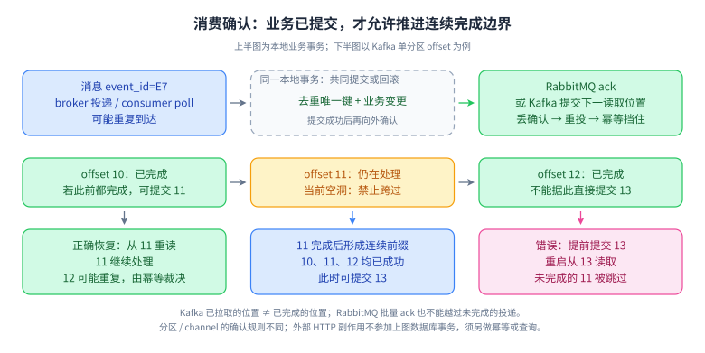

# 08 · 消息系统：投递、顺序、幂等与积压

## 目标、前置与优先级

前置：事务、网络超时、数据库唯一约束。目标：能沿生产、存储、投递、业务处理四段链路指出丢失和重复窗口。P0：确认、幂等、顺序、积压；P1：重试、死信、事务；P2：重平衡、日志压缩与跨集群复制。L1—L4 表示深度。Kafka 机制按 4.1 官方文档核对，RabbitMQ 使用在线文档；生产默认值须按实际版本确认。

## L1 · 必会口述（P0）

消息队列用于解耦时间和处理速率，不会消灭下游容量不足。生产者发送成功、broker 接受、消费者收到、业务事务提交，是四个不同事件。确认丢失会造成“实际成功但发送方不知道”，所以可靠投递常伴随重复。若业务先提交再确认，崩溃可能重投；若先确认再提交，崩溃可能丢失业务处理。

Kafka 是分区日志：消费者位置与记录保存分离，同一分区内有序；RabbitMQ 常见工作队列以投递和确认管理待处理消息。选择要结合回放、多订阅、路由、顺序域和运维能力，不能仅凭“吞吐大”或“延迟小”下结论。两者都需要应用明确重试与结果查询规则。

RabbitMQ 的 publisher confirm 表示 broker 对发布承担责任，consumer acknowledgement 表示消费者确认处理，二者互不替代。发布被确认也不等于已经到达消费者，路由不到队列的情况还要按路由和返回机制处理。[官方：确认](https://www.rabbitmq.com/docs/confirms)

## L2 · 机制推导（P0/P1）

Kafka 生产者的重试、`acks`、幂等与 in-flight 设置有相互约束；`acks=all` 是按同步副本集合确认，不是等待所有配置副本。`min.insync.replicas` 与副本数量、故障选主策略共同影响拒写及丢失风险。幂等生产者处理其协议范围内的重发，不会识别业务代码重新创建的两笔“同一个订单”。[官方：生产者配置](https://kafka.apache.org/41/configuration/producer-configs/)

Kafka 事务可以把向 Kafka 输出的记录与消费位点提交纳入同一事务，并配合隔离读取获得特定 Kafka 流处理范围的 exactly-once 语义。外部数据库、HTTP 扣款、邮件不会自动参加这份事务；需要协同提交、外部幂等或 Outbox 等方案。[官方：设计与语义](https://kafka.apache.org/41/design/design/)

应用幂等通常在同一数据库事务里插入 `(consumer_name,event_id)` 唯一记录并执行业务更新。重复冲突表示这个消费者已经提交过该事件；若插入成功而业务失败，应一起回滚。幂等记录保留时间要覆盖允许的最晚重投/回放窗口，避免清理后旧消息再次生效。

顺序需要同时满足同业务键稳定路由、有序读取和有序生效。把同订单消息放同分区后再交给普通线程池，仍可能后读先完成。并行消费应按业务键串行执行，或让业务使用状态机和版本条件拒绝倒退。队列 FIFO 不等于业务完成顺序；重投、多消费者和优先级会改变观察结果。[官方：RabbitMQ 队列顺序](https://www.rabbitmq.com/docs/queues)

### 看图：确认的是连续完成边界，不是最大的已完成编号

**读图顺序：**先看顶端“投递 → 本地业务事务 → 确认”，再看底部 offset 10、11、12 的并行完成顺序。Kafka 提交位置表示恢复后开始读取的位置：完成 10 只可提交 11；12 虽完成但 11 未完成时，不能跳到 13。实现应按分区维护连续完成前缀，保留处理中的记录状态；异步并行必须同时处理分区撤销后的旧任务，避免旧 worker 覆盖新所有者的进度。[官方：KafkaConsumer 提交语义与多线程处理](https://kafka.apache.org/41/javadoc/org/apache/kafka/clients/consumer/KafkaConsumer.html)

**记忆锚点：**“业务提交在前，传输确认在后；重复靠原子幂等，位点不越空洞”。数据库连接在提交时断开也可能结果未知，重投时仍由唯一约束和已提交结果裁决。示例中 10、11、12 是连续普通记录；事务记录、过滤与日志压缩等可能形成数值空隙，因此实际跟踪的是已交付记录与可恢复位置，不能机械要求每个整数都有业务消息。

**适用限制：**RabbitMQ 的 delivery tag 按 channel 有作用域，批量 `ack(multiple=true)` 不能越过未完成的投递；Kafka offset 按 partition 有作用域，两者不是同一个计数器。RabbitMQ prefetch 限制未确认投递数量，可以约束消费者在途内存；过大增加故障重投与不公平，过小也可能损失吞吐。准确作用域按客户端及服务端配置核对。[官方：Consumer acknowledgements](https://www.rabbitmq.com/docs/confirms)

**闭卷重画：**11 执行成功但确认响应丢失、11 执行失败但错误提交 13，分别重启消费者，指出哪种可通过幂等恢复、哪种会漏处理。然后让处理耗时超过消费组允许的 poll 间隔，说明分区可能被撤销以及旧任务如何停止或被 fencing。

## L3 · 工程情境与取舍（P0）

支付成功事件需要更新订单、发积分与通知。不要在一个消费者里无边界重试所有动作；拆成各自可重试的订阅，每个消费者维护自己业务语义的幂等键。通知服务超时未必代表供应商未发出，应使用供应商请求号和结果查询；数据库里的“已发送”标志无法跨 HTTP 原子提交。

发现积压先看最老消息年龄、输入速率 λ、成功处理速率 μ、失败重试比例与分区倾斜。若积压 B=120 万、输入每秒 2000、处理每秒 3000，理想清空时间是 `B/(μ-λ)=1200 秒`；若 μ≤λ，永远追不上。消费者扩容还受分区数、热点键、数据库容量和外部限额约束。直接增加线程可能制造更多超时和重试。

毒消息要有限次重试、退避、保存失败原因并转隔离区；重放前修复根因、验证幂等、限速并记录审计。若严格顺序链路把失败消息移走继续后续消息，就已经改变顺序语义，需要状态机允许跳过或阻塞同一业务键。[官方：可靠性](https://www.rabbitmq.com/docs/reliability)

## L4 · 拓展边界（P2）

Kafka 组内分区分配变化可能引入暂停和已拉取未完成工作的交接。消费位点不能越过尚未成功的记录，否则重启可能跳过业务。回放要隔离副作用和控制速率，避免把历史通知重发给用户。消息 schema 应带事件 ID、聚合 ID、事件版本、发生时间及必要追踪信息，新增字段优先保持兼容，消费者不能把事件时间当成可靠全局顺序。

## 六道核心题：60～90 秒参考回答与追问

### 1. 如何保证消息不丢？

**参考回答：**我会逐段说明保证范围。业务与待发事件先写入同一本地事务，relay 可靠重试；生产端检查发送确认，broker 选择满足要求的持久化和副本配置；消费端在业务事务提交后确认或提交位点。这样仍可能重复，所以消费需要幂等。还要监控未发事件年龄、消息积压和最终业务差异，并能对账重放。所谓不丢依赖明确故障域和保存期限，不能只配置一个确认参数就覆盖磁盘损坏、错误删除和外部服务副作用。例如消费者已把积分写入数据库却在确认前退出，消息必须能够重投；如果此时业务不幂等，就会把可靠性转化成重复加分。对丢失的最终检查还应面向业务流水而非只比较队列条数，因为消息存在不代表业务已完成。

**追问：确认超时是否可以判定发送失败？**不能；它是结果未知。沿用原事件 ID 重试，并允许重复到达。

### 2. Kafka 的 exactly-once 是否等于只扣款一次？

**参考回答：**不是。Kafka 的幂等生产者和事务有明确协议边界，Kafka 内部消费、计算、再输出可把位点和输出统一提交；外部扣款 API 不自动参与。一次扣款成功后消费者崩溃，重新处理仍可能再调用扣款。因此我会把扣款请求号传给支付端，由支付端保证请求语义幂等并提供查询；本地保存请求状态，超时进入待确认而非立即当作失败重建请求。面试中必须把消息语义和业务效果分别讲清楚。例如消费者执行了支付请求但没收到回应，应把这笔支付保留为结果未知，用原请求身份向渠道确认。重新生成流水号再发送会让对方合理地认为是新付款。明确这个窗口，比宣称中间件配置开启恰好一次更有工程意义。

**追问：消费者侧先写 Redis 去重可否解决？**若去重标志与业务效果分离，仍存在先写标志后失败或先执行后丢标志的窗口。

### 3. 如何保证订单消息顺序？

**参考回答：**先把顺序要求缩小为同订单，而不是全站。生产端按订单 ID 路由到稳定分区，消费端避免同键并发执行，处理成功后才推进相应位点；数据库用订单版本和合法状态迁移兜底。跨生产者的先后关系需由业务序号表达，消息时间戳不能当全局时钟。失败重试时也不能随意把旧事件放到后面而继续执行新事件。扩分区前要验证路由变化对既有订单的影响，并设计迁移或版本切换。例如创建、付款、取消三个事件不能单凭收到的先后顺序推进状态，取消与付款可能来自不同进程。我会使用订单版本和允许的状态迁移校验，记录被拒绝的迟到事件，必要时查询权威状态并触发后续业务补偿。

**追问：全局顺序代价是什么？**它压缩并行度并扩大故障阻塞范围；只有业务确实需要时才选择单一串行域。

### 4. 如何做消费者幂等？

**参考回答：**先定义重复的业务身份，例如支付渠道流水号和业务类型，而不是每次重试随机生成的消息 ID。在数据库中用唯一约束占位，并在同一本地事务完成状态变更；重复请求返回已提交结果。涉及状态迁移时再加版本或条件更新，避免迟到事件覆盖较新状态。对外部副作用则需要对方提供幂等或查询能力。幂等记录还要设计保留期、作用域和冲突参数校验，避免同一个 key 携带不同金额被静默接受。例如同一个订单可以合法发生支付、退款、积分撤回，不能只拿订单编号去掉所有后续事件。通常需要业务动作和事件身份共同限定去重范围；对于事件内容被错误修改的情况，应告警和隔离，而非仅返回处理成功。

**追问：`SELECT` 判断不存在再 `INSERT` 安全吗？**仅靠查询不安全，并发会同时看到不存在；必须由唯一约束或等价原子机制裁决。

### 5. 积压突然增加如何排查？

**参考回答：**我先确认积压代表条数还是延迟，并对比输入与成功输出速率，看增长是否来自突发流量、消费者变慢或重复重试。然后按分区、事件类型和依赖耗时拆解，检查重平衡、数据库锁、线程池和外部限流。先保护下游并止住错误重试，再决定扩容或降级。计算净处理能力与预计清空时间，恢复期间观察最老消息年龄下降，不能只看到消费者实例增多就宣布恢复。例如某个商家的消息集中在单个分区，其他消费者很空闲，增加同组实例不会分担这个分区。若改路由拆热点，又必须重新评估同键顺序。扩容前先判断约束来自分区并行度、业务串行要求还是共享数据库写入能力。

**追问：为什么积压条数不变但业务更糟？**可能旧消息卡住、年轻消息不断进出；平均条数掩盖尾部年龄和关键事件超时。

### 6. 重试队列和死信怎样设计？

**参考回答：**可恢复故障采用有界指数退避和抖动，明确最大次数、总时长与业务截止时间；格式错误等不可恢复问题直接隔离。死信保留原事件身份、异常原因和处理次数，但避免泄露敏感内容。重放是可审计的业务操作，需要先修复根因、验证幂等并限速。对严格顺序业务，重试不能简单绕开失败事件继续同键后续事件，要选择暂停该键或用显式状态机解决依赖。例如一个字段缺失的事件重试一百次也不会自动修好，应保留它的原始身份与失败原因并隔离。临时依赖限流则应延后并减少并发。重放时还要检查事件是否已经超过业务期限，过期促销通知不应在第二天集中发给用户。

**追问：无限重试有何问题？**它会放大故障流量、占据资源、延长关键消息等待，还可能把永久错误伪装成暂时问题。

## 易错点

- 生产确认不是消费完成确认；提交位点不是外部副作用提交。
- 至少一次描述允许重复的投递语义，不意味着无条件永不丢。
- 分区有序不等于多线程处理结果有序。
- 死信不是垃圾桶，需要负责人、处置时限和重放流程。

## 练习、参考思路与验证

完成 [Outbox 实验](../labs/02-consistency.md)，标注四个崩溃点：本地事务前、提交后发送前、发送后标记前、消费提交后确认前。参考结论：两处“不知道是否完成”的边界通过稳定身份及幂等恢复，不能通过猜测消除。另给定输入 5000/s、积压 900 万、30 分钟追平目标，求最低成功处理能力：`5000+9000000/1800=10000/s`，还需预留波动余量并验证依赖承载。

## 过关标准

能闭卷画完整确认链路、算积压清空时间、解释 exactly-once 边界；六题能够附带失败时间线；实验在重复投递时业务效果仅一次，并能解释原因。

## 官方来源与版本核对

核对日期：2026-10-04。文内官方来源包括：Kafka 4.1 设计与生产配置，RabbitMQ 确认、队列和可靠性。复习时结合实际集群版本，不背诵未经核对的默认参数。
