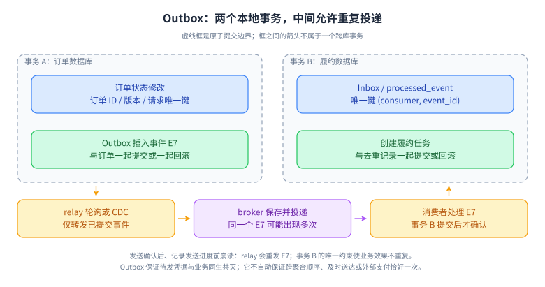
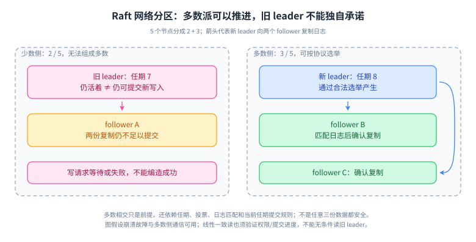

# 09 · 分布式：从不确定结果到可恢复协议

## 目标、前置与优先级

前置：数据库事务、消息确认、网络超时。目标：能把“保持一致”拆成业务不变量、故障假设和恢复动作。P0：CAP、幂等、超时重试、Outbox；P1：Saga/TCC/2PC、共识；P2：跨地域、多写与形式化推理。L1—L4 是知识深度。理论原理稳定，产品实现应另按版本验证。

## L1 · 必会口述（P0）

分布式系统的基本困难是无法仅靠一次超时区分“对方没执行”与“已执行但响应丢失”。所以 API 要能重复调用、查询状态、恢复半成品，并限制重试放大。正确设计以不变量开始：例如余额不得小于零、一个付款请求只记一笔账、已取消订单不能进入已发货。

CAP 的讨论有特定模型：当网络分区发生时，无法同时保证线性一致性和所有非故障节点对请求的可用响应。它不是正常运行时随便选两个的产品分类表，也不把超时、吞吐和事务隔离所有问题都归结为 CAP。业务可按操作划分：浏览允许旧信息，扣款则可能在无法确认权威状态时拒绝继续。[原始论文：Gilbert/Lynch CAP](https://www.comp.nus.edu.sg/~gilbert/pubs/BrewersConjecture-SigAct.pdf)

幂等表示相同业务请求重复执行不重复产生业务效果，不等于每次返回字节完全相同。请求身份应由调用方稳定携带，服务端校验相同 key 的关键参数一致，保存处理状态和结果。`PROCESSING`、`SUCCEEDED`、`FAILED`、`UNKNOWN` 的含义应明确，超时不能直接当成业务失败。[官方工程文献：幂等 API](https://aws.amazon.com/builders-library/making-retries-safe-with-idempotent-APIs/)

## L2 · 机制推导（P0/P1）

Outbox 把业务修改与待发事件写入一个本地事务。relay 后续轮询或 CDC 转发。它解决本地状态提交而事件未被可靠记录的问题；relay 发送成功后标记前崩溃，仍会重复发送，因此需要事件 ID 和消费幂等。CDC 也要处理断点、schema、日志保留和重放，并非免运维按钮。[官方：Debezium Outbox](https://debezium.io/documentation/reference/stable/transformations/outbox-event-router.html)

### 看图：Outbox 的“同一个事务”到底画在哪里

**读图顺序：**左侧事务 A 包含订单与 Outbox；下方 relay 经 broker 投递；右侧事务 B 包含消费去重与履约变更。两个框各自提交，没有一条数据库事务横跨全部箭头。业务表与 Outbox 只是在同一台服务器上还不够，必须实际由同一个数据库事务控制；换连接、异步线程或提前提交都可能破坏这个前提。

**记忆锚点：**“本地保证凭据，跨网接受重复，消费保证效果”。轮询式 relay 通常在确认发布后记录进度；CDC 通常依据日志/连接器位点推进，不能把轮询的 `sent` 字段要求生搬到 CDC。多 relay 抢占要避免长期持有业务事务锁，按租约或数据库抢占机制安排工作；同聚合有序仍需分区键与事件版本，不能只按事件创建时间排序。

**适用限制：**Outbox 不自动完成初始数据回填、下游索引对账、过期事件处置或外部支付幂等。去重表在消费本地事务内才可保护同库业务效果；远程工具/支付服务仍需自己的幂等契约。

**闭卷重画：**把 relay 的“确认发布后记进度”倒过来，标出新出现的丢失窗口；把消费去重提交与业务提交拆成两个事务，再分别在中间崩溃，解释为什么会漏处理或重复。

2PC 的参与者在准备阶段承诺可提交，协调者再决定提交或回滚；经典协议存在不确定状态下阻塞资源的问题。它需要各参与系统支持相应协议，不是给两个 HTTP 请求套一个本地注解。TCC 在业务上实现预留、确认、取消，必须处理重复、空回滚和悬挂。Saga 由一系列本地事务与补偿组成，补偿是业务动作而非数据库时间倒流，例如退款不能让用户没收到过商品。

Raft 等共识协议让副本对日志顺序达成一致。多数派相交是安全性的基础之一，但还需要任期、选举和日志匹配规则；不能简化成“任意数据复制到多数就永远安全”。在通常崩溃故障模型下，N=2f+1 可容忍 f 个节点不可用仍形成多数；网络长期不满足进展条件时不能保证持续可用。[论文与可视化：Raft](https://raft.github.io/)

### 看图：Raft 的多数侧和少数侧各能承诺什么

**读图顺序：**左侧旧 leader 留在 2/5 分区，右侧 3/5 通过选举产生新 leader 并复制日志。少数侧即使进程还活着、已有两个副本，也不能据此承诺新的共识写入成功。多数侧继续推进仍依赖消息可达、合法选举与日志规则，不是仅数机器。

**记忆锚点：**“活着不等于有权，复制不等于提交，提交不等于已应用”。Raft 通过多数复制直接判断提交时还涉及当前任期条件；旧任期日志通常随着后续当前任期日志提交而间接提交。不要把“任何日志放到三台机器”作为安全证明。[原作者论文与资料](https://raft.github.io/)

**适用限制：**图按崩溃故障模型说明五节点配置，没有覆盖拜占庭节点、动态成员变更或某一产品具体读优化；线性一致读需要对应协议保障。

**闭卷重画：**让旧 leader 上有一条未提交日志而新 leader 没有它，恢复网络后应如何处理；然后指出读旧副本为什么可能陈旧，以及单纯增加副本数对写延迟和多数门槛的影响。

## L3 · 工程情境与取舍（P0）

创建订单后通知仓库，不应在本地事务内远程调用并长时间持锁。采用订单和 Outbox 同事务，事件携带订单版本；仓库消费者在本地事务里记录已处理事件并创建履约任务。订单 API 返回“已受理”，履约进度独立查询；超过业务期限告警并进入人工或自动补偿。每个中间状态都有负责人和恢复期限。

扣款请求超时后，调用方使用原请求号查询或重试。若用户明确再次付款，那是新业务请求，需要新身份，而不是把所有同金额请求当重复。幂等键保留期要覆盖客户端重试、消息回放和第三方晚回调；删除记录前要有业务依据。

重试应只在一个合适层主导，限制次数和总时间，指数退避加抖动，且区分可恢复错误与参数错误。五层调用每层最多三次尝试（首次加两次重试），在一次原请求下最深处最多可能放大到 `3^5=243` 次尝试；架构图里必须画出重试责任。[官方：限制重试](https://docs.aws.amazon.com/wellarchitected/2024-06-27/framework/rel_mitigate_interaction_failure_limit_retries.html)

## L4 · 拓展边界（P2）

线性一致性约束单一操作的实时顺序，可串行化约束事务等价于某个串行执行，两者不是同义词；严格可串行化再增加实时约束。最终一致性需要收敛条件：写入停止、消息能传播、冲突解决确定、修复机制运行。若事件永久丢失或消费者永远失败，“最终”不会自动到来。

跨地域多写需要处理并发冲突。最后写胜出依赖定义的时间或版本规则，可能丢掉业务上不能丢的更新；CRDT 也只适用于满足合并性质的数据结构。对资金和唯一资源，先研究是否能按账户归属单写和局部事务，而不是追求所有地域都可任意写。

## 六道核心题：60～90 秒参考回答与追问

### 1. 怎样解释 CAP 并用于业务设计？

**参考回答：**CAP 需要先固定模型：分区期间，线性一致性与所有非故障节点请求都得到满足可用性要求的响应不能同时保证。应用时我会落到具体操作，例如商品展示可接受旧副本，但扣款必须确认权威状态，确认不了可拒绝或返回待处理。正常网络下仍有延迟、一致性和成本的取舍，CAP 不能包办。面试里我会说明读写范围、失败响应与重试语义，而不会把整个公司系统简单贴成 AP 或 CP。例如两个地域彼此无法通信时，各自都接受同一件商品最后一份库存的购买，若都宣布成功便可能破坏唯一资源约束。可选择让权威地域继续处理、另一侧等待或失败；这是这项写操作的取舍，不意味着所有浏览请求也要停。

**追问：拒绝请求是否仍满足 CAP 的 A？**不能把任意错误响应当成满足可用性的业务成功响应，否则定理被偷换。

### 2. 超时后的重试怎样安全？

**参考回答：**超时只说明调用方没及时拿到结果。具有副作用的调用必须带稳定请求号，服务端将幂等记录和业务修改放进同一可原子提交的边界，并保存结果供查询。重试沿用同一请求号和一致参数，设置总截止时间、次数和退避抖动；不可重试的参数与权限错误直接返回。对于外部系统，要确认它是否支持幂等和状态查询，否则只能保留未知状态并对账，不能用本地锁假装消除远程不确定性。例如创建订单响应丢失，客户端仍应使用原请求号重试并拿到原订单，不能顺手再生成一张新订单。并发的相同请求要由唯一约束裁决，正在处理的请求返回可查询状态；原请求成功后，还需将结果保留到承诺的幂等窗口结束。

**追问：幂等表先提交再做业务可以吗？**一般不行，会出现记录已占用但业务从未完成；需要共同事务或显式可恢复状态机。

### 3. Outbox 保证了什么，还缺什么？

**参考回答：**它保证在同一个数据库事务范围内，业务变化和待发事件一起存在或一起不存在，避免数据库成功但没有任何可恢复发送凭据。relay 独立发送并在失败后重试，但发送与标记通常不是同一原子事务，所以仍会重复。消费者需要自己的幂等事务，事件需要稳定 ID，系统还要监控最老未发事件、重放和清理。它通常达成可恢复的最终传播，不代表所有服务在同一时刻看到一致状态，更不覆盖外部邮件或扣款自动恰好一次。例如一条订单事件在发送成功后 relay 崩溃，重新启动会看到未发送标记并再次发布，这属于预期恢复行为。对同一聚合的顺序，仍需稳定分区键或版本控制；Outbox 保证写入凭据不丢，并未自动排序多个并行发送进程。

**追问：先标记已发再发送呢？**会把崩溃窗口从重复变成丢失，通常更难恢复；不能靠调整两步顺序消除原子性缺口。

### 4. 2PC、TCC、Saga 怎么选？

**参考回答：**先看参与者能力和业务不变量。2PC 适用于能参加协议且可接受协调与锁成本的资源；TCC 要业务能显式预留资源，确认或取消可重试；Saga 适合可拆本地事务且允许中间态和业务补偿的长流程。选择同时考虑吞吐、持续时间、补偿代价和人工介入。支付退款、库存归还都有自己的失败过程，不能把补偿写成一个永远成功的箭头。小范围单库能解决时，我优先保持本地事务以减少协议复杂度。例如酒店和机票预订可能允许先锁库存再确认，适合讨论预留模型；已发送的短信无法像数据库修改一样撤销，就需要业务层接受或补偿。选择方案时我会列出每一步不可逆的时点，让产品也理解失败时用户会看到什么。

**追问：Saga 等同原子事务吗？**不等同；中间状态可能对外可见，补偿可能失败，也可能无法完全撤销现实影响。

### 5. Raft 为什么需要多数派？

**参考回答：**多数派集合必有交集，使不同任期的决策不能完全由互不相干的一批节点独立决定，但仅有交集还不够，需要投票限制、日志新旧比较和提交规则一起维护安全性。leader 复制有序日志，故障后通过选举继续；少数派通常不能独自提交新的共识写入。工程上还要区分已复制、已提交和已应用，以及读请求是否经过必要一致性检查。共识解决副本对状态机输入达成一致，不自动给业务跨多个系统的 HTTP 调用提供事务。例如旧 leader 被隔离后，客户端仍可能向它发送请求；若它不具备必要确认就宣布新写入成功，会破坏协议预期。读路径同样要确认自身仍有权提供所要求的一致性，不能因为节点曾经是 leader 就永久信任它。

**追问：三节点坏两个还能写吗？**通常不能组成多数；强行降配可能破坏安全，应按协议与运维恢复流程处理。

### 6. 最终一致性怎样验收？

**参考回答：**我会把“最终”变成时间和结果指标，例如正常情况下 99.9% 的订单事件在五秒内传播，超过五分钟自动告警，对账能发现并补齐漏单。再枚举写者崩溃、发送确认丢失、消费者提交后重启、乱序和毒消息，验证恢复后业务不变量保持、状态可收敛。还要测积压恢复时间和修复程序是否幂等。没有监控、补偿和期限，只说使用消息队列所以最终一致，无法形成可验收方案。例如上游订单已支付但积分事件迟迟未处理，对账应定位缺失事件并以原身份补投，再验证积分流水只出现一次。还要演练修复过程中服务再次重启，确认恢复动作本身可重复执行，而不是把稳定性依赖于人工只点击一次。

**追问：五秒指标是否等于强一致？**不是；它是传播时效目标，期间仍可能观察到不同状态。

## 易错点

- `@Transactional` 不会自动覆盖另一个服务的本地数据库。
- 补偿不是回滚时间，退款和撤销也会失败。
- 多数派复制不等于任意读取都线性一致。
- 请求号必须识别一次业务意图，而不是一次网络尝试。

## 练习、参考思路与验证

完成 [一致性实验](../labs/02-consistency.md)。再画“订单—支付—履约”状态机，至少包含支付结果未知、支付成功但履约失败、取消与晚支付回调竞争。参考思路：先画终态和合法转移，使用条件更新拒绝非法倒退；金额与支付流水建立唯一关系；晚成功走明确退款或人工处置流程，而非覆盖取消状态。对每条转移写幂等键、事务范围、超时和补偿动作。

## 过关标准

能画出一个含重复与超时的恢复时间线；六题都能给出作用域和反例；明确至少三条业务不变量，证明它们由哪个原子操作或状态转移维护。

## 官方与原始来源

核对日期：2026-10-04。文内核心链接包括 CAP 原论文、Raft 原作者资料、Debezium 文档及 AWS 幂等/重试工程文献；论文说明理论，产品文档说明实现，不互相替代。
