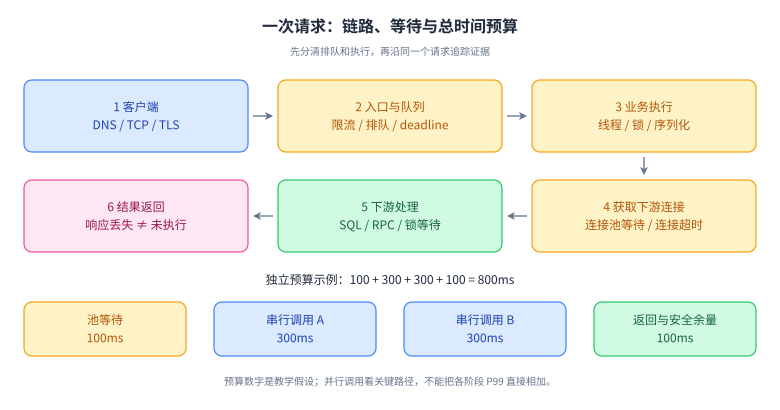

# 10｜网络、Linux 与一次请求的完整路径

优先级：P0。前置：知道进程、线程、HTTP 的基本概念。学习目标：能沿请求链路定位慢在哪里，并给出证据；能解释超时、连接、内存和负载指标的边界。Linux 命令用于 Linux 测试环境，macOS 上名称/选项可能不同。

## L1 必会：先把一条请求讲完整

输入 URL 后，客户端解析域名，按地址建立传输连接；HTTPS 还要协商 TLS；连接复用时可以省去部分步骤。请求经过网关、负载均衡和服务，服务可能等待线程池、数据库连接、锁和外部调用，再把结果写回。DNS、连接、TLS、排队、业务处理和传输都会贡献延迟。一次请求慢，不等于 Java 执行慢。

进程提供地址空间和资源隔离，线程是进程中的执行单元；线程通常共享堆等资源，有自己的栈和执行状态。上下文切换有成本，但“线程越少越快”也不对：IO 等待期间需要足够并发，CPU 密集任务需要避免无效抢占。

| 现象 | 第一层拆解 | 应补充的证据 |
| --- | --- | --- |
| CPU 高 | 业务计算、GC、忙等还是内核工作 | 热点栈、CPU user/system、GC 指标 |
| CPU 不高但响应慢 | 锁、IO、连接池还是排队 | 等待栈、池活跃/等待数、下游耗时 |
| 内存高 | 堆、直接内存、线程栈还是其他 native | JVM 指标、RSS、容器限制、NMT |
| load 高 | 可运行任务还是不可中断等待 | CPU 利用率、任务状态、IO 延迟 |
| 连接多 | 正常长连接、泄漏还是下游慢 | 连接状态、持有者、空闲时间、请求速率 |

Linux load average 不等于 CPU 使用率，它包含可运行以及不可中断睡眠任务的负载信息。看到 load 高，应继续区分 CPU 与 IO 等待。[Linux /proc 文档](https://www.kernel.org/doc/html/latest/filesystems/proc.html)

## L2 原理：连接、超时与 IO

### TCP 能保证什么

TCP 向应用提供可靠、有序的字节流。它通过序号、确认、重传等机制处理传输，但不为应用保留消息边界，也不知道“一次扣款”的业务含义。因此服务端写入数据库后返回的数据丢失，客户端依然可能只看到超时。业务需要请求标识、查询结果和幂等设计。

三次握手用于建立连接并同步双方序号等状态。关闭是两个方向分别结束发送，FIN 与 ACK 可能组合，不要把固定“四个包”当所有情况下的保证。TIME_WAIT 常由主动关闭方承担，用于处理迟到报文与关闭确认相关问题；CLOSE_WAIT 表示已收到对端关闭，应用还没有完成本端关闭，要看资源释放和应用状态。

### 多路复用与异步

阻塞 IO 可以让调用线程等待；非阻塞 IO 让调用立即返回是否就绪；select/poll/epoll 等机制用于同时观察多个描述符事件。事件就绪不意味着一整条业务消息已经读完，应用仍要处理半包、背压和状态。Java NIO/Netty 常把少量事件线程用于网络处理，阻塞数据库调用若直接放在事件循环里，会阻塞其他连接的处理。

HTTP/1.1 可以复用连接；HTTP/2 在一个连接上多路复用流，但底层 TCP 的丢包仍可能影响多个流；HTTP/3 基于 QUIC，能在传输层提供独立流恢复。协议升级不能替代业务容量和下游优化，代理与客户端支持也要检查。[HTTP/2 RFC](https://www.rfc-editor.org/rfc/rfc9113.html) · [HTTP/3 RFC](https://www.rfc-editor.org/rfc/rfc9114.html)

### 超时不是一个数字

区分连接超时、连接池获取超时、读超时、单次调用超时与整个业务 deadline。举例：入口预算 800ms，获取池连接用掉 100ms，两个串行调用各 300ms，最后还需序列化和网络传输。若每个调用各设 800ms，整条链路显然无法兑现入口预算。

取消应向下游传播，但“调用方不再等待”不代表远端没有执行。对写操作，应能查询最终状态，并在重试时复用同一业务幂等键。HTTP 的幂等语义关注重复请求的预期效果，响应状态可以不同；POST 也可以通过业务设计实现幂等。[HTTP 语义 RFC 9110 §9.2](https://www.rfc-editor.org/rfc/rfc9110.html#section-9.2)

## 机制图解：一条链路，两类等待



**读图顺序**：沿编号 1～6 区分客户端建连、入口排队、应用执行和下游等待，再看底部独立的 800ms 预算算例。箭头表示处理顺序，不代表阶段耗时相同。

**记忆锚点**：入口耗时不等于 SQL 耗时；超时不等于未提交。图中串行预算只是示例，并行链路要看关键路径，连接复用也会省略部分建连步骤。

**闭卷重画**：画出“服务已经提交，但响应丢失”的位置，并说明客户端为什么需要原操作 ID 查询结果。

### 补充：TLS、Reactor 与 RPC 的职责边界

TLS 的核心是对端认证、密钥协商与受保护的数据传输。以常见证书认证的 TLS 1.3 完整握手为例，客户端协商参数和密钥份额，服务端证明身份并完成握手密钥相关计算，双方确认握手后用派生的对称密钥保护记录。证书与签名主要帮助验证身份，不能把整个过程概括成“用公钥加密所有业务数据”。连接恢复、客户端认证与 0-RTT 是不同分支；0-RTT 还要考虑重放。HTTPS 不替业务判断当前用户是否有权操作某订单。[TLS 1.3 规范](https://www.rfc-editor.org/rfc/rfc8446.html)

Netty 的 EventLoop 处理已注册 Channel 的事件；通常一个 EventLoop 管理多个 Channel。将阻塞数据库调用、耗时计算放在同一事件循环中，会延迟它负责的其他事件。转移到业务执行器时又要明确任务顺序、共享状态、队列上限与回调线程，不能认为“异步”自动消除背压。[Netty EventLoop API](https://netty.io/4.1/api/io/netty/channel/EventLoop.html)

RPC 是跨进程调用约定，不只是序列化：还包括服务发现、负载均衡、超时、错误传播、调用身份、追踪与兼容性。一次调用没有响应时，调用方通常不能区分“请求未到达”和“业务已执行但响应丢失”，因此重复副作用仍需应用协议解决。

## L3 工程：P99 从 120ms 升到 2s

假设服务请求量未变，CPU 35%，错误率 0.2%，数据库平均耗时没有明显变化。不能得出“数据库没问题”。平均值会掩盖尾延迟，连接池等待可能发生在数据库执行之前。

排查顺序：

1. 明确开始时间、影响接口/租户/机房、最近变更与流量分布。
2. 沿 trace 分解排队、获取连接、SQL、远端请求，比较 P50/P95/P99。
3. 若大量线程等待池连接，查看活跃连接、等待人数、借出时长和慢事务，判断是需求上升还是连接迟迟归还。
4. 对照数据库锁等待、执行计划、资源利用和网络错误，寻找可解释时间顺序的证据。
5. 先止损：限制入口或故障租户并发、回滚可疑变更、隔离慢接口；不要盲目加池大小把下游压垮。
6. 修复后在同样负载、数据分布与缓存状态下比较尾延迟和错误率。

“扩大池后暂时好转”只能说明拥塞位置变化，不能证明根因解决。容量要沿整条链路核算。

## L4 拓展：容器、零拷贝与观测成本

容器共享宿主机内核，通过 namespaces/cgroups 等机制组织隔离与资源约束；容器不等于虚拟机。容器 CPU 限流可导致延迟升高，即使宿主机整体空闲；JVM 堆小于容器内存上限，也可能因直接内存、线程栈、元空间等被终止。

零拷贝通常减少用户态/内核态之间的数据复制或切换，并不是字面意义的完全不复制。TLS、压缩、文件到网络的具体路径和平台实现会改变收益。不要看到 Netty/sendfile 就承诺吞吐提升。

生产诊断有成本：堆转储可能暂停并占用大量磁盘；高频采样和全量日志会放大负载。先用低成本指标缩小范围，再选择更重的证据。

## 核心面试题与追问

### Q1｜一个 HTTP 请求很慢，如何定位？

**参考回答**：我先确认慢的范围和分位数，再按客户端、网关、服务排队、业务执行、下游调用拆开。以同一个 trace 或请求标识关联数据，区分连接等待与实际执行。CPU 高看热点栈和 GC；CPU 低看锁、连接池和 IO 等待。接着对照变更时间验证假设，先限流或回滚止损，最后用相同负载验证尾延迟、错误率与吞吐，避免只看平均值。

**追问：没有分布式追踪怎么办？** 用统一请求 ID、各阶段结构化时间戳、线程转储、连接池指标与下游日志建立较粗时间线；并补充观测。不能把不同请求的日志拼成同一链路。

### Q2｜为什么 TCP 可靠，业务仍会重复执行？

**参考回答**：TCP 保证的是连接内字节流传输，不是业务事务。服务端可能已经提交事务，随后连接断开导致响应丢失；客户端无法据此知道结果，重试就可能重复执行。需要以业务操作生成稳定幂等键，服务端以唯一约束、状态机和结果持久化去重，超时后查询或用原键重试。跨系统副作用还需要下游提供同样的去重能力。

**追问：每次重试生成新 UUID 有用吗？** 没有表达“同一次业务操作”，只能区分网络请求，无法去重该业务重试。

### Q3｜线程数应该等于 CPU 核数吗？

**参考回答**：对 CPU 密集任务，以可用 CPU 和压测结果限制并行度比较合理；对 IO 密集任务，等待期间不占 CPU，可能需要更高并发。但最终限制是数据库连接数、下游额度、内存和延迟预算。可用到达率乘平均耗时估计稳态在途数，再通过有界队列、信号量和压测验证，不能把经验公式直接当生产配置。

**追问：虚拟线程可以无限并发吗？** 不能。它降低等待线程的成本，不增加数据库、下游与 CPU 的容量，仍需背压和并发预算。

### Q4｜TIME_WAIT 多就需要调系统参数吗？

**参考回答**：先看是否正常的短连接流量以及是否真正出现端口耗尽、连接失败。TIME_WAIT 有协议目的，数量高本身不一定是故障。优先检查连接复用、生命周期、连接创建速率和负载均衡策略，再结合系统和网络拓扑评估参数。CLOSE_WAIT 持续积累则更应检查应用是否正确关闭资源。

**追问：强行缩短等待有什么风险？** 需要分析迟到报文、端口复用和特定内核行为，不能把网上的内核参数当跨环境通用优化。

### Q5｜为什么 CPU 不高但 load 很高？

**参考回答**：Linux 的 load 不是 CPU 百分比，还包含不可中断等待任务。磁盘、某些网络文件系统或其他内核等待可能推高 load。我要看任务状态、IO 延迟、磁盘队列、CPU user/system/iowait 与服务延迟变化，并关联具体进程和调用栈，而不是直接扩 CPU。

**追问：iowait 高能定位是哪块盘吗？** 不能单独定位，需结合设备统计、进程 IO 和相关调用，多个指标相互印证。

### Q6｜超时设置成 3 秒，为什么用户 10 秒后才收到失败？

**参考回答**：可能把每次调用超时当成整体预算，叠加了排队、重试、退避和多跳调用。应在入口建立总 deadline，下游继承剩余时间，显式限制重试次数和重试预算，同时区分连接池等待、连接和读取时间。失败结果要能追踪；对写请求，不能因为本端超时就直接认为远端回滚。

**追问：读取超时后重试一定安全？** 不一定。只对可恢复的错误、在剩余预算内、具备业务幂等或结果查询能力的操作重试。

## 练习：用证据拆解延迟

在自己有权限的测试接口上运行：

```sh
curl -o /dev/null -sS -w 'dns=%{time_namelookup} connect=%{time_connect} tls=%{time_appconnect} first_byte=%{time_starttransfer} total=%{time_total}\n' https://example.com
```

这些值是从请求开始计时的累计时间，不能直接相加；它们还受连接复用、代理、重定向等影响。它只展示客户端视角，不等同服务器各阶段 trace。任选一次结果，算出可解释的阶段差值，列出两个尚不能确定的原因。不要根据单次测量得出容量结论。

**参考验证**：重复测量冷热连接并记录环境；比较 DNS、连接、TLS、首字节、总时间；首字节等待包含多种因素，服务内部时间需服务端证据。命令是练习步骤，未代表本项目对任何业务系统执行过诊断。

## 常见误区与过关标准

避免把 load 当 CPU，把超时当失败，把 TCP 当消息协议，把加线程当扩容，把平均值当尾延迟。过关要求：能在五分钟内画出完整请求链路；给一个慢请求提出三个可区分的假设及对应证据；解释一次“超时但已成功”。

## 官方延伸阅读

- [TCP RFC 9293](https://www.rfc-editor.org/rfc/rfc9293.html)：连接与字节流语义。
- [curl write-out](https://curl.se/docs/manpage.html#-w)：计时变量的准确含义。
- [Linux /proc](https://www.kernel.org/doc/html/latest/filesystems/proc.html)：进程与内存指标。
- [HTTP RFC 9110](https://www.rfc-editor.org/rfc/rfc9110.html)：方法、缓存与重试语义。
