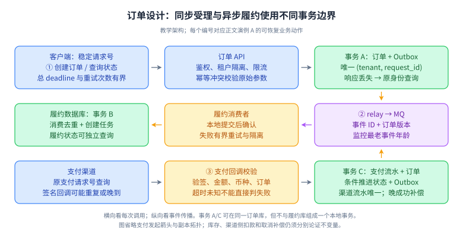
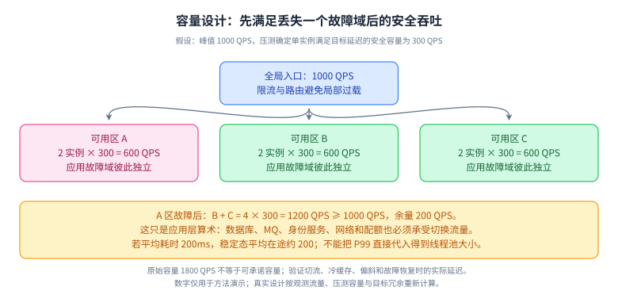

# 11 · 系统设计：从约束推到可验证方案

## 目标、前置与优先级

前置：数据库、缓存、消息、分布式、Agent 基础。目标：在 45 分钟内形成能解释取舍与失败恢复的设计。P0：需求边界、估算、数据模型、关键流程；P1：可靠性、权限和演进；P2：跨地域和复杂扩容。L1—L4 是深度，不是职级。本章数字均为教学假设，不代表公司实际流量或容量承诺。

## L1 · 必会口述（P0）

设计先问谁在何种场景做什么，再确定正确性、延迟、可用性和成本目标。先选一个核心用例走通，随后扩展容量和失败路径。回答顺序可用：范围与假设 → 容量 → API/数据模型 → 核心流程 → 故障 → 权限 → 演进。架构组件必须由具体约束引出。

估算至少包含平均与峰值 QPS、读写比、单条大小、保存周期、复制与索引开销。`平均 QPS=日请求数/86400`；`带宽≈QPS×响应体`；稳定系统中 `平均在途请求数≈吞吐×平均耗时`。峰值系数是待验证假设，不是经验常数。节点数应来自单节点压测及冗余要求。[官方：具体化系统设计](https://sre.google/workbook/non-abstract-design/)

## L2 · 机制：把设计变成可验证约束（P0/P1）

API 不只写 URL：要定义权限作用域、请求身份、分页、超时、错误与状态查询。数据模型不只写实体：要写主键、唯一约束、索引、状态机和事务边界。异步系统不只写 MQ：要明确消息身份、顺序域、重试、最老任务年龄与人工修复。SLO 应从用户体验定义成功事件，避免“服务返回 200，但任务永久未完成”。[官方：SLO 定义](https://sre.google/workbook/implementing-slos/)

## L3 · 三个完整设计演例（P0）

### 演例 A：多租户订单与支付回调

**范围与容量。**每日 100 万订单，平均约 11.6 次创建/s，假设峰值 20 倍约 232/s，按 250/s 规划；每单约 2KB 原始业务数据，约 2GB/日、730GB/年，尚未算索引、副本、日志。订单读取峰值假设 2500/s。创建 P99 目标 300ms，不包含外部支付完成时间。

**API 与模型。**`POST /orders` 携带租户身份和 `Idempotency-Key`；`GET /orders/{id}` 查状态；`POST /payment-callbacks` 验签。订单表含 `tenant_id,id,request_id,status,amount,version`，`(tenant_id,request_id)` 唯一；支付表对渠道交易号唯一；Outbox 表含事件 ID、订单 ID、版本和载荷。订单列表索引按租户、创建时间和 ID；金钱用最小货币单位整数并标注币种。

**流程。**入口鉴权与限流，本地事务建立订单及 Outbox；支付请求有稳定请求号。回调验签并校验金额、币种及订单对应关系，在事务中登记渠道流水、条件推进订单并写事件；重复回调返回既有结果。履约消费者独立幂等，支付状态与履约状态分开。

**恢复与取舍。**创建响应丢失用原幂等键查询；支付超时标为待确认并查渠道；Outbox 积压告警；晚成功与取消冲突按明确退款流程处理。缓存只用于列表展示，支付决策读权威状态。先单库验证 250/s 写入，达到瓶颈再按租户或用户分片，避免提前引入跨片事务。审计保留状态变化原因，日志不记录完整支付凭据。

### 看图：订单、支付、履约各自维护什么状态

**读图顺序：**先走上排的创建请求；再从右向左走中排的事件投递与履约；最后走下排支付回调并回到事件链。每条箭头都要回答身份、超时、重试责任、失败状态和可观测指标。订单已受理、支付已成功、履约已完成是三个不同的业务事实。

**记忆锚点：**“先定义状态，再画存储边界，最后解释每一条失败箭头”。创建幂等键识别用户的一次创建意图，渠道交易号识别一笔渠道流水，消费事件 ID 识别一次事件处理；三种身份作用域不同，不能统一用订单 ID 去重所有动作。

**适用限制：**这是方法演示，图省略支付发起与库存扣减，以免把三种独立约束混成一条成功链。面试扩展时必须补出库存权威源、余额/金额校验、退款和取消竞争；也要补数据库、broker 与身份服务的故障域。

**闭卷重画：**遮住图片，重画三种事务边界；依次删掉任一响应箭头，说明调用方如何通过原身份查询恢复。最后让取消先完成、支付成功回调后到，写出状态迁移条件与退款动作。

### 演例 B：百万级定时任务与通知平台

**范围与容量。**每日 1000 万任务，平均约 116/s，假设峰值触发 5000/s。任务元数据 1KB、保留 30 天约 300GB 原始数据。若外部调用平均 200ms，持续 5000/s 理论上需约 1000 个在途调用；实际还受供应商配额限制。目标为正常状态下 99.9% 任务在计划时间后 30 秒内开始，而非保证所有通知都已被人看到。

**API 与模型。**`POST /jobs` 含调用方业务键、计划时间、模板、接收对象引用；`GET /jobs/{id}` 查询；`POST /jobs/{id}/cancel` 条件取消。任务表含 `scheduled_at,status,attempt,next_attempt_at,version,lease_until`，业务键在租户内唯一；按时间桶与分片查询到期任务，载荷存对象存储并保存引用。

**流程。**扫描器抢占到期任务后推送队列；worker 验证状态、调用供应商，使用任务 ID 作为供应商幂等键并落结果。回执异步推进送达状态。取消仅对仍可取消状态生效，开始执行后的取消属于尽力或补偿，API 要说明。

**恢复与取舍。**扫描器崩溃由租约超时恢复；旧 worker 迟到提交用版本条件拒绝，但版本只能保护本地状态，外部重复必须由供应商幂等/查询支持。无此能力时明确可能重复或进入人工待确认。重试有截止时间，毒任务隔离；按租户公平调度，避免单租户挤占队列。远期任务保存在数据库，临近时间再入调度层，避免把海量长延时都挤进内存。

### 演例 C：企业知识库问答 Agent

**范围与容量。**5000 用户，每人日均 20 次请求，共 10 万/日、平均约 1.16/s，假设峰值 20/s。平均执行 8 秒意味着约 160 个在途请求。假设每次总计输入 6000、输出 800 tokens，则每日约 6 亿输入及 8000 万输出 tokens；价格与模型限制需按实际供应商核验。SLO 分为首 token 延迟、任务完成延迟、可验证回答质量和工具成功率。

**API 与模型。**`POST /runs` 带租户与会话 ID、幂等键；`GET /runs/{id}/events` 流式读取；`POST /runs/{id}/cancel` 取消。数据包含文档版本与 ACL、分块及 embedding 版本、run 状态、工具调用 ID、预算、引用证据和必要审计。索引必须保留权限过滤字段，缓存键包含租户及权限相关上下文。

**流程。**认证 → 授权检索 → 召回与重排 → 生成带来源回答。工具由服务端校验参数、身份和权限，不能把文档中的文字当系统指令。高影响写操作进入用户确认；每次 run 限制步数、时间、token 与费用。模型可替换，业务状态由编排层持久化。

**恢复与取舍。**模型超时可用剩余预算重试；工具结果未知时查询原调用 ID，禁止盲目再次创建业务对象。检查点允许恢复，但已输出文本无法撤回，应显式记录失败状态。文档删除/权限撤销要同步到索引与缓存并有验证；上线用版本固定的评测集覆盖正确率、引用、拒答和越权。最初用单 Agent 与少量明确工具，只有实测提升才增加多 Agent 协作。

这些演例的恢复机制对应 [AWS 幂等 API](https://aws.amazon.com/builders-library/making-retries-safe-with-idempotent-APIs/) 与 [Debezium Outbox](https://debezium.io/documentation/reference/stable/transformations/outbox-event-router.html)；具体架构、数字和取舍是本项目教学推导。

### 容量不能只算总实例数：还要算故障后剩余容量

**读图顺序：**从峰值 1000 QPS 出发，核对每区的已压测安全容量，再删除 A 区重算。三处各两台、每台安全容量 300 QPS，丢失一区后剩 1200 QPS。图中的单节点安全容量已要求满足延迟与错误率目标，不能拿“打到 90% 错误时的极限吞吐”代入。

**记忆锚点：**“用故障后容量承诺服务，用正常容量安排成本”。平均在途数量 `L=λW` 的 λ、W 必须来自同一观察边界和稳定区间；它不是根据 P99 直接确定线程数的公式。例中持续 1000/s、平均总耗时 0.2s，平均在途约 200；如果数据库实际持有时间只有 0.01s，对应平均占用连接约 10，不能把全部 200 个请求都等同数据库连接。波动、突发、长尾和限额需要压测另定上限。

**适用限制：**计算假设负载可路由、实例可互换且共享依赖有余量。单热点分片、渠道限额和冷缓存可能先触顶；峰值平均 QPS 也不能描述毫秒级突发。图中数字都是教学假设。

**闭卷重画：**把峰值改为 1600 QPS，判断三处两台是否仍能抗一区故障；再把数据库最大安全写入限定为 800/s，说明增加应用实例为什么无效。

### 45 分钟设计的可交付检查表

| 时间建议 | 需要留下的具体结果 | 自检反例 |
| --- | --- | --- |
| 0—5 分钟 | 业务范围、不变量、SLO、假设 | 202 到底表示受理还是完成？ |
| 5—10 分钟 | QPS、存储、带宽、在途量 | 丢一区、冷缓存或单租户十倍流量怎么办？ |
| 10—25 分钟 | API、主键/索引/唯一键、状态图与主链路 | 两个请求同时更新是否破坏约束？ |
| 25—35 分钟 | 超时未知、重复、乱序、恢复与对账 | 在每个提交后、返回前崩溃一次还能恢复吗？ |
| 35—45 分钟 | 权限、成本、灰度/迁移、验证计划 | 有哪些承诺尚未证明、准备用什么实验验证？ |

这只是本项目的练习节奏，不是统一面试评分规则。回答应随面试官追问调整，不能为了走完流程而绕开最关键的约束。

## L4 · 拓展边界（P2）

高可用首先看故障域，不是实例数量。三个实例部署同一主机不能承受主机故障；跨可用区之后还要确认数据库、消息、DNS、身份服务等共享依赖。迁移方案要包括历史复制、增量追平、比对、切流和回退；双写本身会引入新的不一致窗口。成本要区分固定基础设施、峰值冗余、存储增长和按量模型调用。

## 六道核心题：60～90 秒参考回答与追问

### 1. 面试官让你设计秒杀，第一步是什么？

**参考回答：**我先澄清商品数、库存、峰值、是否允许排队以及下单成功的定义。库存不为负和同一资格不重复购买是关键约束，展示库存可以允许陈旧。然后估算入口和有效请求量，设计资格校验、限流、库存原子扣减与订单事务。异步下单则需要返回已受理而非已成功，并提供状态查询和超时释放。最后讨论热点、重复提交和故障补偿，用数字验证方案，不从 Redis、MQ 名单开始。例如十万请求竞争一千库存，首先需要决定是否允许用户排队以及等待多久；入口吞吐与成功建单吞吐不是同一指标。我的方案会明确售罄、已受理、已成功三种响应，避免用户看到成功后系统却无法兑现。

**追问：队列能无限吸收流量吗？**不能；有容量、存储和等待期限，必须拒绝或削减超出可处理预算的请求。

### 2. 容量估算如何避免拍脑袋？

**参考回答：**把未知量写成假设，并说明如何验证。先算日均、峰值、响应体和保存周期，再加入索引、副本、备份及增长余量。并发用吞吐与耗时估算，但关注稳定条件和尾部排队。节点数由真实负载下单节点安全容量推出，同时考虑失去一个故障域后仍能承载。得到的不是精确预言，而是能发现数量级错误并指导压测的模型，关键参数变化时可以快速重算。例如每天一百万条两千字节记录，原始数据约 2GB，但保留一年、增加索引并保存多个副本，磁盘需求会成倍增加。读写请求量也不能混用：页面展示放大读取次数，缓存失效时还要重新估计数据库的峰值负载。

**追问：平均延迟可推断 P99 吗？**不能；相同均值可能对应完全不同的尾部分布，需要实际测量。

### 3. 什么时候引入微服务？

**参考回答：**我看领域边界、团队独立发布需求和扩缩容差异，而不是把所有表拆成服务。边界清晰且有独立负责人时，服务化有收益；否则远程调用、分布式事务和排障会放大协作成本。可以先用模块化单体建立接口与数据所有权，再把瓶颈或变化频率不同的模块拆出。拆分方案要明确 API、兼容性、数据迁移、回滚和可观测性，尤其不能让拆出的服务仍任意修改彼此数据库。例如订单与库存原来处于单库事务，拆开后一次创建会跨服务等待并出现半成功；如果团队没有状态机和补偿能力，拆分反而降低交付速度。我会先在单体中强制模块接口，积累独立边界证据，再判断远程化收益。

**追问：服务粒度越小越好吗？**不是；过细会增加网络与组织耦合，粒度应围绕业务能力与变更边界。

### 4. 架构图怎样体现可靠性？

**参考回答：**我会给每条关键箭头标超时、重试责任、幂等身份与失败后状态，再给有状态组件标副本、故障域和恢复点。异步链路标积压期限和补偿入口，同步链路标并发与队列上限。最后沿用户请求挑一个故障做推演，例如数据库已提交但响应丢失，看是否能够查询并恢复。组件有多副本并不足够，还要证明重试不会放大故障以及依赖失效不会拖垮核心路径。例如模型调用失败时可以降级到普通检索结果，但应把降级状态告诉用户；支付状态未知时则不能编造失败或成功。可靠性不仅是快速返回，还包括错误语义可信、结果能查询、恢复后不会重复产生业务副作用。

**追问：降级返回空结果算成功吗？**应按业务契约和 SLI 定义计算，不能用 HTTP 200 掩盖功能缺失。

### 5. Agent 服务为什么不能直接无限循环？

**参考回答：**模型决策具有不确定性，工具调用又可能耗时、收费或产生副作用。编排必须限制最大步骤、总体时间和 token 预算，持久化状态并区分可重试与不可重试操作。检索内容不能改变权限边界，工具由服务端鉴权，高影响动作需要用户确认。评测同时关注任务成功率、越权、幻觉与成本，恢复时尤其要避免重复执行工具。增加多 Agent 前先证明它对质量的提升超过通信和调度成本。例如搜索工具通常可以重试，而创建工单工具超时可能已经产生工单，需要先按调用身份查询。若只重放全部对话步骤，就可能连续创建多份对象。我会把工具结果和检查点持久保存，让恢复遵循业务状态而非模型猜测。

**追问：保存对话历史就是检查点吗？**不够；还需工具身份、完成状态、版本、预算及可恢复的编排位置。

### 6. 设计到一半发现规模估计大十倍怎么办？

**参考回答：**我先重算真正受影响的资源，而不是全部推翻。读流量增大会优先影响缓存、带宽和查询，写增长则影响日志、索引和锁；数据保留变长主要影响存储与维护。保留业务不变量和 API 语义，再定位单点瓶颈，选择批量、异步、分片或归档。说明每个变化带来的复杂度和迁移路径，并安排压测验证。资深设计应能演进，不能只在一个理想数量级成立。例如用户数扩大十倍但单租户写入未变，可以先横向隔离租户；若单个大租户的写入扩大十倍，则仍受单分片热点限制。方案应该区分整体增长与局部倾斜，保留可迁移路由和回退开关，避免扩大后才发现拆不动。

**追问：怎样证明扩容有效？**比较相同负载模型下的吞吐、P99、错误率、单次成本及故障时剩余容量。

## 易错点、练习与过关标准

易错点：把 202 已受理当业务完成；漏算索引与副本；只设计正常路径；只谈技术组件而没有权限和数据归属。练习：任选一例，限时 45 分钟画图并回答六题，再把峰值改为十倍、删除一个可用区、注入一次结果未知。参考验证：列出假设变化、首先触顶的资源、保持不变量的机制、恢复路径和待压测参数。过关要求是三个例子都能独立讲 15 分钟，至少一个有实际代码或故障实验支撑，不能只复述本文架构。

## 官方来源

核对日期：2026-10-04。文内官方来源支持容量设计方法、SLO、幂等与 Outbox；演例为训练用原创设计，不是公司真题或生产背书。
