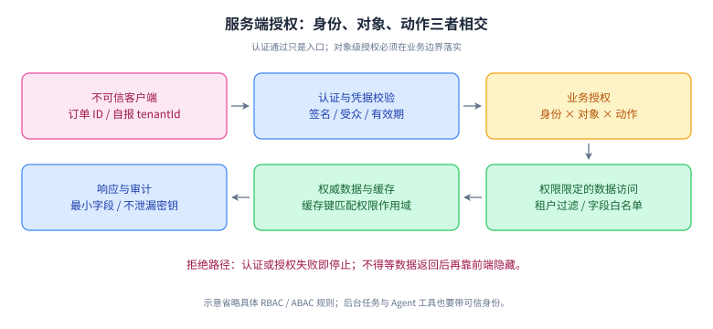
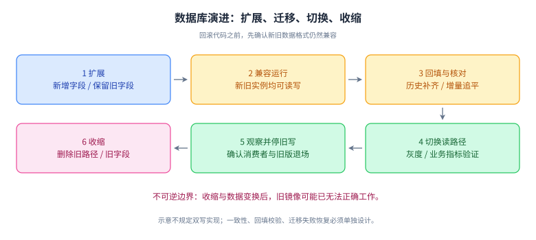

# 13｜安全、测试与可控交付

优先级：P1；鉴权、数据边界、关键路径测试为 P0。前置：HTTP、数据库事务与系统设计。目标：让方案在异常输入、权限变化、部署与回滚时仍然可控。

## L1 必会：安全边界在服务端

认证回答“你是谁”，授权回答“你能对哪个对象做什么”。有登录状态不代表能读取任意订单；拥有某个角色也不代表拥有某个租户的数据。对外接口、内部 RPC、后台任务和 Agent 工具都需要明确身份与权限上下文。

| 风险 | 错误思路 | 应建立的约束 |
| --- | --- | --- |
| 租户越权 | 前端不展示就安全 | 服务端按可信身份、对象归属和动作校验 |
| SQL 注入 | 手写替换引号 | 参数绑定；动态表名/排序字段使用白名单 |
| SSRF | URL 格式合法就能请求 | 限制协议/目标/重定向，防止访问内网元数据等受限位置 |
| 敏感数据泄漏 | HTTPS 就够了 | 输出最小化、日志脱敏、最小权限和保存期限 |
| JWT 误用 | 解码成功就可信 | 校验签名、算法、issuer、audience、时效与撤销策略 |
| 资源耗尽 | 每个请求都合法 | 配额、速率、并发、超时和输入大小限制 |

使用 UUID 不能代替对象权限检查；校验“当前用户 ID 等于请求参数用户 ID”也不能覆盖复杂的组织、角色和对象关系。[OWASP 对象级授权说明](https://api-security.owasp.org/editions/2023/en/0xa1-broken-object-level-authorization/)

## 机制图解：认证通过之后，还有对象授权

**读图顺序**：从客户端输入走到凭据验证，再用可信身份和对象关系决定访问范围，最后检查数据、缓存和输出。任一校验失败就结束，不必等到数据返回后再隐藏。

**记忆锚点**：认证识别身份，授权限制动作；tenantId 既要有可信来源，也要与资源归属匹配。图中没有展开 RBAC/ABAC 的策略模型，也没有穷举全部拒绝响应。

**闭卷重画**：如果缓存命中发生在对象授权之前，画出可能越过的边界，并给一个跨租户失败用例。

### 补充：Session、JWT、OAuth 与 OIDC 不在同一层

Session 常把登录状态放在服务端，通过会话标识关联；JWT 是一种声明载体，不等于自动认证或自动授权，其内容编码也不等于加密。采用 JWT 仍要定义签名校验、受众、过期、撤销和密钥轮换，资源服务按可信上下文执行对象授权。

OAuth 2.0 是授权框架，访问令牌用于在约定范围内访问资源；OIDC 在其上增加身份层，使用 ID Token 等表达认证结果。不要把面向客户端的 ID Token 直接当成访问任意 API 的凭据，具体 token 类型、受众和验证规则必须符合系统契约。[OAuth 2.0](https://www.rfc-editor.org/rfc/rfc6749.html) · [OIDC Core](https://openid.net/specs/openid-connect-core-1_0.html)

## L2 原理：边界测试与兼容性

单元测试验证纯规则和状态转换；集成测试验证事务、SQL、序列化、中间件等真实边界；契约测试验证跨服务约定；端到端测试验证关键流程。层数不是目标，按错误风险选择最经济的证据。

例如退款逻辑可以拆为：金额与状态规则的单元测试；唯一键与事务回滚的集成测试；支付网关响应协议的契约测试；超时重试与对账流程的端到端验证。只 mock 数据库可能永远测不出隔离级别和唯一约束行为。

可靠测试需要可重复输入、受控时钟、隔离数据和明确断言。对异步流程，等待业务条件或完成信号，避免固定 sleep；对竞争条件，用 barrier/latch 制造交错。测试名应表达业务不变量，例如“同一幂等键不得产生两个扣款结果”。

### 数据库变更的扩展—收缩

假设把 `name` 字段拆成 `first_name`/`last_name`，一次发版直接删除旧列会破坏旧实例和回滚。更稳妥的过程是：加兼容字段 → 新旧代码共存 → 回填并核对 → 切读路径 → 观察 → 停止旧写路径 → 最后移除旧字段。每一步要讨论新旧版本同时运行时如何读写，以及数据如何对账。

回滚镜像不能自动回滚已经写入的新格式数据。涉及不可逆变换时，前向修复或数据恢复可能才是真正的退路。

## 机制图解：数据演进的不可逆边界

**读图顺序**：先添加兼容能力，再回填和验证，然后切换路径；确认旧版与消费者退场后，才清理旧字段。

**记忆锚点**：代码回滚与数据恢复是两件事。图只画了阶段依赖，未指定双写方案、数据库 DDL 锁行为或迁移工具，这些必须按实际版本与业务约束验证。

**闭卷重画**：在每一阶段标出“能否直接回滚旧镜像”，并给出判断所需的数据兼容前提。

## L3 工程：一次安全的发布

假设新版本更改订单路由，先定义成功与回滚条件：核心接口错误率、P99、订单状态滞留、重复处理数量；再选择少量可辨认流量灰度。功能开关要有默认值、回滚路径和清理时间，不要无限堆积。

Kubernetes 中，startup 控制启动阶段探测，readiness 控制是否接收流量，liveness 决定是否重启。数据库短暂变慢不应随便让所有应用 liveness 失败，重启风暴可能更糟。探测应围绕本实例能否服务和能否自行恢复设计。[Kubernetes probes](https://kubernetes.io/docs/concepts/workloads/pods/probes/)

优雅停机需要：停止接收新任务、等待在途任务在预算内完成、持久化未完成状态、停止消费者/调度器、关闭资源。无限等待不是优雅，直接中断也不能宣称任务没执行。

## L4 拓展：供应链、密钥与多租户

依赖审查不只看“有没有 CVE 编号”，还要看可达性、暴露面、版本、缓解措施和修复成本。构建记录应能追踪源码、依赖、制品、配置与发布，必要时保留软件物料清单。密钥不进源码与示例，按服务/环境隔离并支持轮换。

多租户隔离要贯穿缓存键、搜索索引、数据库查询、异步消息、对象存储路径和审计，而不只是入口加一个 tenantId。身份从可信认证上下文取，不能直接信任用户请求体；后台任务也要使用明确的服务身份和作用范围。

## 核心面试题与追问

### Q1｜登录用户修改 URL 中的订单 ID 就能读别人订单，哪里错了？

**参考回答**：系统只做了认证或功能权限，没有做对象级授权。服务端应校验当前身份、租户、订单归属和请求动作，查询本身也应按授权边界收窄。不能只依赖前端隐藏、难猜 ID 或客户端 tenantId。还要检查列表、导出、详情、批量接口、缓存和后台任务是否有同类路径，并补跨租户的负例测试。

**追问：缓存怎么防止串租户？** 缓存键和缓存内容的授权边界必须匹配；命中缓存后仍需保证请求有权读取该对象，不能把缓存当可信授权决策的替代品。

### Q2｜什么样的单元测试没有太大价值？

**参考回答**：只重复实现细节、mock 一切再验证调用次数的测试，可能无法发现真实业务错误。我会围绕输入边界、状态不变量和失败结果断言。例如退款不能超额、同一业务键不能重复生效、超时应保持可查询状态。事务和约束需要真实数据库集成验证；测试层次由风险决定，而不是盲目追覆盖率数字。

**追问：覆盖率高为什么仍会出事故？** 执行过不等于断言正确，更不等于覆盖并发交错、真实数据分布和外部故障。

### Q3｜如何测试一个“有时才失败”的并发问题？

**参考回答**：先确定不变量和可疑交错点，再用 latch/barrier、受控时钟或故障注入让竞争稳定出现。例如两个线程都读到旧余额后再同时提交更新，观察是否丢更新。记录实际执行顺序、提交结果和最终状态。概率压力测试可以辅助，但不能靠一次没复现证明安全。

**追问：sleep 能解决吗？** sleep 可以演示但不可靠，调度与机器负载不同会改变交错；优先用明确同步信号。

### Q4｜发布失败后回滚镜像就够了吗？

**参考回答**：不够。要看数据库结构、数据格式、消息协议、缓存内容和外部副作用是否已变化。设计时采用兼容的扩展与收缩流程，使新旧版本能共存；先灰度，再观察业务指标，最后移除旧路径。对不可逆变更需准备前向修复或恢复方案，不能把旧代码能启动等同业务已恢复。

**追问：消息新增字段安全吗？** 要检查消费者对未知字段、枚举值、必填字段和默认值的行为，并做契约测试，不能仅凭“JSON 向后兼容”判断。

### Q5｜readiness 和 liveness 有什么区别？

**参考回答**：readiness 表达实例当前是否适合接流量，失败通常使其从服务流量目标中移出；liveness 用来发现需要重启才能恢复的状态。startup 为慢启动提供独立窗口。下游短暂故障若触发所有实例重启，会放大问题，因此探测目标与阈值要结合故障模式和恢复能力设计，部署时验证摘流和在途处理。

**追问：readiness 失败是否立刻没有任何请求？** 实际流量切换有传播与连接层行为，还要考虑在途请求和长连接，因此仍需应用自身的停机和拒绝新任务逻辑。

### Q6｜怎样向面试官证明你重视安全？

**参考回答**：我会给具体边界和验证证据，例如多租户接口按可信身份过滤，跨租户详情/导出/缓存命中均有负例；外部 URL 工具有受限出站策略；日志不落敏感内容；权限改变后验证缓存与后台任务。并说明一个发现过的问题、修复路径和残余限制，比只列 OWASP 名词更可信。

**追问：这些都是网关负责吗？** 网关可做统一认证、限流等，但业务对象和动作的授权通常需要服务内部结合数据判断。

## 练习：为订单查询写测试矩阵

接口假设：`GET /orders/{id}`，调用者可能是订单拥有者、同租户客服、其他租户用户、未登录用户。自行规定客服角色的可见字段和权限。列至少八个用例，覆盖缺失对象、批量查询、缓存命中与权限撤销。

**参考思路**：合法拥有者成功；获授权客服仅返回允许字段；无关用户拒绝；不同租户拒绝；未登录拒绝；对象不存在采用既定错误策略；缓存命中仍不越权；权限撤销后按约定生效时间拒绝。每个用例写调用身份、资源归属、预期状态和返回字段，而非只写“应失败”。具体 403/404 策略由接口规范和信息泄漏边界决定。

## 过关标准

能指出设计中的信任边界；能设计至少两个不依赖 happy path 的测试；能说明一次发版中代码、数据和消息如何兼容与恢复。了解一份规则清单不算完成，要能落到自己的项目。

## 官方延伸阅读

- [OWASP API Security 2023](https://api-security.owasp.org/editions/2023/en/0x11-t10/)：本章采用的风险分类版本，非宣称最新综合 Top 10。
- [OWASP SQL 注入防护](https://cheatsheetseries.owasp.org/cheatsheets/SQL_Injection_Prevention_Cheat_Sheet.html)：参数绑定与动态标识符边界。
- [OWASP SSRF 防护](https://cheatsheetseries.owasp.org/cheatsheets/Server_Side_Request_Forgery_Prevention_Cheat_Sheet.html)：URL 校验与网络防护。
- [Kubernetes 探针](https://kubernetes.io/docs/concepts/workloads/pods/probes/)：探针语义。
