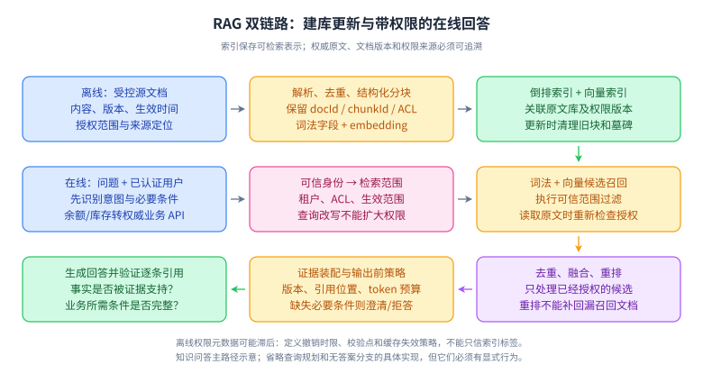
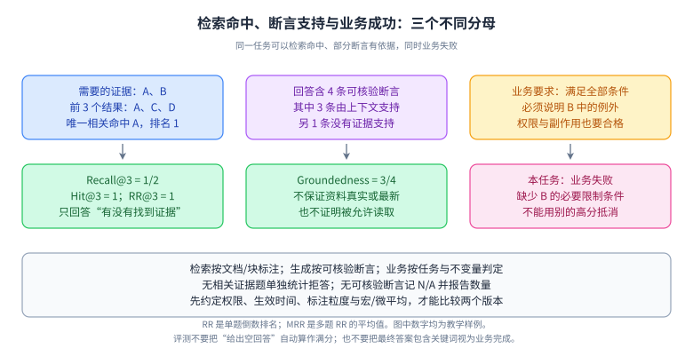

# 16｜RAG：检索质量、权限与证据链

目标：能设计企业知识问答，并定位“没找到、排错了、答错了、泄露了”的不同原因。前置：[LLM 基础](15-llm-foundations.md)、倒排索引、数据库索引与访问控制。资料核对：2026-10-04；本文固定评测定义和架构原理，框架方法签名与索引参数以所选版本为准。

## L1｜必须能口述

RAG 在生成时提供从外部来源检索到的证据。典型在线链路是：身份和意图识别 → 查询改写或路由 → 带权限的召回 → 合并去重 → 重排 → 上下文组装 → 生成带引用的回答 → 验证。离线链路是文档解析、去重、分块、元数据抽取、向量化、建立索引和更新删除。[RAG 原始论文](https://arxiv.org/abs/2005.11401)

**复述骨架：先保证资料可用与授权，再找全、排准、答对；检索指标和生成指标必须分开。**账单余额、库存和实时订单状态优先查询权威业务服务，不能因为有向量库就把所有问题都变成文档检索。

## L2｜理解机制

### 1. 分块与数据生命周期

固定长度分块简单，但会切断定义、条件与例外。按标题、段落、表格结构分块更贴近语义，也需要保留标题路径、文档 ID、版本、生效时间和来源定位。重叠区能减少边界损失，同时增加重复命中和存储成本。可以使用小块召回、父段落补全，但补全的每段也必须满足权限和预算。

索引更新要支持稳定 ID、幂等写入、墓碑删除与版本切换。修改源文档后，旧段落如果没有被清理，会让模型同时看到新旧规则。改分块策略或 embedding 时，用新索引回放评测，再切别名或流量；不要混用不兼容的向量空间。

**读图顺序：**上排是建库与更新；中排从用户身份到带范围的召回；下排从右向左，经过融合重排、证据组装和回答验证。索引向在线检索提供候选，但不替代权威原文与权限服务。

**关键记忆点：**ACL 应在数据入库时可追溯、查询时按可信身份执行、读原文时再次验证；重排与生成只能看到其被允许处理的内容。查询改写只能改检索表达，不能改用户身份或扩大租户范围。若权限标签存在缓存和同步延迟，需要定义撤销生效时限、授权校验点及失效机制；无法确认授权时应采用明确的拒绝策略。

**简化边界：**图示为知识问答主路径，并未要求所有系统都用独立向量数据库；小规模可直接用现有数据库和搜索设施。权限检查的具体实现可以前置或在可信检索服务内后置，但未授权内容不能越过允许的数据处理边界。图中无答案分支合并在证据组装节点，真实接口仍需区分回答、澄清与拒答。

**闭卷重画：**文档删除、用户权限撤销和 embedding 换模型分别影响哪些节点？参考验证：删除不仅移除原文，还要处理旧索引、缓存与历史引用；权限撤销按既定时限生效；更换不兼容 embedding 通常需要新索引与切换验证。

### 2. 召回、融合与重排

关键词检索适合专名、错误码、精确术语；向量检索补充语义近似表达；结构化过滤处理租户、类别和时间。两路分数通常不能直接相加，因为尺度不同。RRF 依据排序位置融合，例如对每路文档累加 `1/(c+rank)`，其中 c 是平滑常数；它降低了分数标定要求，但参数与候选数量仍需验证。[Elasticsearch RRF 文档](https://www.elastic.co/docs/reference/elasticsearch/rest-apis/reciprocal-rank-fusion)

重排对候选与查询做更细的相关性判断，通常提高排序质量，也增加延迟和成本。它不能恢复召回阶段完全漏掉的文档。ANN 用速度和资源换取近似检索；强过滤可能使候选不足，应结合具体引擎的过滤执行方式、扫描预算和分区设计处理。[pgvector 官方项目](https://github.com/pgvector/pgvector)

Spring AI 将查询转换、扩展、检索和文档合并分成不同组件；这种拆分适合逐段测量和替换。多查询能提高覆盖面，也可能放大无关召回与模型调用成本，不能默认越多越好。[Spring AI RAG 文档](https://docs.spring.io/spring-ai/reference/api/retrieval-augmented-generation.html)

### 3. 指标必须写清分母

| 指标 | 本项目采用的定义 | 不能推出什么 |
|---|---|---|
| Recall@K | 前 K 个去重结果中的相关文档数 / 标注相关文档总数 | 不表示答案正确 |
| Hit@K | 前 K 中至少一个相关文档的问题占比 | 不等于找全证据 |
| MRR | 第一个相关结果排名倒数的平均值；未命中计 0，仅统计前 K 时标 MRR@K | 不评价多个证据是否齐全 |
| Groundedness | 可由给定证据支持的可核验断言数 / 可核验断言总数；无可核验断言记 N/A | 不保证证据本身真实或最新 |
| 答案正确率 | 满足金标准事实与必要条件的回答占比 | 不代表有权限访问 |
| 业务成功率 | 在权限、时延及动作约束下完成用户目标的任务占比 | 不等于 HTTP 200 比例 |

无答案题不能用空相关集合直接除零算 Recall；应单独衡量正确拒答和误答。Groundedness 的 N/A 不计入该指标平均值，但必须报告其数量与占比，并单独统计拒答及任务成功，防止用空回答抬分。评测集保留独立测试部分，覆盖真实问题与困难反例，持续加入线上失败样本，并对模型裁判做人工校准。[评测实践](https://developers.openai.com/api/docs/guides/evaluation-best-practices)

**读图顺序：**三列分别以文档、断言和业务任务为评分对象；先看上排事实，再算下排结果。最底部列出跨版本比较之前要固定的口径。

**关键记忆点：**单题 RR=第一个相关结果排名的倒数，MRR 才是多题 RR 的平均；只看前 K 需标注截断。Recall 的金标准应注明文档级还是块级，并基于评测用户有权访问、评测时刻有效的证据集合。对题目先算比例再平均是宏平均；累加所有命中与所有相关证据后再相除是微平均，两者在题目证据数量不同的时候可能不一致。

**简化边界：**图中人工知道 A、B 是完整相关集合；实际标注往往不完备，需要抽样扩充和复核，不能把“未标注”无条件当作“不相关”。Groundedness 这里只针对可核验断言，语气、可读性、任务完成与信息完整性另行评价。

**闭卷重画：**把排名改为 C、D、A，重新算 Recall@3、Hit@3 和 RR@3。参考验证：前两项仍为 1/2 和 1，RR@3 变为 1/3；重排改善排名并不必然改变 Recall。把答案改为空，groundedness 应为 N/A，而不是自动得到 100%。

## L3｜面试题与参考表达

每题以正文加追问组织成约 60～90 秒的回答；涉及自己未做过的方案时应说“我的设计是”，不要包装成真实项目成果。

### Q1：RAG 回答不准，你怎么定位？

**参考回答：**我先确定金标准和用户当时有权访问的资料，然后分段回放。检查源文档是否存在、解析是否丢表格、分块是否断开条件，再看召回是否覆盖必要证据。如果召回有但最终上下文没有，查融合、重排、去重和 token 截断；如果上下文正确但回答错误，查生成约束、冲突处理和引用支持。我会分别记录 Recall、排序、答案正确率和 groundedness，按问题类型分桶。否则一味换大模型，可能掩盖数据更新或权限过滤的问题，也无法知道改动是否有效。

**追问：Recall 很高但仍答错？**可能缺少关键例外、旧文档排前面、上下文冲突，或模型没有正确综合；必须审查实际送入模型的证据，而不只看候选列表。

### Q2：chunk size 怎么选？

**参考回答：**我不预设一个万能长度，先看文档结构和问题粒度。FAQ 可以按问答切，规章要保留条款及适用条件，表格要保留表头，代码要保留符号与上下文。小块检索精细但容易丢条件，大块完整却容易引入噪声并增加成本。我会用同一问题集比较不同长度、重叠和父子块策略，观察找全率、上下文精度、答案正确率与延迟。最终还要验证跨块问题和版本变更，确保线上更新能删除旧块，避免只优化静态实验。

**追问：把 overlap 加大能解决吗？**只能部分缓解边界问题，还可能让重复段落占满 topK。需按来源去重，必要时显式补全父段落。

### Q3：为什么要混合检索和 rerank？

**参考回答：**用户表达有两类需求：概念近似适合向量，编号、术语与版本号适合词法或精确查询。混合召回可以覆盖两类弱点，再通过去重与融合形成候选；重排进一步判断问题与证据的关联。两步服务不同目标，召回重覆盖，重排重顺序。代价是索引维护和推理延迟增加，所以我会保留纯词法、纯向量基线，比较它们各自漏题的类型。如果问题只是查订单号，我会直接路由数据库，避免复杂链路反而降低准确性。

**追问：两路分数怎么融合？**可先用基于排名的 RRF 做基线；若做分数融合，必须在验证集标定尺度和权重，不能直接相加后凭感觉定阈值。

### Q4：多租户知识库怎样避免数据越权？

**参考回答：**用户身份来自认证上下文，租户和 ACL 由可信服务生成，不能由模型或用户随意填写。检索前对可访问范围做限制，并在读取原文、重排输入和生成前再次确认实际可见性；缓存键也需要包含权限范围或版本。索引内保存文档权限来源和版本，权限变化触发撤销与缓存失效。最终链接访问还要由源系统鉴权。如果向量引擎不能可靠施加过滤，我会使用租户分区或独立索引，而不是先把全库结果交给模型再让它忽略敏感内容。

**追问：检索后再过滤不行吗？**仅当不授权内容从未越过可信边界时才可作实现步骤；它还可能导致 topK 被过滤空，应考虑候选预算，绝不能先送给外部重排模型。

### Q5：有资料但答案与事实不符，怎么评测？

**参考回答：**我分别问三个问题：证据是否相关，答案是否受证据支持，结论是否符合权威事实。比如旧规章支持一个已经作废的答案，groundedness 可以高但正确率低；正确答案如果来自模型记忆，也可能没有证据支持。评测应保留问题、相关文档、版本、必要断言和允许拒答条件。数字和 ID 用确定性检查，开放表达用人工或校准后的模型裁判。对引用还要检查是否支持对应断言，不能仅检验 URL 能打开。

**追问：模型裁判是否客观？**它也有偏差，可能偏好长答案或同类模型。要盲测、随机化顺序、提供评分规则，并抽样与人工一致性校验。

### Q6：RAG 如何处理无答案和互相矛盾的资料？

**参考回答：**无答案是必须设计的正常分支。我会结合检索覆盖、证据有效时间和关键条件完整性决定回答、澄清或转人工，不能只靠相似度阈值。资料冲突先用来源权威性、版本和生效范围判断，例如不同城市政策可能都正确；不能简单投票。无法确定时展示冲突与缺失条件，限制结论范围。评测中同时放入无资料、有相似但不相关资料，以及新旧制度冲突的样本，统计误答和过度拒答，避免靠全部拒绝刷高可信度。

**追问：模型自报“90% 信心”能作阈值吗？**未校准前不能。需要与真实标签比较可靠性，通常采用可观测证据和规则更容易解释。

### Q7：长上下文、微调出现后，RAG 还必要吗？

**参考回答：**是否用 RAG 取决于知识规模、更新频率、权限和引用需求。少量固定且授权清晰的材料可以直接放入上下文，这能减少检索误差；大规模动态文档仍需要选择证据。微调可能改善表达和任务行为，但很难承担实时查询、精确删除或按用户隔离知识的职责。我会先用简单方案建立质量与成本基线，再决定是否引入检索。对于多跳问题，可以分解查询再检索，但增加的轮次必须有预算与停止条件，并用端到端成功率验证收益。

**追问：GraphRAG 一定更强吗？**不一定。关系结构明确的跨实体问题可能受益，但建图、实体合并、更新和权限传播有成本，应对照普通混合检索评测。

## L4｜工程案例与取舍

设计“公司差旅助手”：制度解释走知识检索，个人报销状态走认证后的业务 API，提交申请走确定性流程。文档块携带 `docId、version、effectiveAt、tenantId、aclRef、source`。先规定权限撤销的生效时限与授权校验点；通过权威权限查询、版本化缓存失效等机制落实。索引与缓存更新滞后期间宁可拒绝无法确认授权的读取，也不能假设异步标签更新天然即时完成。

教学样例中，某题需要文档 A、B，top3 是 A、C、D，则 Recall@3=1/2，Hit@3=1。答案包含四个可核验断言，三个被证据支持，则 groundedness=3/4；即使数字看起来尚可，遗漏 B 中的必要限制仍可能导致业务失败。**参考验证：指标必须能逐项追溯到文档和断言，不能只输出一个总分。**

练习：新增“仅研发部门可见”和“规定已作废”两个文档，设计一个会诱使系统引用它们的问题。预期应在生成前排除未授权文档，并解释为什么废止版本不能支持当前决策。完整离线练习见 [Agent 评测实验](../labs/03-agent-evaluation.md)。

## 常见误区与过关标准

- 误区：RAG 消除幻觉；topK 越大越好；重排补回未召回证据；向量库负责全部权限；高 groundedness 就代表业务成功。
- L1：闭卷画出离线与在线链路，并讲清每步输入输出。
- L2：手算 Recall、Hit、MRR，解释无答案题如何单独统计。
- L3：给出数据更新、ACL、缓存隔离、无答案和冲突的完整方案。
- L4：完成消融实验计划，能够解释为什么某项优化提升 Recall 却损害答案质量，并提出回滚条件。

[返回项目首页](../README.md) · [下一章：Agent 架构](17-agent-architecture.md)
