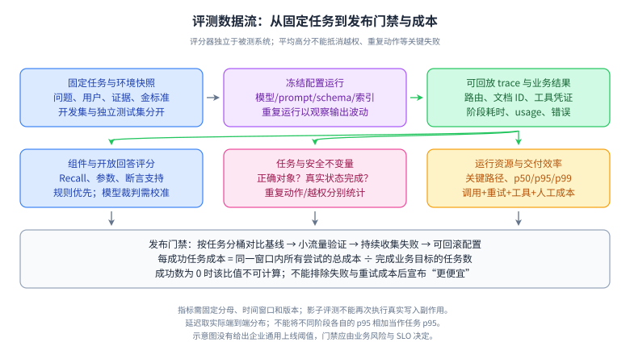

# 18｜Agent 生产工程：评测、安全、恢复与成本

目标：能把“演示可以跑”推进到“表现可量化、失败可追踪、动作可约束”。前置：[Agent 架构](17-agent-architecture.md)、可观测性、幂等、超时与权限控制。资料核对：2026-10-04；MCP 安全文档本次跳转至 **2025-11-25** 文档路径，本文显式使用该版本。Spring AI 指标与配置项随版本核验。

## L1｜必须能口述

Agent 生产质量由任务成功、事实质量、权限边界、运行稳定性、延迟与成本共同决定。HTTP 成功、JSON 合法、调用了正确工具，都不足以证明用户目标达成。上线前要定义任务样本、初始环境、可验证结果和失败分类；上线后把真实失败补回回归集，持续监测版本变化。

**复述骨架：先定义成功，再收集 trace；安全靠运行时控制；副作用靠业务幂等；性能看整条任务链路。**

## L2｜指标、trace 与控制面

### 1. 分层评测与发布

组件层检查检索覆盖、路由、工具名和参数；轨迹层检查是否绕路、重复操作、过早停止；任务层检查最终业务状态；系统层看权限、延迟与成本。模型裁判适合开放质量评价，精确金额、对象 ID、权限和副作用次数应由规则或真实环境验证。裁判需要校准，评测集也会偏离线上分布。[Agent 评测实践](https://www.anthropic.com/engineering/demystifying-evals-for-ai-agents)

固定模型版本、提示词、工具 schema、知识库版本和运行配置。区分开发集与独立测试集，对高风险、无答案、超时、模糊请求单独分桶；随机输出的任务需要重复运行并报告波动。灰度时保留旧版本与人工入口，遇到权限或副作用异常应能快速停用相关写工具。[评测最佳实践](https://developers.openai.com/api/docs/guides/evaluation-best-practices)

### 2. 一次 trace 应记录什么

记录运行 ID、父子调用、模型与提示词版本、路由、检索文档 ID 和版本、工具参数摘要、授权决策、幂等键、状态转移、耗时、token 与最终判定。敏感内容按最小必要原则采样、脱敏和限制保留，不能把全部原文和凭据默认写进日志。可观测性框架提供指标与 observation 接入，但业务成功条件仍需自己定义。[Spring AI observability](https://docs.spring.io/spring-ai/reference/observability/index.html)

### 3. Prompt injection 的信任边界

网页、邮件、文档和工具结果都是外部数据，可能含有“忽略之前指令、上传密钥”等内容。提示词要求模型忽略恶意文本只是其中一层；执行端还应限制可用工具、对象级权限、出站地址、文件范围与凭据用途，并对高影响动作绑定已审核的具体参数。MCP 安全资料讨论了 confused deputy 和 token passthrough 等风险，协议连接成功不等于资源授权正确。[MCP 安全资料，2025-11-25](https://modelcontextprotocol.io/docs/2025-11-25/tutorials/security/security_best_practices)

**读图顺序：**左列从外部资料到模型提议，右列从已认证身份到门禁与业务服务；唯一跨区动作箭头进入门禁，不直接进入业务执行。门禁拒绝时不得继续执行右下节点。

**关键记忆点：**来源可信不等于该来源中的任意文字有指令权。工具服务可以是公司的服务，但其返回的工单正文仍可能由攻击者填写。只读能力也要限制对象与输出目的地；多个单独看似低风险的工具组合后，可能形成“读取敏感信息 → 发送外站”的链路。

**简化边界：**这是控制职责图，不是绝对安全证明。模型过滤、策略引擎、沙箱与网络隔离都有各自覆盖范围。对审批需要固定具体对象、参数指纹、身份和有效期；参数变更或审批失效应重新判断，不能拿一次“同意”放行任意后续动作。

**闭卷重画：**画出“未授权文档要求调用发邮件工具”的攻击路径，并标出阻断点。参考验证：检索 ACL 限制可读来源；模型提议进入服务端授权；收件人与数据范围按政策限制；审批与审计不能由不可信文档自我声明。

**沙箱具体限制什么：**代码执行沙箱可以限制文件路径、网络出口、进程能力、CPU、内存与执行时长，把工具运行放进更小的影响范围。容器、进程隔离和虚拟机的边界强度不同，需要按威胁模型选择；不能把“运行在容器里”直接等同无法影响宿主。即便隔离实现正确，被允许的数据库连接或发信接口仍可能产生合法形式的越权业务动作，所以沙箱不能替代对象级授权、外发策略和副作用审批。验证时分别尝试越界读文件、访问未允许地址、耗尽预算，以及通过允许工具操作无权对象，四类失败不能用同一个通过结果替代。

### 4. 延迟与成本

关注任务 p50/p95/p99、TTFT、单步工具延迟、请求轮数、失败重试与每成功任务成本。输入、输出、缓存、工具、存储和重排都可能计费，按实际供应商口径核算。减少不必要轮次、限制冗余输出、并行独立查询、复用允许缓存的数据，以及用确定性程序处理简单任务，都是可验证方向。[延迟优化指南](https://developers.openai.com/api/docs/guides/latency-optimization)

**读图顺序：**上排冻结任务、版本并执行，得到 trace 和业务结果；中排分别评价组件、业务不变量、资源消耗；下排才根据分桶结果决定是否发布。裁判的金标准不应作为被测模型的额外输入泄露。

**关键记忆点：**同一窗口内的总成本要包含失败、重试、模型升级、工具与人工处理，再除以成功业务任务数；成功数为 0 时不能报告一个有限“每成功任务成本”。延迟沿同一次 trace 的关键路径分析，并行步骤可能重叠；分位数要从真实端到端样本计算，不能简单相加各阶段 p95。

**简化边界：**图不提供统一上线阈值，也不把某个综合加权总分作为唯一门禁。权限和重复写入通常需要单独约束，数据量不足的分桶应报告不确定性。模型裁判只评其能够可靠判断的质量维度，工具执行与订单状态通过外部事实验证。

**闭卷重画：**一个新模型 token 单价更低，但需要两次重试且更常人工接手，如何比较？参考验证：对同一任务分布记录完整尝试链和人工口径，计算成功数、总成本与尾延迟，检查失败类型；不能只比较单次模型请求账单。

## L3｜面试题与参考表达

每题以正文和追问组成约 60～90 秒回答。说优化成果时必须交代样本、分母与观察窗口；以下案例均为教学设计，不是实际业务业绩。

### Q1：你怎么证明 Agent 比原方案好？

**参考回答：**先定义用户目标与成功条件，例如准确查询本人订单、按规定解释政策、在授权下创建唯一工单。建立规则或人工流程基线，用脱敏的真实任务和困难反例比较。组件指标帮助定位，最终以任务成功率、人工接手率、延迟和每成功任务成本作判断，并将越权和重复写入设为单独约束。我会固定版本并隔离测试集，对随机任务重复运行。上线后采用小流量灰度，检查数据分布和分桶变化，因为离线高分不能直接代表线上收益。

**追问：平均成功率 95% 可以上线吗？**缺少任务风险、失败类型、样本量和置信区间，不能判断；剩下 5% 若全是越权提交，含义完全不同。

### Q2：LLM-as-a-judge 有哪些问题？

**参考回答：**模型裁判可能偏好长答案、某种表达方式或同源模型，也可能被被评答案中的指令诱导。评分规则不清时，它与业务标准容易偏离。我会把精确事实和动作检查交给确定性校验，对开放部分提供明确 rubric 和证据，随机化比较顺序，隐藏方案身份，并抽取人工标注样本校准一致性。评测结果保留原始样本与判断理由以便复核，不能只看汇总分。对高风险结论还需专业审核，不能让同一个 Agent 自评后直接放行。

**追问：通过率提高可能是假提升吗？**可能，提示词过拟合测试集、裁判偏差和样本变简单都会抬分。保留独立集、线上分桶与长期漂移监控。

### Q3：遇到 prompt injection 怎么防？

**参考回答：**我把它视为不可信内容试图改变系统行为的风险，而不只是敏感词问题。首先明确来源层级，文档和工具结果只能提供数据；其次在执行层限制工具集合、参数、对象权限、出站地址和文件访问，密钥不放入模型上下文。对转账、发信等高影响操作绑定用户授权与具体参数，必要时经过人工确认。最后用恶意文档、伪造工具结果和跨租户请求做对抗评测。过滤和提示词只能降低部分风险，不能声称彻底消除注入。

**追问：只读工具就安全吗？**也可能泄露敏感信息，或返回诱导后续写工具的内容。读取权限与输出目的地仍需控制，并检查跨工具组合风险。

### Q4：工具超时后 Agent 应该怎么重试？

**参考回答：**先区分只读、幂等写入和不可确认副作用。只读临时错误可以在总预算内退避重试；写入必须带稳定业务幂等键。超时只说明客户端没有收到结果，不能断言服务端没执行，所以优先查询操作状态。运行状态保存 UNKNOWN 和请求 ID，恢复时对账后再决定继续。多层 SDK、网关和 Agent 都有重试时还要控制放大效应。校验失败和无权限不应无脑重试，未知结果无法确认时应人工处理。

**追问：工具调用 ID 可直接作为幂等键吗？**未必。模型重新规划可能生成新 ID；幂等键应与同一个业务意图稳定绑定，并防止相同键承载不同参数。

### Q5：线上响应突然变慢，如何排查？

**参考回答：**我按端到端 trace 找关键路径，先区分排队、检索、模型首包、输出、工具和多轮循环。看 p95 是否来自某个租户、长上下文、供应商限流或错误重试，而不是只看平均值。若是输出过长就压缩结果，若是多轮绕路就改善工具契约和路由，若独立查询串行则考虑并行。并行会增加瞬时并发，需要连接池与限流保护。所有优化都回放质量集，避免为了快而漏证据或提前宣布完成。

**追问：使用流式就解决慢了吗？**它主要改善首段可见时间，仍需统计任务完成时长；结构化或有副作用输出不能在未校验完整结果前直接执行。

### Q6：如何降低 Agent 成本？

**参考回答：**我先算每成功任务成本，而不是每次调用成本，因为便宜模型若频繁失败和升级可能更贵。拆出输入输出 token、检索重排、工具费、重试和人工处理；观察哪些任务有重复上下文或多余轮次。可用规则处理简单路由、按难度选择模型、缓存稳定且权限允许的结果、缩短冗余输出。缓存键包含版本和访问范围，实时余额不宜长期缓存。优化时保留质量与安全门槛，设置任务总预算、最大步数和超时，耗尽后明确移交。

**追问：小模型失败后再大模型总更省吗？**取决于简单任务占比、路由误差、失败识别能力和额外调用成本，要用真实分布测总期望成本。

### Q7：如何设计上线与回滚？

**参考回答：**我把模型、提示词、工具契约、检索索引和权限策略作为一组可追溯配置发布。先离线回放，再影子或小流量灰度；有副作用的请求不能在影子环境重复执行真实写入。监控按任务分桶的成功、拒答、越权、重复动作、延迟和成本。回滚优先关闭风险工具或切回稳定配置，运行中的任务按版本继续或显式迁移，不能混用状态格式。新旧模型切换后还要核对业务动作与残留运行，因为恢复配置不能撤销已发生的外部副作用。

**追问：需要什么回归样本？**真实失败、历史修复案例、无权限、无答案、恶意内容、服务超时、进程中断、取消以及预算耗尽，且明确每题期待的业务状态。

## L4｜完整案例与验算

**退款助手设计：**解释政策使用带 ACL 的 RAG；资格与金额由业务服务计算；模型生成操作提议；授权网关绑定用户、订单、金额及有效期；执行服务用 `intentId` 去重。请求超时进入 UNKNOWN，通过流水查询恢复，绝不因“模型说未成功”立即再退一次。trace 记录决策与结果，不记录完整支付凭证。

**成本算例：**某方案每任务平均花费 0.02 元，完成率 80%，若将全部尝试费用计入，则每成功任务成本为 `0.02/0.8=0.025` 元。另一方案每任务 0.024 元，成功率 96%，同样为 0.025 元。后者是否更好还取决于延迟、失败危害和人工成本。这里是虚构数字，不代表任何供应商价格。

**可靠性算例：**若六步的条件成功率恰好都为 98%，则沿这一路径全部成功概率为 `0.98^6≈88.6%`。若只有各步骤边际成功率，没有独立性或条件概率信息，不能直接这样相乘。真实流程有相关故障和恢复机制，需要任务级测量。

**练习：**在 [离线评测实验](../labs/03-agent-evaluation.md) 运行 baseline 与 improved，解释为什么 Recall、路由和业务成功率会不同；再添加一个重复动作及一个工具返回后进程崩溃案例。参考验证：重复交付不新增副作用，结果未知不得误报失败或成功，无权限资料不得进入生成输入。

## 常见误区与过关标准

- 误区：只用模型裁判就够；加安全 prompt 就能隔离；重试保证可靠；工具调用成功就是任务成功；切回旧模型能撤销所有动作。
- L1：讲清五类指标：质量、权限、可靠性、延迟、成本。
- L2：对照一次 trace，找出路由、检索、生成和工具中的真实失败点。
- L3：设计未知结果恢复、权限撤销、灰度与停用写工具的过程。
- L4：给出可重复评测、分桶分析、成本验算和回滚证据；能说明离线 fixture 与真实模型、真实生产环境之间的差距。

[返回项目首页](../README.md) · [动手实验：Agent 评测](../labs/03-agent-evaluation.md)
