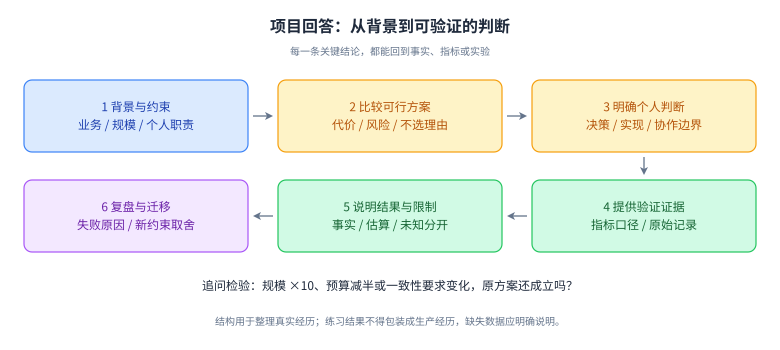

# 19｜项目深挖、技术判断与面试表达

优先级：P0。前置：选择一个真实负责过的项目。目标：让面试官看见你的判断过程、个人贡献和证据，避免“讲了很多技术，仍不知道你做了什么”。

## L1 必会：五分钟讲出一个完整项目

先给一句话定位：为哪类用户解决什么问题，你负责什么边界。然后按背景与约束、关键决策、落地过程、结果与反思展开。业务价值不一定只有收入，也可以是减少错误、缩短交付、降低故障恢复时间、提升可维护性；指标必须有定义。

五分钟建议分配：背景 40 秒、职责 30 秒、架构/流程 60 秒、最难决策 100 秒、结果和反思 70 秒。它是练习节奏，不必逐秒背诵。

**可填写表达骨架**：

> 我负责【业务边界】，用户在【场景】遇到【问题】。当时约束是【规模/时效/一致性/人力】。我们比较过【方案 A/B】，我主要负责【明确决策和实现】。最终采用【方案】，因为【证据与代价】。用【验证方式】确认后，在【范围和时间】上线。结果是【有口径的数据或可核实事实】；仍然存在【限制】，下一步会【改进】。

没有数据时，可以明确“当时没有保留这个指标，我能确认的是……”。不要把全团队成果换成“我一个人做的”，也不要把实验数字说成生产峰值。

## 结构图：把技术名词还原成判断链

**读图顺序**：先明确业务与个人职责，再比较备选、解释判断，最后用证据和结果检验。图中的箭头是表达依赖，不是规定所有项目必须按同样过程执行。

**记忆锚点**：每个技术选型都应回答“为了哪个目标、付出什么代价、如何知道有效”。没留存的指标应明确未知，不用故事补造数据。

**闭卷重画**：用自己的项目填满六个节点，再把一个约束改成十倍规模，说明哪一处原决策要重新评估。

## L2 原理：把决策讲成可检验的推理

资深能力常在约束变化时显现。回答“为什么用 MQ”，要先说业务需要异步解耦还是削峰，是否容忍延迟、如何处理重复和状态滞后；再说不引入 MQ 的方案为什么在当时不合适。技术名词本身不是理由。

每个关键决策准备五个问题：

1. 当时真正要优化的目标是什么？
2. 有哪些可行替代方案，为什么没选？
3. 付出了什么复杂度、成本或一致性代价？
4. 用什么证据检验，而不是仅凭经验？
5. 规模缩小十倍或扩大十倍时，结论会怎样变化？

“微服务更先进”“Redis 更快”“Agent 更智能”都缺少约束和因果链。用同一组指标比较方案，让面试官能反驳、你也能据此修正。

## L3 工程：准备两份项目和一次失败

### 项目一：主责复杂系统

准备真实需求、架构图、数据模型、关键状态机、一个技术决策、一个线上问题和结果证据。写清你负责的代码/设计/协作边界，哪些依赖由别人提供。

### 项目二：改进或迁移

可以是性能优化、稳定性治理、重构、平台化、Agent 引入。重点讲前后对比、兼容性、灰度、风险和实际收益，避免把“换框架”当结果。

### 一次失败复盘

说明信号、影响、止损、根因、为什么既有防线没挡住、后续措施与验证。区别根因与触发条件；“开发粗心”不是足够的系统性解释。比如漏关连接可以进一步追问为什么没有生命周期约束、等待指标和回归测试。

**练习案例（虚构，不可充当个人经历）**：某订单系统 P99 从 300ms 升至 2s，CPU 不高。证据显示远端调用在数据库事务内，连接持有时间变长，等待队列堆积。方案包括缩小事务范围、持久化状态后异步执行、限制远端并发。代价是用户可能看到处理中，需要查询、补偿和对账。验证应比较同负载下连接等待、尾延迟与错误率，而不是只说“快了很多”。

## L4 拓展：影响力不是头衔

技术领导力可以通过推动接口契约、减少团队重复工作、让故障经验变成工具、澄清产品约束体现。说明你如何发现分歧、形成可比较选项、促成决策，以及怎样知道方案被实际采用。

当面试官挑战你的方案，不必捍卫每个细节。先确认新约束，承认旧结论的适用范围，再调整设计。能合理改变结论，比把答案背得不容质疑更有说服力。

对于没有做过的技术，分开说“我知道的原理”“我做过的实验”“我没有经历过的规模”。可以推演方案，但把推演标为推演。

## 核心面试题与追问

### Q1｜介绍一下你最有代表性的项目。

**参考回答结构**：一句话业务目标 → 自己职责 → 规模和约束 → 关键链路 → 一项最难决策 → 有口径的结果。比如说明为什么需要异步状态，而不是罗列十个中间件。主介绍留出可追问的具体切入点，详细表结构和源码等对方追问再展开。

**追问：这是你做的还是团队做的？** 分别列出本人决策、实现、评审/协作以及不负责的部分；不要用“我们”含混所有职责。

### Q2｜为什么不用更简单的方案？

**参考回答结构**：先承认更简单方案的优势，再对照当时明确约束说明哪里不能满足；若当时没有足够证据，应承认决策可能过早复杂化。展示方案对比、容量或一致性验证与维护成本。不是复杂就更专业，要解释复杂度买到了什么。

**追问：流量只有原来的十分之一呢？** 重新评估单体/单库、本地事务与定时任务等更简单方案；保留真正必要的业务不变量。

### Q3｜这个性能提升数字怎么算的？

**参考回答结构**：说明指标定义、统计窗口、流量与数据分布、环境、样本量以及比较方式。P99 下降和平均值下降不同；吞吐提升是否以更多资源和错误率为代价也要说明。没有可比实验时，用“观察到相关变化”代替确定的因果结论。

**追问：为什么不是缓存预热造成的？** 需要比较冷/热状态、相同数据集、多次测量和资源基线；不能凭上线前后两张图排除混杂因素。

### Q4｜讲一次你主导处理的事故。

**参考回答结构**：时间和信号 → 影响范围 → 止损动作和判断依据 → 排查假设与证据 → 根因 → 修复与回滚 → 预防与验证。主线围绕当时的信息和决策，避免事后把所有选择讲成显而易见。

**追问：为什么监控没有提前发现？** 说明缺少什么 SLI/阈值/覆盖、是否存在盲区，并给出改进后的验证；不要只说“加告警”。

### Q5｜你与同事对技术方案有分歧怎么办？

**参考回答结构**：把分歧转为目标、约束和风险的差异，列共同评价标准，用小实验或数据缩小争议，记录决策与回看条件。讲一个真实例子，说明你是否改变过观点，以及最终由谁承担决策责任。

**追问：没有时间做实验呢？** 用现有证据与可逆性选择较低风险方案，设验证/回滚点，明确不确定性，避免拖到无法交付。

### Q6｜为什么十年经验还要做工程师岗位？

**参考回答结构**：直接说明希望承担的职责，例如复杂业务建模、系统稳定性、Agent 工程化；用近期亲自做的技术工作证明深度，再说明协作和培养他人的方式。不要贬低管理岗位，也不需要为工作年限辩解。岗位匹配比“年限应该对应什么”更重要。

**追问：你和五年经验工程师的差别是什么？** 用风险预判、跨边界取舍、复杂问题解决和团队复用成果举证，而不是简单说“经验更多”。

### Q7｜没有生产 Agent 项目，如何回答相关问题？

**参考回答结构**：如实说明目前做的是实验或内部试点，展示可运行流程、评测集、失败分类、工具权限和恢复设计。将后端经验连接到 Agent 的状态、幂等、容量和监控，但承认真实流量、多模型差异和长期记忆的经验边界。

**追问：怎么证明不是照着教程做？** 改一个约束，展示你自己的设计取舍、失败实验、评测变化和代码，而不是只演示 happy path。

## 练习与参考核对

写一页真实项目材料：100 字背景，100 字职责，200 字关键决策，100 字结果，100 字不足。每个数字后写来源；每个“我主导”后写一个可观察行动。找出三句无法被验证的空话，替换成具体事实。

**核对方法**：请读者复述你解决的问题和你的贡献，若复述不出来，继续收窄表达；连续问三次“为什么”，答案应仍连接业务约束。将事实不详的地方标为待查，不自行补数。

## 简历与反问

简历每条经历尽量包含“问题—行动—结果”，只写能经受追问的内容。熟悉、精通等程度词需要对应能力证据。准备两页以内还是更多内容取决于招聘要求，优先让重点可扫描。

反问可围绕：岗位当前最重要的技术问题、成功标准、工程质量与发布方式、Agent 任务的评测和业务闭环。避免只问自己已经能从职位介绍直接读到的信息。

## 过关标准与来源

能稳定完成五分钟介绍；二十分钟追问仍能区分事实和推演；至少一个取舍有可核实证据；至少一个失败能说明后续防线如何验证。

本章的叙事模板、追问与评分属于原创训练设计，不是企业官方答案。面试能力范围可参照 [Amazon 官方技术面准备](https://amazon.jobs/content/en/how-we-hire/interview-prep/software-development-topics)；具体招聘流程与要求以目标岗位为准。
