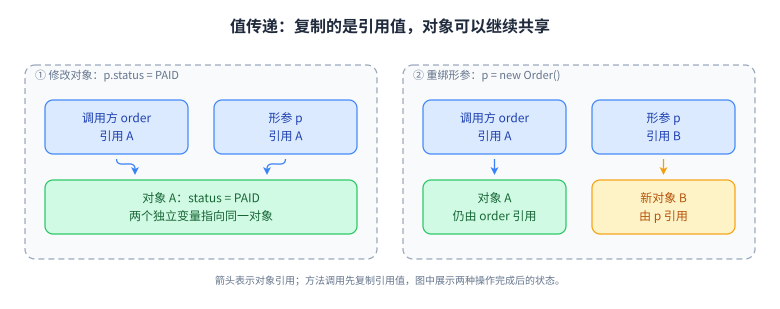

# 20 Java 语言、标准库与接口设计深挖

> 优先级：P0/P1。基线：Java 17/21。承接第 01、02 章；本章 27 题用于补齐语言、标准库与框架底层机制。L1～L4 是学习深度，不对应职级。

## 主题清单与分层路线

| 层级 | 学习范围 | 能力输出 |
| --- | --- | --- |
| L1 准确表达 | 类型、多态、相等、字符串、金额、时间、异常 | 能根据代码预测结果，说明适用前提 |
| L2 解释机制 | 擦除、桥接、反射、注解、SPI、类初始化、Buffer 状态 | 能画出调用和数据流，不靠记术语 |
| L3 工程应用 | API 契约、序列化、I/O、Stream、插件隔离 | 能处理异常输入、资源责任与兼容性 |
| L4 取舍验证 | 模块强封装、语言特性迁移、性能证据 | 能把优化和升级拆成可回滚实验 |

每题先给出自己的 90 秒回答，再读参考；对熟悉问题仍要回答“反例是什么、如何验证”。这些题与基础章共享原理，但新增的重点是边界和工程取舍。

## 机制图：从复制引用推到 API 所有权



**读图顺序：** 先看变量，再看引用，最后看对象状态。左图的变化穿过了共享对象，右图的变化停留在局部参数。**记忆点：** API 的参数类型不能单独表达所有权，需要额外说明是否保存引用、是否修改输入、复制到哪一层。**未覆盖边界：** 该图没有表达并发发布、异步任务生命周期和 JIT 物理布局。**闭卷重画：** 给共享订单再加一层 `List<Order>`，分别画不可修改视图、浅复制和不可变值对象快照；指出每种方式还能从哪条路径修改数据。

## L1～L4 专题问答

### Q1：封装、继承和多态怎样帮助维护业务不变量？

**参考回答：** 封装的目标是让对象负责维护状态规则，而不是只把字段设为 private 再生成全部 setter。例如退款对象应通过带校验的行为维护累计退款不超过实付额。继承表达可替换的类型关系，子类不能任意收紧前置条件或破坏父类承诺；单纯为了复用几行代码而继承容易把实现耦合变成契约耦合。多态让调用方依赖稳定能力，但接口不应大到强迫所有实现提供空方法。变化方向不同的能力通常用组合，把定价、校验和持久化分别注入，边界更容易测试。最终看不变量由谁维护、变化会影响哪些调用者。

**深入追问：** 模板方法和策略模式如何选择？**答案要点：** 固定流程但少量步骤可变可用模板；算法需要运行时替换或独立组合可用策略；不要为了模式名建立无必要层级。

### Q2：重载、重写、静态方法隐藏和字段访问如何判定？

**参考回答：** 先在编译期根据接收者和参数的声明类型确定可调用签名，包括重载匹配；对于可重写的实例方法，再按接收对象实际类型选择实现。静态方法属于类，子类同名方法是隐藏，不能套实例方法的动态分派。字段访问也依据表达式的编译期类型，不会因实际对象是子类就自动选子类字段。因此“运行时是子类”不能解释全部调用结果。排查代理、泛型桥接与反射调用时，先写出编译期签名和运行期对象类型，通常比猜输出可靠；设计上避免同名字段和令人意外的重载组合。

**深入追问：** `f(Object)` 与 `f(String)` 面对 null 如何选？**答案要点：** 若只有这两个可用重载，String 更具体；若另有不相关的 `f(Integer)`，调用可能有歧义，不能只说 null 总选 Object。

### Q3：equals、hashCode、compareTo 怎样共同影响集合行为？

**参考回答：** equals 定义领域相等，hashCode 必须满足相等对象哈希相同，而排序容器通常按比较器返回零判断同一排序位置。若 compareTo 与 equals 不一致，HashSet 和 TreeSet 的去重结果可能不同，BigDecimal 的 scale 就是典型例子。设计时先明确身份生命周期，避免把入集合后会变化的属性作为键。继承体系还要保持对称和传递，不能父类只看编号、子类又多看类型导致双向比较不同。对于持久化实体，未分配主键和分配之后的相等规则也需要稳定，不能简单使用所有字段自动生成。

**深入追问：** 比较器写 `a.age - b.age` 有什么问题？**答案要点：** 整数溢出会破坏排序关系；用 `Integer.compare`，并明确定义 null、并列值和稳定的次级排序键。

### Q4：字符串常量池、intern 和拼接应该如何回答？

**参考回答：** String 不可变，字面量和编译期常量字符串具有规范规定的驻留行为；intern 返回具有相同内容的规范表示，不能把它理解成对任意原对象就地改造。用双等号比较运行时拼接结果会把身份与内容混淆，业务比较应使用 equals。编译期常量折叠与运行时拼接不同，现代 JDK 的实现也不必沿用旧版 StringBuilder 字节码策略。大量循环拼接可考虑局部 StringBuilder，但少量表达式先看清晰度。对无限用户输入做 intern 可能引入内存和表维护成本，不能把驻留当作自动有界缓存。

**深入追问：** `new String("x").intern()` 一定返回这个新对象吗？**答案要点：** 不保证；若池中已有同内容规范字符串，则返回已有引用。对象数还受编译、加载和优化影响，不凭一行源码武断计数。

### Q5：如何区分 final、不可修改、浅不可变和深不可变？

**参考回答：** final 限制变量重新赋值，不限制其引用对象的变化；不可修改集合只禁止通过该接口修改，底层源集合和元素仍可能变化。浅不可变对象固定自身字段引用，但嵌套对象可以变化；真正满足业务要求的不可变性要覆盖所有可观察状态。构造时复制可变输入，访问时不泄漏内部数组或集合，控制继承并避免构造期间泄漏 this。record 自动生成数据载体方法，却不自动深拷贝组件。是否复制到最深层应由业务边界决定，过度复制可能带来成本，采用不可变值对象常能同时简化共享与测试。

**深入追问：** 返回 `byte[]` 怎样保持不可变？**答案要点：** 构造输入与输出访问都要考虑复制，或提供安全的读取接口；只复制输入仍会从 getter 泄漏内部数组。

### Q6：为什么泛型不协变，PECS 如何用于真实接口？

**参考回答：** 若允许把整数列表直接当成数字列表，调用方就能加入小数而破坏原列表类型约束，所以参数化集合通常不协变。读取未知数字子类型可用 `? extends Number`，但不能安全加入任意具体数字，因为实际可能是小数列表。向某种类型及其父类型容器写入可用 `? super T`，读取通常只能视为 Object。PECS 表达的是这个参数在当前方法中承担生产者还是消费者，不是给所有泛型加通配符。若方法既读取又写回同一明确类型，使用类型变量往往更清楚，也能让返回类型保持关联。

**深入追问：** 怎样声明把源列表元素复制到目标列表的方法？**答案要点：** 类似 `<T> void copy(List<? super T> dst, List<? extends T> src)`；还要说明目标是追加还是替换，以及容量和别名语义。

### Q7：泛型擦除、桥接方法与堆污染有什么关系？

**参考回答：** 擦除后类型变量通常变成上界，编译器在需要处插入转换；为维持泛型重写后的多态关系，还可能生成桥接方法。声明签名仍可保留部分泛型元数据，因此框架读取字段泛型与普通对象运行时携带完整类型参数是两回事。使用原始类型、未经检查的转换或不安全泛型可变参数，可能把错误类型放入容器，直到后续读取才抛转换异常，这就是堆污染的常见来源。工程上应缩小 unchecked 操作范围，写清不变量并验证边界，不能一键抑制全部警告后认为类型安全已经恢复。

**深入追问：** 为什么不能直接创建 `new T[]`？**答案要点：** 数组在运行时检查元素类型，而擦除后的 T 缺少所需具体信息；可使用类型令牌、数组工厂或列表，并说明转换风险。

### Q8：异常链、受检异常和 try-with-resources 如何设计？

**参考回答：** 异常类型首先服务于调用者决策：输入错误、业务拒绝、可重试依赖故障和代码缺陷需要不同处理。受检异常要求编译期处理声明，但不代表一定可恢复；运行时异常也不意味着一律不可恢复。跨层转换要保留 cause，避免每层重复打日志。try-with-resources 按声明的相反顺序关闭资源，主体已抛异常时关闭失败通常成为 suppressed，便于保留主要故障。普通 finally 中再抛异常或 return 可能覆盖原结果。捕获中断应按契约传播或恢复标记并停止当前工作，不能当普通错误吞掉。

**深入追问：** 只有 close 失败而主体成功，会怎样？**答案要点：** 关闭异常成为对外抛出的主要异常；若多个资源关闭失败，后续关闭异常可能进入 suppressed，排查要检查完整异常树。

### Q9：Java 原生序列化为什么需要谨慎，serialVersionUID 能解决什么？

**参考回答：** 原生序列化把对象图和类型信息写入流，反序列化会参与对象恢复与类相关逻辑，因此不应把不可信数据直接交给通用对象反序列化入口。serialVersionUID 参与序列化类版本兼容检查，但相同编号不保证字段变化后业务语义兼容，更不提供输入安全。transient 也只是默认字段序列化规则的一部分，不能等同加密。跨服务协议通常应采用明确模式、字段范围和演进规则；必须处理遗留对象流时，限制允许类型、对象图深度、数组大小与资源消耗，并测试旧数据兼容和失败路径。

**深入追问：** 自定义 readObject 为什么不能当普通构造器？**答案要点：** 恢复路径与正常构造流程不同，必须重验不变量、防御性复制和资源限制；不能相信流中对象天然满足业务前置条件。

### Q10：注解的保留策略、继承与运行机制是什么？

**参考回答：** 注解本身是元数据，需要编译器、注解处理器、反射框架或字节码工具读取后才产生行为。SOURCE、CLASS、RUNTIME 决定信息保留在哪些阶段，运行期反射通常需要 RUNTIME。Target 限制合法标注位置；Inherited 仅影响特定类注解沿父类链的查询，不表示方法注解、接口注解都会自动继承。Spring 的组合注解和合并查找又是框架附加语义，不能等同 JDK 原始反射。设计注解时要说明读取方、冲突优先级、默认值与版本兼容，避免只定义名字却没有实际执行机制。

**深入追问：** 方法上有事务注解为什么仍不生效？**答案要点：** 元数据存在不等于调用被拦截；还需容器对象、代理入口、方法可增强和事务管理器等条件，参见第 05 章。

### Q11：反射和 MethodHandle 的区别是否就是快慢？

**参考回答：** 反射提供通用成员发现和调用接口，MethodHandle 表达可组合、带方法类型的调用句柄，两者访问检查、调用适配和优化机会不同。不能脱离 JDK 版本、句柄是否稳定、调用是否可内联来断言谁永远更快。工程上先考虑调用路径频率、缓存生命周期和可维护性，热点再做适当基准。缓存反射对象或句柄可能同时保留定义类及其加载器，插件卸载时要注意清理。突破访问限制还受模块开放规则约束，不能因为以前 setAccessible 成功就认为升级后仍可访问任何内部字段。

**深入追问：** 如何判断反射真的导致接口慢？**答案要点：** 先采样 CPU 和调用次数，隔离数据库、序列化和网络成本；用相同数据验证调用缓存前后收益，不只比较单次纳秒计时。

### Q12：SPI 和 ServiceLoader 怎样实现可替换插件？

**参考回答：** SPI 让主程序依赖服务接口，提供者通过约定注册，运行时发现实现。类路径部署常用 META-INF/services 文件，模块路径则有 uses 和 provides 等声明，不能混用规则。ServiceLoader 的提供者发现与实例化具有惰性特征，调用方要处理没有实现、多个实现及配置错误；发现顺序也不应直接充当业务优先级。插件系统还要明确公共接口由哪个加载器定义、私有依赖如何隔离，以及插件资源如何关闭。ServiceLoader 不是完整的依赖注入容器，更不会自动提供热更新和线程安全。

**深入追问：** 为什么同名接口仍可能转换失败？**答案要点：** 类型身份包含定义类加载器；宿主和插件各加载一份接口会形成不同类型，公共 API 应有共享的加载边界。

### Q13：模块系统中的 exports、opens 和强封装如何理解？

**参考回答：** exports 允许其他模块按规则使用包中的公开类型，opens 面向运行期深反射访问，二者目的不同。使用公共 API 能编译不代表框架可以反射访问该包的私有成员。升级 JDK 后内部实现包受到更严格封装，旧库可能抛出不可访问异常，此时要定位依赖、调用点和实际模块，再判断能否升级或改用公共接口。临时增加 add-opens 只是明确开放边界的兼容手段，不应无限扩大为永久配置。模块设计还要关注服务发现、拆分包和运行时镜像，与简单把 jar 政名不同。

**深入追问：** exports 一个包能修复全部反射失败吗？**答案要点：** 不能；公开访问、深反射、可读关系是不同约束，需要结合异常指出缺少哪条访问关系。

### Q14：BIO、NIO 和异步 I/O 应该沿哪几个维度比较？

**参考回答：** 阻塞描述发起操作的线程是否等待就绪或完成，同步与异步描述结果如何交付，不能把这些术语压成一个高低级排序。传统阻塞 I/O 写法直接，但平台线程多时可能有调度和内存成本；NIO 的 Channel、Buffer 与 Selector 支持就绪事件驱动，应用仍需自己处理读写及连接状态；异步通道通过回调或 Future 报告完成，底层机制取决于实现和系统。选择还要比较连接数、单次工作量、背压、编码复杂度以及虚拟线程可用性，不是见到 NIO 就一定性能更好。

**深入追问：** Selector 可读事件能保证读到完整业务消息吗？**答案要点：** 不能；可能只有部分字节，也可能读到 EOF，需要明确帧协议、累计缓冲、长度校验和断连处理。

### Q15：ByteBuffer 的 position、limit、capacity 和 compact 如何推演？

**参考回答：** capacity 是容量上限，limit 限定本轮可访问范围，position 表示下一次相对读写位置。写入后 flip 把 limit 设为已写位置并把 position 归零，便于读取刚写入的数据；clear 只重置索引，不擦除字节，也不能保留未消费区的读取语义。半包场景中 compact 将未读取数据搬到前面，并把 position 放在其后以继续写入，再 flip 继续读。直接缓冲可能减少某些本地 I/O 中间复制，但分配回收成本、堆外预算和生命周期都要考虑；不能把 direct 等同永远零复制。

**深入追问：** slice 或 duplicate 会复制底层内容吗？**答案要点：** 通常共享内容但具有各自索引状态；只读视图不阻止另一可写别名改数据，因此不能直接当不可变快照。

### Q16：文件传输中的零复制、映射和 transferTo 有哪些条件？

**参考回答：** 零复制通常指减少用户态与内核态之间的某些数据复制或 CPU 搬运，不表示整条链路没有任何复制。FileChannel 的 transferTo、transferFrom 给实现采用高效传输的机会，但实际能力取决于操作系统、目标通道、加密和协议处理等条件。调用可能只传输部分字节，必须循环推进偏移并正确处理无进展、EOF 和失败。内存映射把文件区域映射到地址空间，也要考虑页面缺失、映射生命周期和文件变更。选择方案先看瓶颈在磁盘、网络、CPU 还是协议转换，再用实际文件大小测试。

**深入追问：** 大文件下载怎样避免占满堆？**答案要点：** 分块或流式传输、有界缓冲、关闭资源和客户端断开后的取消；不要先 readAllBytes 再交给响应层。

### Q17：Instant、LocalDateTime 和时区怎样用于业务时间？

**参考回答：** Instant 表示时间线上的时刻，LocalDateTime 只表达当地日期时间而不包含时区，二者不能无条件互换。日志和事件通常需要统一时刻，日历预约则可能还要保留用户时区与当地规则；OffsetDateTime 包含偏移，但偏移不等于完整地区时区规则。夏令时切换可能造成某段当地时间不存在或出现两次，因此“明天同一时间”与“增加二十四小时”不是总等价。工程上明确存储、传输和展示格式，测试中注入 Clock，而不是到处直接读取当前时间；耗时测量则用适合间隔的单调计时方式。

**深入追问：** 订单超时能仅比较本机当前时间吗？**答案要点：** 需要考虑多机时钟偏差、权威时间来源、重试与延迟执行；时间判断和状态更新还应有条件更新以防重复处理。

### Q18：BigDecimal 的精度、scale、舍入与金额守恒如何设计？

**参考回答：** 精度是有效数字数量，scale 表示小数缩放，两者不能混为一谈。金额规则要明确币种最小单位、输入是否合法、每个计算步骤在哪里舍入，以及最终差额如何归属。用字符串或明确转换接口构造数值，避免直接从二进制浮点引入意外小数；除法还需考虑无限循环小数和指定舍入规则。compareTo 按数值比较，equals 还看 scale，进入集合前要统一业务相等语义。分摊应验证总额守恒和结果确定性，不能只给每项保留两位后接受总额差一分；整数最小单位方案也要防止溢出。

**深入追问：** 税额是逐行舍入还是汇总后舍入？**答案要点：** 两种方案可能得出不同结果，按业务或适用规则确定并保存计算依据，不能在技术层任意选择。

### Q19：Optional 应该解决什么问题，orElse 有何陷阱？

**参考回答：** Optional 主要让返回值明确表达可能缺失，促使调用方处理分支，但不会自动消除所有 null。把它无差别用于每个字段、参数或持久化模型，可能增加框架兼容与序列化复杂度。orElse 的参数表达式会先求值，所以即便已有值，昂贵的默认查询也可能执行；orElseGet 接收供应函数，仅在缺失时计算。map 用于转换存在的值，flatMap 用于避免嵌套 Optional。业务上还要区分“确实不存在”和“依赖查询失败”，不能把异常吞成 empty，否则重试和监控会失去依据。

**深入追问：** `Optional<List<T>>` 与空列表表达一样吗？**答案要点：** 不一定；若缺失与查询成功但零条结果无区别，空列表更简单；若有区别，应明确语义，必要时使用带状态的结果类型。

### Q20：Stream 的惰性、短路、顺序和副作用怎样影响正确性？

**参考回答：** Stream 描述数据处理流水线，中间操作通常延迟执行，由终结操作驱动；短路操作可能只消费部分元素，因此不能依赖每个元素都触发某个副作用。流水线应尽量使用无状态、不干扰数据源的函数，避免在并行处理时向普通集合追加或修改共享计数。保留遇见顺序和要求有序结果可能限制并行优化；并行还受拆分成本、任务大小与执行资源影响，不保证更快。数据库游标、文件流等来源还涉及关闭责任。阅读代码时分别检查数据来源、状态操作、终结操作及异常路径，比只看链式语法可靠。

**深入追问：** 用 peek 写审计日志可靠吗？**答案要点：** 不适合承载必须执行的业务副作用；优化和短路可能影响调用次数，应把可靠审计设计成明确流程或持久化事件。

### Q21：lambda 捕获 effectively final 变量是否意味着线程安全？

**参考回答：** 捕获局部变量要求 final 或 effectively final，约束的是该局部变量不能重新赋值，不保证它指向的对象不可变。lambda 捕获列表后多个任务同时 add，仍可能产生数据竞争；捕获 this 还可能让整个服务对象和大量关联状态存活到异步任务结束。lambda 与匿名内部类在 this 含义等方面也有区别，不能只当更短的写法。设计异步任务时应捕获最小、不可变的上下文快照，明确执行时机、异常观察和取消责任；不能把捕获时的对象状态误认为任务执行时仍完全相同。

**深入追问：** 为什么捕获一个数组再修改元素可以编译？**答案要点：** 数组引用没被重绑，数组内容却可变；这只绕过了局部变量赋值限制，并未建立任何跨线程同步。

### Q22：record、sealed 和模式匹配如何帮助建模状态？

**参考回答：** record 适合数据载体，自动生成组件访问与相等方法，但仍要校验输入并处理可变组件。sealed 限制直接继承者集合，使一个有限领域状态可以被清楚枚举；模式匹配减少显式转换，并帮助表达穷尽分支。组合使用可将成功、业务拒绝和重试状态建成不同类型，避免一个对象堆多个互相矛盾的布尔值。前提是层级确实相对封闭，插件扩展点就未必适合 sealed。迁移还要区分 Java 17 与 21 已正式提供的特性，不能把后续预览特性写进学习基线而不说明构建条件。

**深入追问：** 为什么给所有 switch 增加 default 也有代价？**答案要点：** 在封闭领域里可能遮住新增状态后的编译期提醒；但跨版本兼容与异常输入也需设计，不能绝对禁止 default。

### Q23：类加载、链接与初始化什么时候真正发生？

**参考回答：** 加载得到类的运行时表示，链接包括验证、准备与解析，初始化才执行类初始化逻辑。new、调用某些静态方法、访问非常量静态字段等主动使用可能触发初始化；读取编译期常量可能已经内联，不能用输出判断为所有情况必然初始化。通过子类名称访问实际声明在父类的静态字段，也不等于一定初始化子类。初始化过程受同步协调，过重的静态 I/O 会阻塞依赖该类的线程，失败还可能使后续使用持续报错。实践中把外部依赖初始化放到可观测、可重试的生命周期更可控。

**深入追问：** Class.forName 和 ClassLoader.loadClass 是否都立即初始化？**答案要点：** 常用单参 Class.forName 会初始化，带 initialize 参数可控制；loadClass 通常负责加载，不能据调用名推断相同初始化效果。

### Q24：从 Java 8 升级到 17/21 应如何验证而非只改编译版本？

**参考回答：** 升级同时涉及源码、字节码、运行时行为、依赖和运维参数。先建立依赖与运行参数清单，检查移除的组件、反射强封装、旧代理字节码库、字符编码及 TLS 等兼容点，再分别验证构建、集成、启动和关键业务链路。性能比较要有相同流量、预热和资源配额，观察吞吐、尾延迟、GC 与内存，而不是新版本启动成功就宣称更快。灰度时保留回滚方案，避免数据库或协议变化与 JDK 升级绑成一个不可分的大包。新语法采用与运行时升级可以分阶段进行，减少定位变量。

**深入追问：** class 文件能否用新 JDK 编译后直接在旧 JDK 运行？**答案要点：** 要看目标字节码和使用的 API，适当使用 `--release`；仅改 target 不一定阻止引用目标版本不存在的 API。

### Q25：一个成熟 Java API 的契约至少应说明什么？

**参考回答：** 类型签名之外，还应说明输入范围、null 与空值语义、返回值所有权、是否修改或保存输入、线程安全、失败类型、资源关闭责任以及超时取消。对批处理接口要明确部分成功、顺序、重试与幂等；对集合返回值要区分视图、快照和元素可变性。设计应从调用方要做的正确动作出发，用约束少且可组合的契约降低误用，而不是暴露全部内部实现。验证时写反例：重复调用、调用后修改输入、并发调用、依赖超时和调用方提前退出。一个清晰契约往往比增加许多注解更能稳定系统边界。

**深入追问：** 如何改变旧接口又不破坏调用方？**答案要点：** 先检查源码、二进制和行为兼容，提供迁移窗口与观测；默认值变化、异常变化和排序变化也可能是破坏性变更。

### Q26：包装类型缓存、自动拆箱与数值提升为何容易出错？

**参考回答：** 包装对象比较要区分对象身份、值相等与触发拆箱后的数值比较，不能依赖某些整数值共享缓存引用来写业务判断。自动拆箱遇到 null 会抛异常，三元表达式、混合算术和重载选择也可能隐式改变类型或触发拆箱。数值计算先按表达式规则执行，再赋给目标变量，因此把两个 int 相乘后赋给 long，不能自动挽回已经发生的整数溢出；应先扩展操作数或使用精确运算检查。代码审查要关注边界值、空值与类型混用，尤其是金额、累计计数和分页偏移，不能只测试小数字。

**深入追问：** `long x = 100_000 * 100_000` 有什么问题？**答案要点：** 右侧按 int 计算可能先溢出；用 `100_000L * 100_000` 或明确的溢出检查，不能靠左侧类型修复。

### Q27：数组协变为什么会运行时失败，而泛型列表倾向编译期拒绝？

**参考回答：** Java 数组保留运行时元素类型并支持协变，因此 String 数组可以赋给 Object 数组引用；但通过该引用写入整数会触发数组存储检查并失败。泛型列表通常不协变，提前在编译期拒绝把字符串列表当作对象列表，从而避免同类非法写入。两者检查时点与类型信息不同，也解释了泛型数组创建为何受到限制。接口需要传输元素序列时，应根据修改权限、运行时类型需求和复制成本选择数组或集合，不要用强转绕过约束。二维数组还可能各行长度不同，浅复制外层也会继续共享内部数组。

**深入追问：** `Object[] a = new String[1]; a[0] = 1;` 在哪里失败？**答案要点：** 赋值到数组引用可编译，存储 Integer 时抛 ArrayStoreException；若 a 为 null 则先产生另一种错误，前提要明确。

## 代码推演与练习

以下 Java 17/21 小程序练习浅复制与 Buffer 状态。先预测输出，再保存为 `LanguageBoundaryLab.java`，执行 `javac LanguageBoundaryLab.java && java LanguageBoundaryLab`；不需要第三方依赖。

```java
import java.nio.ByteBuffer;
import java.util.ArrayList;
import java.util.List;

public class LanguageBoundaryLab {
    static final class Order { int amount = 1; }
    public static void main(String[] args) {
        var source = new ArrayList<>(List.of(new Order()));
        var snapshot = List.copyOf(source);
        source.clear();
        snapshot.get(0).amount = 2;
        System.out.println(source.size() + ":" + snapshot.get(0).amount);
        var b = ByteBuffer.allocate(8);
        b.put(new byte[] {10, 20, 30, 40}).flip();
        b.get();
        b.get();
        b.compact();
        b.put((byte) 50).flip();
        while (b.hasRemaining()) System.out.print(b.get() + " ");
    }
}
```

参考验证：第一行 `0:2`，后续 `30 40 50`。继续添加三个验证：向 snapshot 增删应失败；改用不可修改视图后 source.clear 的影响不同；把 compact 换成 clear 后未读字节不再按原语义保留。该代码是可执行练习，最终过关需要自己解释每个索引和引用变化，不能只抄输出。

## 过关标准

L1：27 题都能说出结论与前提。L2：能脱稿推演泛型、分派、引用、初始化和 Buffer 代码。L3：为自己项目中一个 API 补齐输入、所有权、线程、异常和资源契约。L4：写一份 JDK 升级验证计划，包含基线、灰度、观测和回滚，所有指标使用真实测量或明确标为待测。

## 官方资料与核对入口

- [JLS 21：类型、泛型与擦除](https://docs.oracle.com/javase/specs/jls/se21/html/jls-4.html)、[表达式与方法调用](https://docs.oracle.com/javase/specs/jls/se21/html/jls-15.html)、[类初始化](https://docs.oracle.com/javase/specs/jls/se21/html/jls-12.html)：Q2、Q6、Q7、Q21、Q23。
- [String API](https://docs.oracle.com/en/java/javase/21/docs/api/java.base/java/lang/String.html)、[Stream 规范](https://docs.oracle.com/en/java/javase/21/docs/api/java.base/java/util/stream/package-summary.html)：Q4、Q20。
- [ServiceLoader](https://docs.oracle.com/en/java/javase/21/docs/api/java.base/java/util/ServiceLoader.html)、[反射访问规则](https://docs.oracle.com/en/java/javase/21/docs/api/java.base/java/lang/reflect/AccessibleObject.html)：Q11～Q13。
- [ByteBuffer](https://docs.oracle.com/en/java/javase/21/docs/api/java.base/java/nio/ByteBuffer.html)、[FileChannel](https://docs.oracle.com/en/java/javase/21/docs/api/java.base/java/nio/channels/FileChannel.html)、[java.time](https://docs.oracle.com/en/java/javase/21/docs/api/java.base/java/time/package-summary.html)：Q14～Q17。
- [JDK 序列化过滤](https://docs.oracle.com/en/java/javase/21/core/serialization-filtering1.html)、[JDK 21 迁移指南](https://docs.oracle.com/en/java/javase/21/migrate/)：Q9、Q24。

以上是按机制整理的原创讲解，版本敏感行为需按实际运行时和依赖复核；不能用题目数量或背诵完成度替代编码与项目证据。
