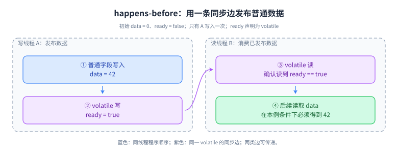
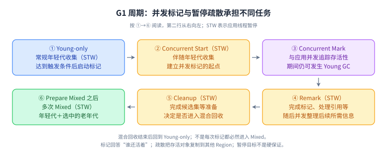

# 21 并发工具、JVM 机制与诊断深挖

> 优先级：P0/P1。基线：HotSpot Java 17/21，明确标注 Java 24 的变化。承接第 03、04 章；本章 34 道题从正确性证明延伸到容量、运行时和诊断。

## 分层主题清单

| 层级 | 专题 | 交付物 |
| --- | --- | --- |
| L1 | 锁、原子类、同步工具、线程池、GC 术语 | 说清保证与不保证，避免绝对化结论 |
| L2 | AQS、条件队列、CAS、上下文、JIT、类加载 | 用状态和调用顺序推导结果 |
| L3 | 超时取消、资源限制、泄漏和热点定位 | 有界实验、证据链与修复验证 |
| L4 | 虚拟线程、收集器迁移、性能实验 | 按版本和负载作取舍，有反证标准 |

## 两张主图：从正确性到运行时成本



**读图顺序：** 写数据、发布标记、读取标记、使用数据。**记忆点：** 需要的是一条可证明的同步边，而不是“我的测试没有出错”。**未覆盖边界：** 多写者、复用标记和发布后的持续修改。**闭卷重画：** 用线程启动、闩锁释放或队列交接分别替换紫色边，并指出各自 API 的内存一致性约束。



**读图顺序：** 沿编号走一遍，再只圈出 STW。**记忆点：** 标记、候选集、疏散不是同一件事。**未覆盖边界：** Full GC、疏散失败及特定版本的优化。**闭卷重画：** 给“分配越来越快、存活对象不变”和“分配稳定、长期保留越来越多”分别标出压力变化的阶段。

## L1～L4 专题问答

### Q1：AQS 的 state、等待队列和子类分别负责什么？

**参考回答：** AQS 提供围绕同步状态、排队、阻塞和唤醒的通用框架，子类定义 state 的含义以及怎样获取和释放。例如可重入锁可把状态用于持有计数，信号量可表达剩余许可，但不能把这些具体语义说成 AQS 自带。获取失败的线程可能进入同步队列等待，再被唤醒并重新尝试；唤醒不是直接授予资源。共享与独占是获取协议，公平与否还取决于子类获取策略。理解源码应沿一次成功、一次竞争失败、一次取消走通，不需要为了面试背不同 JDK 中每个节点字段的名字。

**深入追问：** FIFO 队列为什么不自动等于公平锁？**答案要点：** 新到线程可能在入队前先尝试获取并插队；公平性需要获取逻辑配合，而且仍不保证操作系统调度公平。

### Q2：Condition 等待与同步队列重新竞争有何区别？

**参考回答：** 条件等待解决的是业务条件暂时不满足，同步队列等待解决的是获取同步资源失败。以 ReentrantLock 的 Condition 为例，线程持有关联锁调用 await，按协议释放锁并进入条件等待；被 signal 等唤醒后，还要重新竞争并获取锁，才能返回业务代码。signal 并不会立即释放发信号者的锁，也不会保证被唤醒者看到条件仍成立，因为其他线程可能抢先改变它。正确写法是在锁内用 while 检查条件，修改状态后发信号，获取成功后在 finally 解锁。中断和超时也要作为独立完成路径处理。

**深入追问：** 一个锁上用两个 Condition 有什么价值？**答案要点：** 有界队列可分别等待“非空”和“未满”，只通知相关等待者；仍要正确维护队列状态与循环检查。

### Q3：CAS 为什么不能简单等同“无锁所以更快”？

**参考回答：** CAS 把比较预期值与条件更新合成原子动作，适合短状态更新，但失败通常需要重新读取和重算。竞争激烈时大量重试会消耗 CPU 并造成缓存一致性流量，某个线程也可能长时间失败，所以一次原子指令不等于整个算法无等待。复合业务若涉及多个关联字段，可用不可变状态整体替换，但对象分配和冲突成本也要计入。锁可以让失败者阻塞等待，某些高竞争场景反而更可控。选择要结合临界区长短、竞争度、失败代价和公平需求，用相同负载比较尾延迟与吞吐。

**深入追问：** CAS 重试函数可以直接发消息吗？**答案要点：** 重试可能执行多次，副作用会重复；应只计算新状态，外部动作另设幂等与提交协议。

### Q4：ABA 在什么情况下才是实际问题，版本号又有什么边界？

**参考回答：** ABA 指线程看到值为 A，期间其他线程把它改成 B 再改回 A，原 CAS 仍可能成功。若业务只关心当前值等于预期，这未必有错；若指针背后的节点生命周期或状态变化历史有意义，就可能破坏算法假设。带版本的原子引用可把值和版本一起比较，但必须让所有修改都遵守更新版本的协议，还要考虑版本回绕和状态复用。Java 的垃圾回收缓解某些手工内存回收问题，却不会自动消除所有逻辑 ABA。面试时应先给出被破坏的不变量，再选择版本、不可复用身份或更清晰的锁协议。

**深入追问：** 只在旁边放一个普通 int 版本够吗？**答案要点：** 值和版本必须在同一比较更新协议内一致地观察和修改，否则它们自身又形成复合操作竞态。

### Q5：AtomicLong 与 LongAdder 怎样按业务语义选择？

**参考回答：** AtomicLong 适合需要单一原子状态和条件更新的场景，例如根据旧值决定新值。LongAdder 在高竞争统计中分散更新，再汇总多个单元，降低单点竞争，但 sum 不是与并发更新线性一致的瞬时快照，也不能表达“余额足够才扣减”的原子业务动作。无并发更新时，汇总可以用于得到已完成统计；并发计费、库存与序号分配则不能仅因性能高就替换。还要考虑额外空间、重置时机和数据采集窗口。如果业务需要的是近似运行指标，应明确容忍范围，而不是给它财务准确性的承诺。

**深入追问：** sumThenReset 能直接做无损每秒计费吗？**答案要点：** 并发更新与重置没有自动形成业务窗口原子边界；需要额外协调或持久化计费事件，不能把指标工具当账本。

### Q6：读写锁与 StampedLock 的乐观读如何取舍？

**参考回答：** 读写锁允许多个读者共享而让写入排他，适合读操作足够长且写比例受控的场景；若临界区很短，维护锁本身也可能抵消收益。StampedLock 的乐观读先读取状态再验证期间是否有写入，验证失败时退回真实读锁，不能省略校验。乐观区内看到的中间值可能不一致，因此要先复制必要字段到局部变量，避免依赖未验证结构执行危险操作。StampedLock 不提供一般可重入锁的相同语义，调用链嵌套获取可能出问题。选型要比较竞争、读写比例、对象结构与代码可推理性。

**深入追问：** 持有读锁能直接升级为写锁吗？**答案要点：** 不能把升级当通用保证；按具体 API 尝试转换或释放后重获，并重新检查条件，防止等待自己或状态已变化。

### Q7：公平锁、死锁、饥饿和活锁分别如何判断？

**参考回答：** 公平策略影响锁竞争次序，但不保证线程实际运行次序。死锁是参与者等待彼此才能释放的资源而无法推进；饥饿是某任务长期得不到机会；活锁则可能不断执行和让步，却没有业务进展。排查需要看资源持有与等待关系、时间跨度和任务完成率，不能只看线程是 BLOCKED 还是 RUNNABLE。设计上固定多锁顺序，避免锁内不可控 I/O，必要时限时获取并回退，但超时后的补偿本身也要正确。公平锁可能改善等待分布，同时降低吞吐，不能把公平开关当死锁通用解法。

**深入追问：** 给所有获取锁加超时就不会死锁了吗？**答案要点：** 可以打破部分无限等待，但错误的释放、重复重试或补偿可能形成活锁与不一致；仍要检查资源协议。

### Q8：ThreadLocal 的弱引用键为什么没有自动解决泄漏？

**参考回答：** ThreadLocal 把数据放在线程关联的映射中，键的弱引用不代表值也是弱引用。线程长期存活时，失去键的条目或仍存在键的业务值都可能继续保留大对象，清理还依赖后续访问等机制。线程池复用会把内存问题进一步变成串请求数据问题，因此应在明确作用域内设置，并在 finally 中 remove；嵌套作用域要恢复旧值而不是无条件清空外层上下文。它也不负责跨线程传播，不能把数据库连接或请求对象随意复制到异步任务。诊断应沿线程到映射再到值的引用链找实际保留者。

**深入追问：** static final ThreadLocal 还会有问题吗？**答案要点：** 键稳定不等于值自动清理；长期线程仍会保留每次设置的内容，并可能让下个请求读到旧上下文。

### Q9：异步上下文传播为什么不能只用 InheritableThreadLocal？

**参考回答：** InheritableThreadLocal 的继承发生在线程创建时，而线程池任务提交通常复用已有线程，因此任务看到的值可能与当前请求毫无关系。可控方案是在提交边界捕获允许传播的不可变上下文，在执行边界安装，并在 finally 恢复工作线程之前的状态。传播内容应最小化，例如 trace 与必要租户标识，权限数据还要确认有效期和重新校验策略。不要把请求对象、事务连接或大缓存作为上下文整体搬过去。若回调又提交任务，要明确每一层的所有权，不能以为包装一次执行器覆盖所有第三方异步路径。

**深入追问：** 同步嵌套调用为何不能简单 remove？**答案要点：** 内层结束可能误删外层仍需使用的上下文；进入时保存旧值，退出时恢复，并测试异常和重入路径。

### Q10：CompletableFuture 的线程选择与异常传播怎样分析？

**参考回答：** 非 Async 阶段可能由完成前序任务的线程执行，也可能在注册时已完成而由当前线程执行，不能假设固定在线程池中。未指定执行器的 Async 阶段通常使用默认异步执行资源，因此慢阻塞任务最好显式隔离。异常会让后续正常转换阶段跳过，whenComplete 主要用于观察，handle 可以同时处理成功与失败，exceptionally 用于异常恢复；恢复为空值可能把真实失败伪装成成功。get 与 join 的异常包装和中断契约也不同。设计时画出每个阶段在哪执行、谁观察失败、恢复结果是否仍符合业务契约。

**深入追问：** whenComplete 中再抛异常会怎样？**答案要点：** 它可能影响返回的依赖阶段；如果原阶段已失败，还需按 API 的异常优先级理解，不能把监控回调看成完全无副作用。

### Q11：allOf、anyOf、thenCompose 与并行取消有哪些坑？

**参考回答：** thenCompose 用于把产生新阶段的函数展平，避免嵌套 Future；allOf 等待组成阶段都结束，但不直接收集各自结果，也不是某个失败就自动取消其余任务。anyOf 由任一阶段的完成结果驱动，可能先收到异常，不能自动等同“第一个成功”。并行调用需要明确整体截止时间、分支超时、部分结果是否可接受和失败后的取消策略。orTimeout 改变的是完成状态，不保证底层客户端停止请求；CompletableFuture 的 cancel 也不能被当作通用线程中断协议。没有贯通取消的重试可能留下大量后台工作。

**深入追问：** 聚合服务如何处理一个慢分支？**答案要点：** 在明确预算内选择降级、部分结果或整体失败，取消需要连接到底层客户端；结果中保留缺失原因，不能静默当完整成功。

### Q12：ForkJoinPool 的工作窃取适合什么任务？

**参考回答：** 工作窃取让空闲工作线程从其他工作队列获取可执行任务，适合可拆分、子任务相对独立且计算量足够的并行工作。拆分太细会被调度开销吞噬，拆分不均衡则会留下长尾；共享可变状态也可能把并行变回锁竞争。普通阻塞 I/O 不会自动因为进入 ForkJoinPool 就高效，补偿机制也不等于无限资源。公共池会被多个库共享，彼此阻塞可能互相影响。设计时先证明任务可分与合并正确，再测粒度、并行度、CPU 配额和内存，不能只给循环加 parallel 就承诺性能提升。

**深入追问：** 为什么递归分解要设置阈值？**答案要点：** 小任务直接计算通常更便宜；阈值需结合单项成本和机器测量，不是固定元素数通用于所有算法。

### Q13：有界线程池怎样把任务期限和下游容量纳入设计？

**参考回答：** 池大小不是独立参数，要同时考虑到达率、执行时间、排队预算、CPU 配额与下游连接上限。先明确任务超过期限是否还值得执行，再设线程数、有界队列和拒绝策略；对已过期排队任务还需跳过或取消，避免恢复后处理大量无效工作。阻塞比例公式只能给估算起点，下游饱和时增加线程可能放大锁竞争与超时。按不同故障域隔离资源有价值，但过多独立池也增加总线程成本。监控要区分排队和执行耗时，拒绝数量要与入口响应、重试策略和降级相对应。

**深入追问：** 数据库只有 20 个可用连接，开 200 个工作线程一定更好吗？**答案要点：** 多余线程可能只在连接池排队，占内存并消耗超时预算；需看其他工作占比及全局连接竞争。

### Q14：线程池优雅关闭的正确顺序是什么？

**参考回答：** 先停止接收新业务并让上游摘流，再调用 shutdown 允许已接纳任务按约定结束，使用有限时间等待；超时后根据业务允许程度尝试取消或 shutdownNow，并记录尚未开始和未完成任务。shutdownNow 主要尝试中断，不保证无视中断的业务立即退出，返回的排队任务还需负责取消 Future 或持久化补偿。关闭不能无限等待，也不能为了快速退出把关键事务随意截断。任务本身应响应中断、配置外部 I/O 超时并在 finally 释放资源，服务停止流程和任务实现必须共同提供可预测的完成语义。

**深入追问：** 任务捕获 InterruptedException 后继续循环会怎样？**答案要点：** 可能让关闭始终无法完成；按任务契约退出或传播，必要时恢复中断标记，不能把取消当可忽略日志。

### Q15：虚拟线程迁移为什么要同时检查运行时和接纳控制？

**参考回答：** 虚拟线程降低大量阻塞等待的线程成本，让传统顺序代码更容易承载高并发 I/O，但不增加 CPU 核数、数据库连接或外部配额。常见方式是每任务一个虚拟线程，再用信号量、连接池、入口限流和总超时约束稀缺资源。Java 21 中 synchronized 内长时间阻塞可能 pin 住 carrier，Java 24 的相关改进改变了这类主要限制，native 等边界仍需核对。迁移时还应检查 ThreadLocal 大对象、驱动与观测工具，使用相同负载验证尾延迟和错误率，不能只看可创建多少线程。

**深入追问：** 为什么不再给虚拟线程建立固定大小池来复用？**答案要点：** 它们本来面向轻量任务生命周期；限制应落在真正稀缺的资源上，但入口仍需限制总在途请求和等待内存。

### Q16：CountDownLatch 与 CyclicBarrier 怎样选择？

**参考回答：** CountDownLatch 常用于一个或多个线程等待若干事件完成，计数降到零后保持开放，不能把同一个实例重置成下一轮。CyclicBarrier 用于一组参与者在阶段边界汇合，可以进行多轮，但一个参与者中断、超时或屏障动作失败会影响这一代的协作。选择先看“等待事件”还是“所有参与者相互等待”，不要只背一次性与循环。任务失败也要保证通知路径，例如 finally 中 countDown，并把成功结果另行记录，否则计数归零可能被误认为业务全部成功。所有等待都应有合理超时及异常处理。

**深入追问：** 线程数不足而所有参与者都在同一个小池里会怎样？**答案要点：** 已运行任务可能在屏障等待尚未获得线程的任务，形成资源饥饿；需要匹配任务结构与执行容量。

### Q17：Semaphore 怎样限制并发，为什么不能随意 release？

**参考回答：** Semaphore 用许可数量约束同时进入某资源区域的任务数，适合限制远端调用、文件句柄等容量；它不自动保证每秒请求率，也不天然维护业务对象的互斥不变量。必须只有成功获取许可后才在 finally 释放，超时未获取却 release 会增加许可而突破上限。它不像某些锁那样追踪持有者，因此协议需要调用方自己保持正确。排队等待也应消耗总请求预算，不能无限等待导致入口内存增长。若多个实例共同限制外部配额，本地信号量只限制本进程，需要额外的全局协调或配额分配。

**深入追问：** 并发上限 10 是否等于每秒最多 10 次？**答案要点：** 不等；速率与每次耗时有关。QPS 限制和在途并发限制服务于不同目标，经常需要同时存在。

### Q18：Phaser 适合哪些动态分阶段任务？

**参考回答：** Phaser 允许参与方动态注册、到达阶段边界和注销，比固定参与人数的屏障更适合多阶段且成员会变化的任务。到达表示完成本阶段，等待阶段前进又是另一件事；遗漏到达或注销会使其他参与者永久等不到推进。父子分层可以减少大量参与者竞争，但会增加生命周期理解成本。使用前先明确谁拥有注册与注销责任，失败任务怎样离场，终止条件是什么，以及等待的超时中断语义。若需求只是等三个独立请求完成，一个清楚的 Future 聚合或闩锁可能更容易维护，不必为通用性采用最复杂工具。

**深入追问：** 任务提交失败后忘了注销会怎样？**答案要点：** 一个永远不会执行的参与方可能阻止阶段推进；注册、提交、失败回滚必须放在同一生命周期设计中。

### Q19：双重检查单例与不可变快照发布如何证明正确？

**参考回答：** 双重检查的第一次读取在同步块之外，因此仅有内部 synchronized 不足以解释所有读线程的正确发布，通常需要 volatile 引用来连接构造完成与外部读取。锁内再次检查避免多个竞争者重复创建，volatile 负责对应的可见性与顺序保证。更简单的场景可用静态内部类等利用类初始化协议，减少手写并发路径。不可变配置快照同样应先构建完整状态，再一次发布引用，读方获取一次快照后完成相关读取；若连续读取不同版本引用，就可能把两版配置拼在一起。不可变也不代表任意发布方式都合理。

**深入追问：** 把配置的每个字段分别声明 volatile 可以保持整组一致吗？**答案要点：** 不能自动形成多字段事务；优先用不可变配置对象整体替换，必要时附带版本号验证。

### Q20：解释执行、分层编译、内联和去优化为什么影响性能？

**参考回答：** HotSpot 可根据运行情况把热点代码编译为机器码，不同阶段在编译成本和执行效率之间取舍。内联能减少调用开销并暴露更多优化机会，但代码体积、类型分布和编译预算会影响结果。某些优化依赖观察到的假设，后续类加载或调用行为变化可能使假设失效，需要去优化回到可正确执行的状态。因此启动期、预热后和发布后短时表现可能不同，不能用一次冷启动测量概括稳态。排查要关联编译、类加载、CPU 和请求延迟，而不是把所有抖动都归因于垃圾回收。

**深入追问：** 一个虚方法为什么仍可能被内联？**答案要点：** 运行时类型反馈和类型层级信息可能使目标足够确定；并非语法上有多态就永远无法优化，但假设变化要可回退。

### Q21：逃逸分析、标量替换和锁消除是否保证发生？

**参考回答：** 逃逸分析判断对象是否可能离开某个范围，为标量替换、锁消除等优化提供依据；它不等同于“所有不逃逸对象都放到栈上”。标量替换可能把对象的若干字段直接作为优化后的值处理，使最终机器码里没有对应的完整堆分配。优化能否应用还取决于编译阶段、代码形状、路径和 JVM 实现，因此源码里一个 new 不等于固定分配成本，反过来也不能保证它必被消除。工程上先减少明显无意义的对象，再以分配采样或合适微基准验证，不为猜测优化写难以维护的代码。

**深入追问：** 为什么把对象放进黑盒调用后优化可能消失？**答案要点：** 编译器无法证明其生命周期和可观察性，逃逸与别名信息变弱；需要测实际代码形态，不能外推玩具示例。

### Q22：类加载器隔离如何同时影响类型身份与内存泄漏？

**参考回答：** 运行时类身份由类名和定义它的加载器共同决定，所以插件私有依赖可以隔离版本，公共 API 却需要共享定义，否则同名类型也无法转换。父委派是一种常见策略，容器和插件可能采用不同规则，但必须明确边界。类卸载又要求相关类加载器及其类对象不再被活跃引用保留；线程上下文加载器、静态缓存、反射句柄、未注销监听器和 ThreadLocal 都可能留住旧插件。只清空插件列表不一定足够。热更新验证要重复加载卸载并观察类数量与元空间趋势，定位真实保留链。

**深入追问：** 父加载器缓存了子插件类为什么危险？**答案要点：** 长生命周期父对象可能把整个子加载器图保留下来；缓存需控制生命周期、弱引用语义或显式失效，但要验证反向强引用。

### Q23：类初始化锁为什么会造成启动卡顿或难定位失败？

**参考回答：** JVM 协调同一类的初始化，其他需要该类初始化完成的线程可能等待。因此在静态初始化中执行网络访问、获取外部锁或触发复杂的交叉初始化，会把不可控延迟带入类使用路径，甚至形成初始化依赖死锁。初始化失败后，相关类在同一加载器中的后续主动使用也可能失败，不能简单认为下次调用会自动完整重试。诊断时查看等待栈、类初始化相关事件和最早的异常，而不是只看最后一次 NoClassDefFoundError。外部资源初始化更适合放在明确的服务生命周期中，便于超时、重试和健康状态管理。

**深入追问：** NoClassDefFoundError 是否总说明 jar 丢了？**答案要点：** 不是；还可能是此前初始化失败等原因，需追溯最早异常及类加载器来源，不能只重复加依赖。

### Q24：如何从 GC Roots、支配树和 retained size 定位泄漏？

**参考回答：** 根路径回答对象为什么仍可达，支配关系帮助识别谁控制了大块关联对象的存活，retained size 描述某对象不再保留时可能随之释放的范围。它与对象自身的 shallow size 不同，共享引用也不能简单重复相加。排查先比较相近负载下多次 GC 后的存活量，再定位增长的对象种类和保留者，最后结合业务确认这些数据是否应当结束生命周期。一个大缓存可能是有意工作集，也可能是过期失效，不能凭“占比第一”认定泄漏。修复后需在同类负载下验证存活趋势稳定。

**深入追问：** dump 里看到许多对象就能判断创建点吗？**答案要点：** 保留路径与分配来源不同；需结合分配采样、JFR、调用链或复现，不能由持有者直接推断全部分配位置。

### Q25：G1 的卡表、Remembered Set 和 SATB 各解决什么问题？

**参考回答：** 分区回收需要知道来自收集集合外部的引用，否则对象移动后可能漏更新外部指针；卡表和 Remembered Set 用不同层次的信息帮助记录与处理这些跨区域关系。SATB 则服务于并发标记期间的存活视图，避免应用修改引用时把应当追踪的对象漏掉，可能保守保留本轮后来已失活的对象。两类屏障工作不能混为一个用途。它们都带来写屏障、记录和扫描成本，因此对象连接关系也影响暂停，不只是堆用了多少。遇到长暂停应看具体阶段、扫描量、存活率和可用疏散空间，再选择调整方向。

**深入追问：** 年轻代 GC 为什么不能只从线程栈开始扫描？**答案要点：** 老年代对象可能指向年轻代，需要识别相关外部引用；不能漏掉跨代可达对象，也不能每次无差别扫描整个老年代。

### Q26：G1 与 ZGC 怎样比较，分代 ZGC 的版本边界是什么？

**参考回答：** 选择收集器要同时比较暂停分布、吞吐、CPU、内存余量和运维复杂度，不能只依据某个平均暂停数字。G1 通过分区和增量回收平衡目标，ZGC 将更多工作并发执行以降低暂停，但需要足够资源让应用与收集同时推进。Java 21 引入分代 ZGC，使用时需按该版本显式选择相应模式；Java 23 改为 ZGC 的默认模式，Java 24 移除了非分代模式，不能把新版本参数直接倒推。迁移应固定负载与配额，关注分配停滞和业务尾延迟，而不只比较 GC 日志里的暂停。

**深入追问：** 低暂停收集器能解决所有 P99 问题吗？**答案要点：** 不能；数据库等待、网络、锁、排队和 CPU 限额仍可主导尾延迟，先证明 GC 对问题的贡献。

### Q27：Java heap space、Metaspace 与 unable to create native thread 怎样区分？

**参考回答：** 这些错误指向不同资源类别，处置不能统一为加大堆。堆错误要区分瞬时大工作集、分配速率、长期保留和数组长度限制；元空间问题检查动态类生成、类加载器生命周期以及配置上限；无法创建本地线程还要看线程数量、栈开销、进程或容器资源限制。保留错误原文、时间和进程退出信息，再关联内存、线程和类加载趋势。盲目提高 Xmx 甚至可能压缩本地内存余量，让线程创建更困难。应先恢复服务容量，再用受控采样或代表性转储验证根因，避免对所有实例同时采集重诊断。

**深入追问：** 没有 Java OOM 日志但容器退出怎么查？**答案要点：** 检查退出码和平台 OOMKilled 等事件、容器计费内存与限制；操作系统终止进程未必允许 JVM 写出异常或 dump。

### Q28：堆稳定但 RSS 持续增加时如何排查？

**参考回答：** 先确认比较的是已用堆、已提交堆还是保留地址空间，并对齐容器与系统的内存统计口径。随后检查线程栈、元空间、代码缓存、直接缓冲、映射文件和本地库分配，结合线程数、类数量及相应缓冲指标观察增长源。启用合适的 Native Memory Tracking 可以比较部分 JVM 本地分配趋势，但不能保证覆盖第三方本地库的全部开销。堆中一个很小的包装对象也可能关联大量 native 内存，关闭责任和 cleaner 延迟值得检查。最终用可重复负载和资源释放动作证明增长来源，不靠一次截图定性。

**深入追问：** NMT reserved 很大就表示物理内存已经用掉了吗？**答案要点：** 不等于；保留、提交和驻留是不同概念，需结合操作系统指标与容器计费口径，不能直接相加推断 RSS。

### Q29：CPU 高和延迟高但 CPU 低，排查路径为什么不同？

**参考回答：** CPU 高先定位热点线程与调用栈，区分业务计算、序列化、加密、自旋重试、GC 或频繁编译；延迟高而 CPU 低则优先看排队、连接池、锁等待、下游 I/O 和超时重试。两者都要结合发布、流量与资源配额，CPU throttling 可能让墙钟延迟变高，单次线程状态不能说明消耗占比。用连续采样、JFR 与 trace 对齐时间，提出可被证据否定的假设。修复后比较吞吐、错误率和尾延迟，不能通过拒绝更多请求把 CPU 降下来就宣布性能优化成功。

**深入追问：** 多个线程都停在同一栈帧说明它一定是 CPU 热点吗？**答案要点：** 不一定，可能在同一锁或 I/O 上等待；采样类型、线程 CPU 时间和墙钟等待证据要结合判断。

### Q30：为什么手写循环计时经常得出错误性能结论？

**参考回答：** JVM 会预热、内联、折叠常量和消除无可观察结果的计算；把方法循环一百万次再除次数，可能测到与真实业务完全不同的代码。还存在 GC、操作系统调度、CPU 频率、共享缓存和数据分布噪音。JMH 等工具帮助控制预热、测量、fork 和结果消费，但仍不能代替正确实验设计。应明确测量目标、输入变化、线程数、吞吐或延迟模式及误差，保留版本与参数。微基准说明局部机制成本，最终收益仍要在包含真实调用比例和瓶颈的业务负载中验证，避免把纳秒差异外推成整体提速。

**深入追问：** 测试方法返回结果就一定防止全部优化了吗？**答案要点：** 仍可能发生常量折叠或不真实的输入简化；需要合理状态和参数，理解基准框架的结果消费机制。

### Q31：Java 线程六种状态与操作系统状态为什么不能一一对应？

**参考回答：** Java 定义 NEW、RUNNABLE、BLOCKED、WAITING、TIMED_WAITING 和 TERMINATED，描述 JVM 视角的线程生命周期与等待原因。RUNNABLE 不保证此刻正在使用 CPU，也可能等待操作系统资源；BLOCKED 特指进入或重新进入对象监视器时的等待，不能用它概括所有锁等待。基于 park 的显式锁竞争常表现为等待状态，带超时等待与无限等待又不同。因此线程状态用于提出假设，不直接等于性能结论。诊断要结合堆栈、锁拥有者、线程 CPU 时间和连续采样，确认线程是在计算、等锁、等 I/O 还是尚未得到调度。

**深入追问：** 一个线程能对同一个 Thread 对象重复 start 吗？**答案要点：** 不允许用已启动过的 Thread 实例再开始新生命周期；直接调用 run 只是当前线程的普通调用，不能替代 start。

### Q32：interrupt、isInterrupted 和 interrupted 应该如何配合？

**参考回答：** interrupt 是协作信号，不是安全强杀线程。普通运行中的线程通常需要主动检查中断状态或使用响应中断的阻塞 API；isInterrupted 查询状态而不清除，Thread.interrupted 查询当前线程并清除标记。sleep、wait、join 等被中断时通常抛 InterruptedException 并清除标记，因此捕获后若不能继续向上抛，应按契约恢复标记并结束或交还取消责任。不同 I/O 和客户端的取消能力不同，不能假设设置标记就让远端操作停止。业务任务应把取消与资源清理、事务收尾和可重试状态一起设计。

**深入追问：** synchronized 等锁能因 interrupt 立即退出吗？**答案要点：** 监视器进入没有 lockInterruptibly 那样的可中断获取契约；需要该能力时选择支持它的 API，并且仅在成功获得锁后释放。

### Q33：wait、notify、notifyAll 与 sleep 有哪些必须记住的前提？

**参考回答：** wait 和通知必须基于调用线程持有的同一监视器，wait 在等待期间释放这个监视器，并在返回前重新获取；它不会顺便释放线程持有的其他锁。notify 从等待集合选择一个线程，不能保证选择满足业务条件的那个，也不会立即释放通知者的锁。多个条件共用监视器时，notifyAll 配合循环重查通常更容易保持正确，但可能增加唤醒竞争。sleep 只暂停当前线程，不释放已持有监视器，也不建立数据可见性保证。正确协议是锁内检查条件、条件不满足就循环等待、修改状态后通知，并处理超时与中断。

**深入追问：** 为什么只用 if 等待会错误？**答案要点：** 存在虚假唤醒及重新获锁前条件被其他线程改变的可能；被通知表示应重试判断，不等于已经获得所需业务资源。

### Q34：如何回答 synchronized 的“锁升级”，同时避免背过期实现？

**参考回答：** 语言层保证监视器互斥、可重入和相关可见性，偏向、轻量、自旋与膨胀等属于 JVM 实现优化，不能把某一版对象头图当跨版本规范。常见旧资料把无锁、偏向、轻量、重量画成固定链路，但 JDK 15 已默认禁用并弃用偏向锁，Java 17 与后续版本不能不加条件套旧默认流程。实际路径取决于版本、参数、竞争和对象使用；锁消除也可能让某些源码锁不产生原本想象的运行时开销。面试先说明保证，再限定实现版本，工程优化则优先减少共享、缩短持锁时间，并用竞争和暂停证据验证。

**深入追问：** 锁实现升级是否意味着业务临界区改变？**答案要点：** 不应改变同步语义；变化主要是实现与成本。虚拟线程的 pinning 改进也不等于 synchronized 不再互斥。

## 可执行练习：证明许可不会被错误释放

下面片段可保存为 `PermitLab.java`，用 Java 17/21 编译运行。它用两个线程和闩锁确定性地让第二个任务取不到许可，而不是用 sleep 猜先后。

```java
import java.util.concurrent.*;

public class PermitLab {
    public static void main(String[] args) throws Exception {
        var permit = new Semaphore(1);
        var acquired = new CountDownLatch(1);
        var release = new CountDownLatch(1);
        var pool = Executors.newFixedThreadPool(2);
        try {
            Future<?> owner = pool.submit(() -> {
                permit.acquireUninterruptibly();
                try {
                    acquired.countDown();
                    release.await();
                } catch (InterruptedException e) {
                    Thread.currentThread().interrupt();
                } finally {
                    permit.release();
                }
            });
            acquired.await();
            Future<Boolean> denied = pool.submit(() -> {
                boolean ok = permit.tryAcquire();
                try { return ok; }
                finally { if (ok) permit.release(); }
            });
            System.out.println(denied.get());
            release.countDown();
            owner.get();
            System.out.println(permit.availablePermits());
        } finally {
            release.countDown();
            pool.shutdownNow();
            if (!pool.awaitTermination(3, TimeUnit.SECONDS)) {
                throw new IllegalStateException("pool did not terminate");
            }
        }
    }
}
```

参考输出：`false`、`1`。把第二个任务的 finally 故意改成无条件 release，再解释为什么上限被破坏。扩展时为闩锁等待加入超时，增加任务提交失败和中断路径；要求所有 Future 都有明确终态，所有资源都有拥有者。GC 与堆转储练习沿用第 04 章，只在受限本地进程执行。

## 过关标准与资料

正确性过关：每个共享变量能指出同步边、原子范围和生命周期。工程过关：能推演过载、失败、取消和关闭，不留下无观察的 Future。诊断过关：每个判断都有时间序列、栈或引用路径等证据，并有验证修复的负载。

- [AQS](https://docs.oracle.com/en/java/javase/21/docs/api/java.base/java/util/concurrent/locks/AbstractQueuedSynchronizer.html)、[StampedLock](https://docs.oracle.com/en/java/javase/21/docs/api/java.base/java/util/concurrent/locks/StampedLock.html)：Q1、Q2、Q6。
- [CompletableFuture](https://docs.oracle.com/en/java/javase/21/docs/api/java.base/java/util/concurrent/CompletableFuture.html)、[ForkJoinPool](https://docs.oracle.com/en/java/javase/21/docs/api/java.base/java/util/concurrent/ForkJoinPool.html)、[Phaser](https://docs.oracle.com/en/java/javase/21/docs/api/java.base/java/util/concurrent/Phaser.html)：Q10～Q12、Q18。
- [Java 21 虚拟线程](https://docs.oracle.com/en/java/javase/21/core/virtual-threads.html)、[Java 24 虚拟线程](https://docs.oracle.com/en/java/javase/24/core/virtual-threads.html)：Q15 的版本前提。
- [JDK 21 G1](https://docs.oracle.com/en/java/javase/21/gctuning/garbage-first-g1-garbage-collector1.html)、[JDK 21 分代 ZGC 发布说明](https://www.oracle.com/java/technologies/javase/21-relnote-issues.html)、[JDK 23 功能列表](https://openjdk.org/projects/jdk/23)、[JDK 24 迁移指南](https://docs.oracle.com/en/java/javase/24/migrate/jdk-migration-guide.pdf)：Q25、Q26。
- [JLS：线程与锁](https://docs.oracle.com/javase/specs/jls/se21/html/jls-17.html)、[JLS：类初始化](https://docs.oracle.com/javase/specs/jls/se21/html/jls-12.html)、[jcmd](https://docs.oracle.com/en/java/javase/21/docs/specs/man/jcmd.html)：正确性与诊断核对入口。
- [OpenJDK JMH 项目](https://github.com/openjdk/jmh)：Q30，需同时阅读样例中的死代码消除、常量折叠、fork 与预热说明。
- [Thread API：中断与生命周期](https://docs.oracle.com/en/java/javase/21/docs/api/java.base/java/lang/Thread.html)、[Thread.State](https://docs.oracle.com/en/java/javase/17/docs/api/java.base/java/lang/Thread.State.html)、[JDK 15 偏向锁变化](https://www.oracle.com/java/technologies/javase/15-relnote-issues.html)：Q31～Q34，锁实现结论须带版本。
