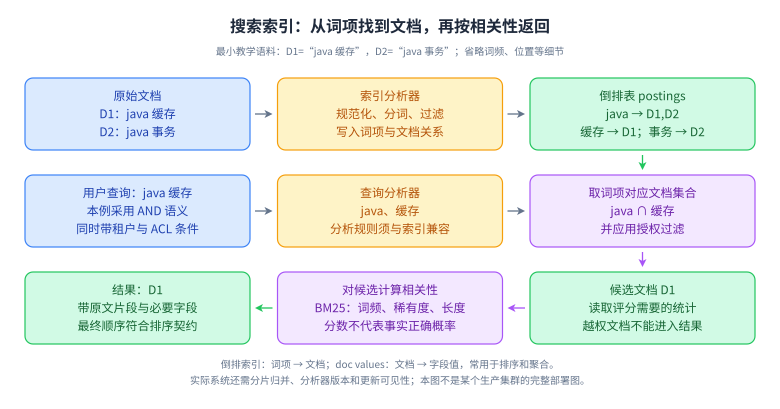
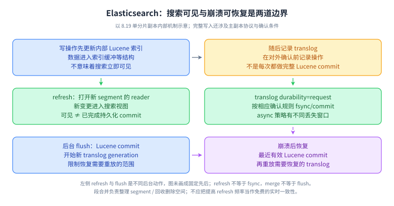
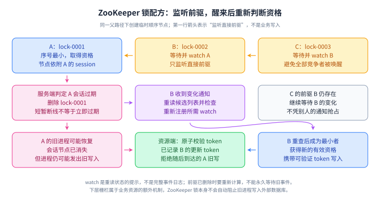

# 25 · 服务治理与搜索：从入口保护到索引一致性

## 目标、层级与适用范围

面向资深后端与 Agent 工程师补齐服务治理、任务调度和 Elasticsearch 检索基础。搜索机制按 Elasticsearch 8.19 官方文档核对；服务治理采用通用机制，并用 Kubernetes、NGINX、Resilience4j、Quartz 的官方材料说明具体实现边界。这里不把某一 SDK 默认配置当成所有版本的通用事实。

| 层级 | 专题 | 过关标准 |
| --- | --- | --- |
| L1 | 注册发现、负载均衡、限流、熔断、倒排索引 | 能定义概念并给出不同故障下的行为 |
| L2 | 算法、并发隔离、ID、调度、分析器、BM25、segment | 能从结构和状态解释结果 |
| L3 | 配置灰度、重试风暴、同步、深分页、权限 | 能画恢复流程并给出验证指标 |
| L4 | 多租户公平、容量、索引迁移、检索质量 | 能解释取舍、版本和回滚边界 |

## L1—L3 · 服务治理与任务调度

### Q1：服务注册发现与健康检查各解决什么问题？

**参考回答：**注册发现将稳定的服务身份映射到变化的实例地址，健康检查帮助判断哪些实例适合接收新流量。注册地址存在不等于业务可用，进程存活、依赖健康和准备接流量也不是同一个状态。客户端或代理还可能缓存旧地址，所以实例下线通常要先摘除、等待在途请求和连接排空，再终止进程。控制面短暂不可用时，能否继续使用本地缓存的实例列表需要明确策略，不能让已有健康服务立即一起停止。故障判定还要防误剔除导致剩余实例过载，监控路由版本、失败率与分区后的行为。

**深入追问与答案要点：**把所有依赖都加入存活探针合理吗？可能让共享依赖故障触发大量无效重启；存活、就绪和业务降级应分别设计，不能用重启代替等待依赖恢复。

### Q2：轮询、最少连接和响应时间负载均衡怎样选择？

**参考回答：**轮询或加权轮询适合请求成本和实例能力比较接近的场景，实现简单且容易解释。最少连接用连接数近似负载，但长连接、连接复用和请求并行会让连接数不等于在途工作。响应时间或在途请求反馈能适应慢节点，却可能因噪声、测量滞后和同步选择产生流量震荡。方案要结合协议、请求时长分布、实例异构和故障摘除，而不是挑一个听起来最智能的算法。新实例还需预热与逐步接流，避免冷缓存拖慢后被误判。验证应看每实例流量、排队、尾延迟和资源，不能只看平均负载均匀。

**深入追问与答案要点：**最少连接为什么未必适合 HTTP/2？一条连接可承载多个流，连接数量不能准确反映实际并发与工作量。

### Q3：一致性哈希与普通取模怎样影响扩容？

**参考回答：**普通按节点数取模在节点数量改变时会让大量键重新映射，一致性哈希通过稳定的映射空间减少增删节点时需要迁移的键范围。虚拟节点可以改善分布和按权重分配，但不能自动消除单个超级热点键，也不能保证任意样本完全均匀。路由算法、节点身份和版本必须在客户端之间一致，否则相同键会被送到不同后端。迁移时还要安排数据复制、旧请求和回退，哈希算法只决定去哪，不负责数据已到达。面试应先问是否真的需要键亲和，再比较缓存命中收益、负载偏斜和运维复杂度。

**深入追问与答案要点：**一致性哈希是否就是 Redis Cluster 的槽位机制？不是同一实现；Cluster 用固定槽位及显式归属迁移，两者都能减少部分重映射，但协议和操作不同。

### Q4：固定窗口、滑动窗口、漏桶与令牌桶有什么区别？

**参考回答：**固定窗口用较少状态统计周期内次数，但窗口边界两侧可能集中通过接近两倍限额。滑动日志能更精确检查最近时间段，代价是保存和清理事件；滑动计数用分桶近似换空间。漏桶常用于按稳定速度排出已接收工作，需要说明队列大小和超时；令牌桶按速率补充令牌并允许容量范围内的突发，更适合既限制平均速率又保留短时弹性。算法还需明确单位是请求、字节还是 token，不同请求成本不能默认相同。选择后应测试边界、时钟、突发和长时间空闲后恢复，而不只验证平均速率。

**深入追问与答案要点：**每秒一百个令牌、桶容量两百，是否任意一秒都至多一百请求？不是，已有令牌允许突发；约束应表达为持续补充速率与桶容量，而非简单固定窗口上限。

### Q5：单机限流与全局限流怎样组合才公平？

**参考回答：**每实例限流保护本地资源，但总允许量随实例数和流量分布变化，不自动满足全局租户配额。共享计数能接近全局控制，却引入中心依赖、热点和网络延迟；也可分配租户令牌预算到本地，以一定超发或利用率损失换可用性。设计要说明配额单位、窗口、突发、优先级和控制面故障时放行还是拒绝。收费额度与保护性限流对超发的容忍不同，不能共用未经区分的策略。多租户还应防单个大租户占满线程、连接或模型 token，即使全局 QPS 尚未触顶也要做公平隔离。

**深入追问与答案要点：**Redis 限流失败时应该 fail-open 吗？取决于业务损失与资源预算；能放行的必须有本地安全上限，不能把控制面故障变成无限请求进入依赖。

### Q6：熔断器的关闭、打开、半开怎样避免振荡？

**参考回答：**关闭状态允许调用并积累统计，失败或慢调用达到约定条件后打开，暂时快速拒绝；等待后进入半开，以受限探测判断依赖是否恢复，再关闭或重新打开。小样本、窗口大小和统计哪些异常会影响误判，所以参数错误、业务拒绝和基础设施失败应分类。打开状态不是把故障修好，只是减少无效压力，降级仍须明确业务语义。多个实例若同时探测会形成恢复波峰，可用抖动、有限探测并发与逐步放量缓解。熔断也不限制所有正常请求并发，必须配合超时、隔离与重试预算。

**深入追问与答案要点：**熔断窗口十次是不是最多允许十个并发？不是，统计窗口与并发限制是不同控制；并发需独立 bulkhead 或信号量。

### Q7：线程池隔离与信号量隔离怎样取舍？

**参考回答：**线程池隔离把依赖工作放入独立执行资源和有界队列，能限制某依赖拖住共享工作线程，但会增加调度、排队和上下文传播成本，取消也不保证底层 I/O 已停止。信号量限制同时进入的调用数，开销较低且适合多种执行模型，但不额外提供线程边界，阻塞依赖仍会占用调用线程。两者都要按下游安全容量和总 deadline 配置，队列过大只是把快速失败变成超时堆积。虚拟线程也不能替代并发限制，因为连接、内存和供应商配额仍然有限。隔离效果须通过一个依赖变慢时其他业务是否存活来验证。

**深入追问与答案要点：**每个接口独立线程池越多越安全吗？会增加总线程、队列和管理成本，还可能一起压同一个数据库；按故障域和关键性隔离更合理。

### Q8：动态配置为什么需要像代码发布一样管理？

**参考回答：**配置可以立即改变所有实例行为，错误的超时、路由、权限或线程数往往比小范围代码发布传播更快。应定义类型、范围和跨字段约束，保存版本与修改人，先验证再灰度，并能查询每个实例实际生效版本。多个相关参数需要按完整快照应用，避免读到一半新一半旧的组合。回滚不只是重新下发旧值，还要确认客户端接受和生效，处理不可动态改变的资源。配置中心不可用时使用最后已验证版本或明确失败策略，密钥独立管理并避免出现在日志。验收应覆盖错误推送、乱序、断连与重启恢复。

**深入追问与答案要点：**收到配置通知就代表已生效吗？通知、下载、验证、应用和业务行为改变是不同阶段；需要版本确认与实际指标，不能只看推送成功数。

### Q9：分布式 ID 怎样兼顾唯一、排序和生成可用性？

**参考回答：**先区分需要全局唯一、趋势有序、严格递增还是不可猜测，它们不是一个目标。数据库号段把协调成本摊薄但需要管理分配与耗尽；时间加节点和序列的方案依赖节点身份唯一、时钟处理及单时间片容量；随机或时间型 UUID 又有空间、索引局部性和碰撞模型的取舍。时钟回拨不能简单忽略，否则可能重发身份；等待、逻辑时钟或切换节点也须防跨重启重复。任何 ID 算法都不应被用作权限凭证，业务唯一性与请求幂等还需要自己的约束。我会用并发、回拨、重启和节点冲突实验验证。

**深入追问与答案要点：**UUIDv7 时间排序是否等于跨机器严格业务顺序？不是，时间精度、并发与时钟差异都影响顺序；严格顺序需要相应协调，而不能从 ID 外形推导。

### Q10：分布式定时任务怎样避免漏触发和重复副作用？

**参考回答：**持久化计划时间和任务身份后，调度器按到期范围抢占工作，执行状态与租约用于故障恢复。抢占成功不代表业务已经执行，执行成功也可能在确认前崩溃，所以最终副作用仍应带稳定幂等键。任务运行超过周期时，要明确禁止重叠、允许并发或跳过旧实例；停机后错过的触发要定义补跑、合并或忽略，不能让框架默认策略替产品决定。时间区、夏令时和时钟变化也影响日历调度。百万任务应考虑分桶、分片、批量扫描与公平性，并用最老到期任务年龄验证时效，而非只看调度器存活。

**深入追问与答案要点：**Quartz 集群一次抢到任务就能保证外部邮件只发一次吗？不能从触发所有权推导外部副作用原子性；故障恢复与业务幂等仍是独立问题。

## L1—L2 · 搜索的核心结构



**读图顺序：**上排把 D1、D2 分词并写倒排；中排把 `java 缓存` 按 AND 语义找交集；下排对 D1 评分并返回。**记忆锚点：**“词找文档用倒排，文档取字段做排序聚合常用 doc values”。**适用限制：**图省略分片和词位置，真实匹配语义取决于 query 与分析器；BM25 分数不是正确率。**闭卷重画：**把 AND 改为 OR，列出候选变成哪些文档；再给 D1 加越权标记，说明为什么不能只在最终页面隐藏它。

### Q11：倒排索引与 B+ 树适合解决什么不同问题？

**参考回答：**倒排索引从词项指向包含它的文档及相关统计，适合文本关键词的集合匹配和相关性计算。B+ 树围绕有序键导航，擅长等值、范围与有序扫描，两者的访问方向和优化目标不同。全文检索还涉及分词、词频、位置、短语和排名，不能通过给原文建一个普通数据库索引就获得相同能力。搜索引擎也不是无条件优于数据库，精确主键查询、事务约束和权威写入往往仍由数据库承担。架构上应明确搜索是派生视图还是权威源，并定义同步延迟、删除和权限传播，不能只比较一次查询的速度。

**深入追问与答案要点：**倒排列表只存文档 ID 吗？实际可含频率、位置等支持评分与短语的结构；配置可改变保存内容及功能，图中列表只是教学简化。

### Q12：索引分析器与查询分析器为什么必须一起设计？

**参考回答：**分析器将原文经过字符处理、分词和词项过滤形成可匹配词项，查询侧也可能进行相应处理。如果索引把复合词拆开，查询却按未经兼容处理的完整词匹配，可能召回不到；大小写、同义词、停用词和中文分词都会改变结果。更新分析规则不一定自动改变已经写入的文档，需要判断是查询侧可调整还是必须重建索引。同义词还可能增加查询展开、短语关系和误召回。设计要保存分析版本，用真实术语、缩写、人名和边界词测试，并观察召回与精确率，而不是只看几个正常例子匹配成功。

**深入追问与答案要点：**term query 与 match query 有什么区别？term 面向索引中的精确词项，match 通常先按字段分析规则处理输入；是否用于 keyword 或 text 要由 mapping 与意图决定。

### Q13：BM25 的词频、逆文档频率与长度归一化怎样影响排名？

**参考回答：**BM25 结合词在文档中的出现程度、词在语料中的稀有程度和文档长度等因素计算相关性。重复出现有收益但通常会饱和，稀有词常比到处都有的词更有区分度，长度归一化避免长文档只因词多占优。参数可以调节饱和与长度影响，但分数不是概率，也不能跨任意查询直接比较为统一质量。分片上的统计可能影响排名，业务字段加权也会改变结果。调参应使用标注查询集比较相关性指标和错误案例，再结合延迟与资源约束；不能凭单个查询的分数高低判断答案真实或适合用户。

**深入追问与答案要点：**文档更长就一定更差吗？不是，匹配词、频率、语料统计和参数共同作用；长度只是其中一项。相关性检索也不替代 Agent 的事实验证。



**读图顺序：**顶排是一笔索引变更及 translog；左侧 refresh 影响搜索可见，右侧持久化影响确认和恢复；底排是 Lucene commit 与 translog 恢复来源。**记忆锚点：**“refresh 管可见，flush 做 commit，merge 整理段”。**适用限制：**图是单分片内部简化，写确认还受复制协议和配置影响；不能用本图证明跨文档事务。**闭卷重画：**让进程在 refresh 后、完整 Lucene commit 前退出，说明 translog 为什么仍然重要。

### Q14：refresh、flush、merge 与更新删除有什么区别？

**参考回答：**refresh 让新的索引内容以可搜索的 segment 视图被打开，主要改变搜索可见性；flush 完成 Lucene commit 并开始新的 translog 代，控制恢复需要回放的范围；merge 合并多个 segment 并整理删除等开销。文档更新通常表现为新版本加入与旧版本失效，不是原地修改所有倒排结构，因此频繁更新会增加写入和合并压力。提高 refresh 频率有助于缩短可见延迟，但会制造更多小段与资源工作，不是免费实时化。排查应分清写入确认慢、搜索不可见慢和后台合并压力，不能把这三个操作混称刷盘。

**深入追问与答案要点：**删掉大量文档为什么磁盘未立即下降？逻辑删除与物理回收不同，空间释放依赖段合并等条件；线上强制合并也有昂贵资源代价。

### Q15：translog 与副本分别怎样支撑写入可靠性？

**参考回答：**每次写入不必立即完成昂贵的完整 Lucene commit，translog 保存恢复最近操作所需信息。其持久化模式影响何时刷盘与回复成功，异步策略和按请求策略具有不同丢失窗口。副本则在其他节点维护分片内容，为故障恢复和读取扩展服务，不能拿副本数量直接替代日志持久化讨论。完整确认需结合主副本写协议、参与副本与错误处理，而不是只看到主分片接受请求。客户端超时仍可能是结果未知，可使用稳定文档 ID 和适当版本条件恢复；搜索可见性受 refresh 影响，写成功也不保证马上被普通搜索查到。

**深入追问与答案要点：**要求写后立即搜索应一律 `refresh=true` 吗？可以研究 `refresh=wait_for` 等按需求等待策略，并验证吞吐代价；不要全局强制每次写立即刷新。

### Q16：主分片、副本分片与协调节点如何影响吞吐？

**参考回答：**主分片划分数据与写入责任，副本保存相同分片内容，协调节点接收请求并将搜索分发到所需分片副本，再归并结果。更多主分片增加并行度，也增加每次查询扇出、元数据、段和调度开销；更多副本可能提高读容量与容错，但写入复制及存储成本也增加。分片过多的小索引会消耗大量固定资源，单个过大的分片则影响迁移和恢复时间。规划从数据增长、查询模式、写入率与故障恢复目标出发，用真实分片大小和查询复杂度压测，不照抄固定分片数量或“越多越快”的经验。

**深入追问与答案要点：**每个查询都一定查全部分片吗？路由、索引选择与查询优化可以缩小范围；但不提供这些约束时，跨分片检索仍可能有广泛扇出。

### Q17：按租户 routing 的收益和隐藏风险是什么？

**参考回答：**自定义 routing 可让相关文档集中到特定分片，带同样路由的查询能够减少扇出，适合大量租户内访问。但大租户会集中成热点，查询收益与写入倾斜需要一起评估。索引、获取、更新和删除必须沿用正确路由，否则可能找不到或重复创建相同业务文档。只要用户能控制路由参数，就不能把它当权限边界，查询仍需服务端强制租户和授权过滤。为超级租户预留拆分、独立索引或多路由方案，并规划数据迁移。路由是数据分布策略，不会自动提供租户公平、唯一性或跨文档原子事务。

**深入追问与答案要点：**同一 `_id` 在不同 routing 下能否当全索引唯一键使用？不能无条件假设；业务文档 ID、路由一致性与去重约束应一起设计。

### Q18：text、keyword、nested 与动态 mapping 怎样避免建模错误？

**参考回答：**text 面向分析后的全文搜索，keyword 面向精确值、排序和聚合，常见字段可以分别保留两种视图，但要控制存储和字段数量。普通对象数组会展开字段，可能丢失同一数组元素内的对应关系，若查询要求同一对象的多字段共同匹配，应考虑 nested 并接受额外文档和查询成本。动态字段任意增长会造成 mapping 膨胀，类型推断也可能被第一批异常数据带偏。上线前明确字段类型、可空语义、日期格式和更新方式；改变已有类型通常要重建索引，而不是相信重新推送 mapping 就能改造历史数据。

**深入追问与答案要点：**商品有红色小号和蓝色大号，普通数组为何可能匹配“红色大号”？字段展开后关联丢失；用 nested 保持同元素条件，或采用适合访问模式的独立文档模型。

### Q19：bool query 的 must、filter、should、must_not 怎么避免逻辑错误？

**参考回答：**must 通常表达必须满足且参与评分的条件，filter 表达必须满足但不计算相关性贡献的条件，must_not 排除匹配，should 表达可选或按最少命中要求参与的条件。需要特别明确 minimum_should_match，不能假定有 should 就必然至少匹配一项；其他必选条件是否存在会影响默认行为。租户和权限通常应由服务端强制构造过滤，用户只提交允许的搜索意图，不能原样接收任意查询树。filter 适合精确约束，但不是每个过滤自动缓存或更快；性能仍取决于基数、复用和实际执行。先写逻辑真值例，再做相关性测试。

**深入追问与答案要点：**加入租户 filter 后 should 突然变得“太宽”怎么办？检查 minimum_should_match，显式写出需求；同时确保业务条件不是无意从必选变成加分项。

### Q20：doc values 与聚合为什么可能造成高内存压力？

**参考回答：**倒排索引擅长词找文档，而排序和聚合需要从文档读取字段值，doc values 提供适合这类访问的列式结构。聚合成本还受匹配文档数、字段基数、桶数量和分片归并影响，所以只返回十个桶也不等于只处理十条数据。分布式 terms 的局部候选截断可能导致计数近似，应理解返回的误差信息和排序限制；需要枚举大量桶可评估 composite 分页。不要为 text 字段随意开启高成本 fielddata 来绕过建模问题，通常先使用合适 keyword 字段并设置请求上限，再用代表性基数压测。

**深入追问与答案要点：**cardinality 得到的去重数总是精确吗？常采用近似算法和精度取舍，不能直接用于必须精确的账务约束；需明确误差与业务用途。

### Q21：from/size、search_after 与 PIT 怎样支持稳定深分页？

**参考回答：**深 from/size 需要各分片保留足够多的候选供协调节点归并，跳过越多通常越浪费内存与计算。search_after 使用上一页排序值继续查询，避免反复获取全部前序候选，但需要稳定排序与决胜键，不能任意跳到未知页。PIT 固定搜索所见的数据视图，减少分页间刷新造成的重复和遗漏；它有生命周期与保留资源成本，应用须及时续期或关闭。每页保持一致的 query、sort 和权限作用域，使用服务器返回的完整排序值。大量导出应单独限制资源，不能把交互检索与无限扫描混在同一预算。

**深入追问与答案要点：**只有 search_after 没有 PIT 就一定稳定吗？并发更新和排序变化仍可能改变结果；稳定性承诺需要说明视图与排序两方面的条件。

### Q22：数据库同步到搜索索引怎样处理重复、乱序和删除？

**参考回答：**权威数据库变更应通过可恢复日志或 Outbox 传播，索引文档使用稳定业务 ID，重复事件覆盖或条件更新时保持幂等。乱序必须有可比较的业务版本或分区顺序，不能让较早事件覆盖新状态；消费者时间戳未必能表达原始先后。删除也要有明确版本和保留策略，否则延迟旧更新可能把已删除文档重新创建。初次回填与增量同时进行时，要记录一致切点、追平进度并对账。监控最老未同步事件、失败文档和业务差异，而非只看连接器在线。权限撤销与用户删除应按更严格时效验证。

**深入追问与答案要点：**建新索引后切 alias 就完成迁移了吗？还需确认增量追平、删除同步、版本兼容、权限和回滚后的新写入去向；别名切换只解决访问入口的一步。

### Q23：搜索与 RAG 的授权过滤为什么要尽早实施？

**参考回答：**搜索结果不仅包括最终展示文档，还可能含摘要、高亮、聚合、建议词以及进入模型上下文的片段。如果先召回跨租户内容再在页面隐藏，敏感信息已经可能泄漏给模型、日志或统计结果。服务端应从可信身份生成租户与 ACL 条件，并确保过滤贯穿召回、重排、缓存与最终读取。缓存键要包含相应权限语义，权限撤销有明确生效时间和验证。近似向量检索的过滤也可能影响召回质量，需要用授权后的候选集评测，但不能为了召回率放宽权限。索引不是最终身份来源，必要时在读取原文前再校验。

**深入追问与答案要点：**只对 Top K 做事后过滤有什么问题？既可能提前暴露内容，也会留下不足 K 条的结果并扭曲召回；应评估检索阶段支持的过滤机制和安全边界。

### Q24：怎样设计一个能解释可靠性和相关性的企业搜索服务？

**参考回答：**先确定搜索对象、租户边界、查询类型和新鲜度目标，以数据库或文档源作为权威数据，构建带版本与授权字段的索引。入口做身份校验、限流与查询复杂度限制，检索按授权过滤后召回、排序并返回来源；缓存按身份语义隔离。同步链路可恢复、可对账，索引切换和删除传播有验证。质量用标注查询集衡量相关性与零结果原因，稳定性看尾延迟、超时、同步年龄和资源饱和，两者分开验收。故障时可降级到有限检索或明确失败，不应伪造结果。最后用增长十倍和丢失一节点检验容量假设。

**深入追问与答案要点：**提高召回数量总会改善 Agent 回答吗？可能增加噪声、上下文成本与延迟，应结合重排、证据质量、最终任务成功率和权限正确性做实验。

## L2—L4 · ZooKeeper 协调机制补充



读图先看序号最小的 A，再看 B 监听 A、C 监听 B；A 会话失效后 B 收到提示，重新读取并判定自己是否最小。记忆锚点：“节点反映会话，不等于进程停止；watch 是重读提示，不是可靠事件日志”。适用限制：这是传统 watch 的锁配方，不能据此推导所有读线性一致或外部资源自动安全。闭卷让 A 断网但进程继续运行，再画资源端如何拒绝 A 的旧写。

### Q25：ZooKeeper 临时节点、顺序节点与 session 怎样配合？

**参考回答：**临时节点与创建它的会话绑定，会话结束后由服务端删除，适合表达成员存活或候选资格；短暂断线不等于会话立即过期。顺序节点在同一父节点下按创建顺序附加序号，组合临时顺序节点可以让竞争者按序排队，最小者执行。客户端创建结果未知时，应凭稳定身份检查自己是否已建节点，避免重试生成多个候选。即便服务端删掉旧会话节点，旧进程仍可能恢复并继续访问外部数据库，因此锁配方还需资源端栅栏或业务约束。顺序号也有作用域，不能直接当作任意跨路径、跨重建的永久全局编号。

**深入追问与答案要点：**临时节点还在就说明进程健康吗？不一定，可能在会话超时窗口内或客户端已失去有效工作能力；它是协议状态，不是业务健康的完整证明。[官方：ZooKeeper 3.9.4 编程指南](https://zookeeper.apache.org/doc/r3.9.4/zookeeperProgrammers.html)

### Q26：watch 为什么不能当作可靠消息队列，锁配方为何监听前驱？

**参考回答：**传统 watch 通常是一次性变化通知，触发后客户端要重新读取状态并按需要重新注册；断线和重注册之间的多次变化不能当作完整事件流逐条处理。新版本还提供持久或递归 watch，但仍不应把它当作带业务确认与任意历史回放的队列。锁队列中每个候选只监听直接前驱，可避免最小节点删除时唤醒全部竞争者形成惊群。注册监听时前驱可能已经消失，应检查返回结果并重新计算，而非永远等待。通知后也要重新判断自己是否获得资格，并正确处理会话失效与重连，不能收到一个事件就直接执行业务写入。

**深入追问与答案要点：**只读取一次孩子列表，再 watch 当时的前驱是否无竞态？前驱可能在两步间消失；应通过 exists 等返回状态处理已不存在的情况，再重读循环。[官方：ZooKeeper 锁配方](https://zookeeper.apache.org/doc/r3.9.4/recipes.html)

## L4 · 算法、查询与故障取舍演练

### 练习 A：固定窗口边界与令牌桶

固定窗口每秒 100 次，前一秒最后 10ms 放行 100 次，后一秒最初 10ms 再放行 100 次。参考：20ms 内可能通过 200 次，平均约束不能当作任意短窗口约束。令牌桶补充 100/s、容量 200、初始满桶，在 t=0 同时来 250 个单位成本请求；不排队且补充可忽略时，最多立即放行 200，拒绝 50。若请求按 token 计费，应按实际成本扣额度并处理结果未知。

### 练习 B：隔离与总 deadline

总预算 600ms，入口已用 50ms，响应预留 50ms；剩下 500ms。第一次下游耗时 350ms、退避 80ms，第二次最多只有 70ms。参考：不应再套独立 500ms 超时；信号量申请等待和线程池排队也要计入。模拟一个依赖卡住，验证另一业务的连接、线程与成功率不被耗尽。

### 练习 C：最小倒排表

D1=`java 缓存`、D2=`java 事务`、D3=`缓存 事务`。手工生成 `java:[D1,D2]`、`缓存:[D1,D3]`、`事务:[D2,D3]`。查询 `java AND 缓存` 得 D1；OR 得三篇。参考：这只验证集合语义，排名需要词频、长度和语料统计；不能凭集合大小推算 BM25 数值。

### 练习 D：明确 bool 查询与授权

下面 JSON 是教学查询体，假设 `tenant_id` 为 keyword、`title` 为 text，分析器已配置。服务端填入可信租户值，客户端不能自行扩大范围。

```json
{
  "query": {
    "bool": {
      "filter": [{"term": {"tenant_id": "tenant-a"}}],
      "should": [
        {"match": {"title": "java"}},
        {"match": {"title": "缓存"}}
      ],
      "minimum_should_match": 1
    }
  },
  "size": 10
}
```

参考：只允许 tenant-a 且至少匹配一个 should；删除显式最少命中要求后，应重新检查 bool 默认语义，不能仍声称所有结果必须匹配关键词。测试租户相同但无关键词、关键词匹配但跨租户两类反例。

### 练习 E：同步乱序与索引切换

按业务版本 v10 更新、v11 删除，再让重试的 v10 最后到达。参考：需拒绝过期版本并防删除墓碑过早清理后的复活。然后做新索引全量构建和增量追平，记录追平切点、抽样差异与 alias 切换；切换后写入 v12 再回滚，必须说明 v12 如何保留。

## 闭卷过关标准

随机抽五题，分别覆盖流量保护、协调与搜索；每题能给一条适用条件和一条反例。独立画出令牌桶突发、熔断半开探测、ZooKeeper 前驱监听和搜索可见/持久化边界。准确手算两组时间预算，并在不看答案时解释练习 D 的允许/拒绝结果。最后设计一次权限撤销与索引重建并发场景，说明传播时效、回退和验证证据；只有组件名称不算完成。

## 官方来源与核对边界

核对日期 2026-10-04。通用算法推导、容量数字和练习为原创；产品实现依下列官方材料限定范围。

- 发现与路由：[Kubernetes Service](https://kubernetes.io/docs/concepts/services-networking/service/)、[NGINX upstream](https://nginx.org/en/docs/http/ngx_http_upstream_module.html)。产品版别与默认策略需按实际版本确认。
- 保护机制：[Resilience4j CircuitBreaker](https://resilience4j.readme.io/docs/circuitbreaker)、[Bulkhead](https://resilience4j.readme.io/docs/bulkhead)、[RateLimiter](https://resilience4j.readme.io/docs/ratelimiter)、[Envoy 本地令牌桶](https://www.envoyproxy.io/docs/envoy/latest/intro/arch_overview/other_features/local_rate_limiting.html)。
- 身份与调度：[UUID RFC 9562](https://www.rfc-editor.org/rfc/rfc9562.html)、[Quartz JDBC 集群](https://www.quartz-scheduler.org/documentation/quartz-2.3.0/configuration/ConfigJDBCJobStoreClustering.html)。时间加节点 ID 是通用设计类，不把某实现固定比特位数推广为统一标准。
- ES 8.19 搜索：[分析器](https://www.elastic.co/guide/en/elasticsearch/reference/8.19/analysis.html)、[BM25 similarity](https://www.elastic.co/guide/en/elasticsearch/reference/8.19/index-modules-similarity.html)、[mapping](https://www.elastic.co/guide/en/elasticsearch/reference/8.19/mapping.html)、[nested](https://www.elastic.co/guide/en/elasticsearch/reference/8.19/nested.html)、[bool query](https://www.elastic.co/guide/en/elasticsearch/reference/8.19/query-dsl-bool-query.html)、[doc values](https://www.elastic.co/guide/en/elasticsearch/reference/8.19/doc-values.html)。
- ES 8.19 存储与分页：[近实时搜索](https://www.elastic.co/guide/en/elasticsearch/reference/8.19/near-real-time.html)、[translog](https://www.elastic.co/guide/en/elasticsearch/reference/8.19/index-modules-translog.html)、[merge](https://www.elastic.co/guide/en/elasticsearch/reference/8.19/index-modules-merge.html)、[主副本读写](https://www.elastic.co/guide/en/elasticsearch/reference/8.19/docs-replication.html)、[routing](https://www.elastic.co/guide/en/elasticsearch/reference/8.19/search-shard-routing.html)、[terms 聚合](https://www.elastic.co/guide/en/elasticsearch/reference/8.19/search-aggregations-bucket-terms-aggregation.html)、[cardinality](https://www.elastic.co/guide/en/elasticsearch/reference/8.19/search-aggregations-metrics-cardinality-aggregation.html)、[深分页与 PIT](https://www.elastic.co/guide/en/elasticsearch/reference/8.19/paginate-search-results.html)、[alias](https://www.elastic.co/guide/en/elasticsearch/reference/8.19/aliases.html)。
