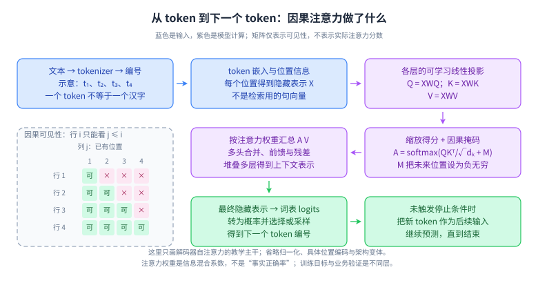
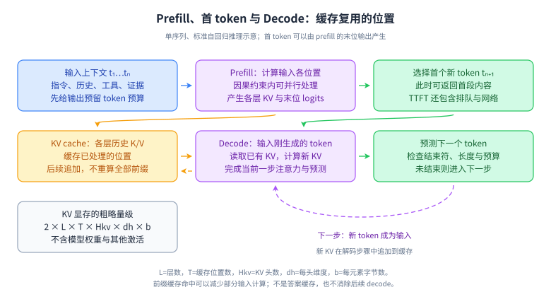

# 26｜LLM 深入：模型机制、训练目标与推理工程

定位：Agent 应用工程的 P1 深入；训练目标的数学推导、分布式训练实现属于 P2。前置：[15 章](15-llm-foundations.md)、矩阵乘法、概率分布、吞吐与延迟。目标是解释机制如何影响系统选择，不要求应用工程师从零训练基础模型。资料核对：2026-10-04；不把某篇论文的特定模型收益当成所有硬件与任务的保证。

## 主题覆盖清单

- 输入与模型：tokenizer、预测目标、Q/K/V、mask、位置、残差、归一化、MHA/MQA/GQA、MoE。
- 训练与适配：预训练、SFT、LoRA、偏好数据、DPO、RL、蒸馏与评测泄漏。
- 推理与交付：prefill/decode、KV 容量、前缀缓存、量化、连续批处理、推测解码、模型路由。
- 必须产出：一张模型主干图、一个 KV 内存估算、一份质量—成本—延迟对照实验。

## L1｜先建立四个层次

模型架构决定信息如何流动；训练目标和数据决定学到什么；推理策略决定怎样生成与调度；业务运行时决定能否安全完成任务。SFT 不是一种网络层，LoRA 不是检索算法，量化不是减少上下文，MoE 也不是多个业务 Agent 对话。回答时先定位层次，再解释机制与代价。

| 名称 | 主要改变什么 | 不能直接解决什么 |
|---|---|---|
| SFT | 用示范数据学习任务行为 | 实时知识、运行时授权 |
| LoRA | 以低秩更新减少可训练参数 | 自动生成高质量标签 |
| DPO / RL | 偏好或奖励驱动的行为优化 | 保证事实正确、杜绝投机 |
| 量化 | 数值表示及计算/存储路径 | 必然等比例提速 |
| GQA / MQA | 查询头共享 KV 的方式 | 删除所有注意力计算 |
| 连续批处理 | 请求在推理批次中的调度 | 无限显存与无限并发 |

## L2｜机制图与最小数学



**读图顺序：**输入编号 → 隐藏表示 → Q/K/V → 得分与因果掩码 → 加权 V → 词表输出。**记忆点：**匹配用 Q/K，汇总用 V；位置关系另有编码机制。**简化边界：**图示常见解码器路径，省略架构变体与训练反向传播。**闭卷重画：**为四个位置画出允许访问的三角区域，并解释为何当前位置能用于预测下一位置。

给定前缀，语言模型学习 `P(xₜ | x₁,…,xₜ₋₁)`。交叉熵损失可以理解为真实后续 token 被赋予的概率越低，惩罚越大。训练时各位置的监督可在因果 mask 下并行计算；生成时下一个输入尚未产生，标准自回归过程需要逐步推进。[Transformer 原论文](https://arxiv.org/abs/1706.03762)

注意力 `softmax(QKᵀ/√dₖ + M)V` 中，`dₖ` 是每个头的查询/键维度，M 屏蔽未来位置。若序列长度为 n，标准稠密注意力涉及位置两两关联，计算与中间存储不能只按 n 估算；优化内核可减少读写与显式中间矩阵，并不因此让所有长序列成本消失。



**读图顺序：**先看 prefill 产生首 token，再看 decode 与 KV 读写。**记忆点：**容量瓶颈可能是 KV，不只是权重。**简化边界：**图为单序列基本过程，不含批调度与分布式通信。**闭卷重画：**在缓存长度翻倍和并发数翻倍时，分别标出增长的内存项。

### 蒸馏与评测泄漏：能力转移不等于复制保证

蒸馏让学生模型学习教师提供的目标，例如软概率分布或经筛选的输出示范，目的是把某些行为迁移到更便于部署的模型。软目标可以保留“哪个错误选项更相近”的信息；只拿教师最终文本做监督，与可访问完整 logits 的训练条件不同。它与量化的区别是：量化主要改数值表示，蒸馏涉及用学习目标训练学生。学生容量、任务分布和教师错误都会限制结果，不能把教师在复杂任务上的能力自动等价转移给小模型。[蒸馏原论文](https://arxiv.org/abs/1503.02531)

应用案例：从允许使用的客服训练问题生成教师示范，先用权威资料和规则筛除错误，再训练学生处理稳定分类；复杂问题保留升级路径。对照实验要同时算教师数据生成成本、学生调用成本、误路由和升级比例。学生在简单题更便宜，不足以证明整个系统更省。

评测泄漏包括训练直接出现测试答案、同一原文的近重复样本被分到训练与测试两边，以及反复根据最终测试集调提示或选模型。它使分数更像“见过这些题后的表现”，削弱对新任务的推断。应按文档、时间或业务实体适当分组，去除近重复，分开训练、开发与最终评估集，并记录数据来源；无法确认基础模型预训练污染时，要如实说明，增加新写任务与线上保留集。RAG 按任务允许检索真实知识不等于泄漏金标准答案，关键在于评测定义允许模型获得什么输入。

**闭卷验证：**把同一政策的三个改写问句随机拆入训练和测试，为什么分数可能虚高？参考答案：改写没有消除共享答案与证据，按来源分组才能更好地检验迁移到未见资料或任务的表现；若目标本来就是固定政策问答，则需另设新问法、时间版本和无答案题，不能混淆两种泛化目标。

## L3｜二十道深入问答

### Q1：tokenizer 为什么影响成本、长度与多语言表现？

**参考回答：**Tokenizer 把文本转换为模型词表中的编号，单位可能是子词、字节或其组合，不等于汉字数或英文单词数。同一段中文、代码和特殊符号在不同词表下可能产生不同长度，影响上下文占用与计费。模型参数与分词器需要配套，不能随便替换后仍期待原含义不变。我会用目标模型的实际分词器测领域样本，保留特殊 token 和模板开销，再估算预算。分词更短也不必然意味着任务能力更强，还要看训练数据与语义任务评测。

**追问：BPE 与 SentencePiece 是同义词吗？**不是。BPE 是一种子词学习方法；SentencePiece 是支持多种子词模型的工具体系，不能把实现工具与算法混为一谈。[SentencePiece 论文](https://arxiv.org/abs/1808.06226)

### Q2：训练能并行，为什么生成还要一个 token 一个 token 地做？

**参考回答：**训练时整段示范文本已经存在，模型在因果 mask 下可并行计算多个位置，并分别预测各自的后续 token。推理时未来 token 尚未确定，标准自回归生成必须先得到当前输出，再把它作为下一步条件。两者的依赖关系不同，不是硬件突然不支持并行。推理仍可以并行计算一个位置的矩阵操作、同时处理多个请求，或用推测解码提出候选后验证。应用侧要区分 token 之间的顺序依赖与请求之间可以利用的并行空间。

**追问：teacher forcing 有什么边界？**训练条件通常来自真实前缀，推理条件包含模型自己的输出；生成错误可能影响后续步骤，不能把训练损失直接等同完整任务成功率。

### Q3：Q、K、V 分别是什么，为什么不用一个向量？

**参考回答：**它们通常是同一层输入表示经过不同可学习投影得到的向量。Q 表示当前位置要匹配什么，K 表示被匹配位置提供什么线索，V 是按注意力权重汇总的信息。分别投影使匹配空间与信息内容可以学习不同功能，多头又允许多组子空间组合。这个比喻只帮助理解，不能把 Q 看成自然语言问题或把 K 当人工标签。工程上理解这三者，可以解释为何生成时复用历史 K/V，却仍需为当前输入计算查询与新的表示。

**追问：K/V 是整个模型唯一一份吗？**不是。通常每层、每个相关头都有各自的 K/V；缓存容量还取决于模型采用 MHA、GQA 或其他注意力结构。

### Q4：为什么注意力要缩放、softmax 和因果 mask？

**参考回答：**点积衡量查询与键的匹配，在一定分布假设下，维度增大会增大点积波动，除以维度平方根可控制量级。softmax 把每个查询对候选位置的得分变成归一化权重，再用于汇总 V。因果 mask 把未来位置排除，避免训练或生成时读取不应可见的信息。这三者职责不同：缩放不是权限，mask 不是采样，softmax 概率也不是事实正确率。部署时输入填充还可能有 padding mask，需要与因果约束一起正确处理，并避免整行都被屏蔽后出现数值异常。

**追问：只把未来得分设成 0 行吗？**一般不行，softmax 后仍可能获得权重；通常在 softmax 前使用负无穷或数值上足够负的掩码值。

### Q5：多头注意力带来什么，头越多越好吗？

**参考回答：**多头把表示投影到多个子空间，分别计算信息关联，再合并成输出，允许模型同时表达不同类型的关系。它不意味着每个头都被人工指定为语法、指代或事实检查器，也不能保证增加头数就提高质量。在隐藏维度固定时，头数增加通常意味着每头维度减少，计算、内存和训练效果共同受结构影响。应用工程师通常不直接改头数，而是理解模型配置对 KV、硬件内核与推理容量的影响，并对选定模型做任务验证。

**追问：能只看注意力图解释全部决策吗？**不能。输出还经过多层投影、残差与前馈网络；注意力权重不是完整因果解释，也不是可直接用于业务授权的证据。

### Q6：没有位置编码，模型为什么难以理解顺序？RoPE 做了什么？

**参考回答：**注意力本身根据向量内容关联位置，如果没有额外顺序信息，其结构不足以表达我们需要的序列位置关系。位置编码把绝对或相对位置信息引入表示或注意力计算。RoPE 对 Q/K 施加随位置变化的旋转，使点积具有相对位置信息，具体维度与频率由模型设计决定。它不是简单把位置数字拼接到文本，也不保证训练长度之外仍然可靠。长上下文扩展需要结合训练、位置缩放和任务评测，不能只改配置中的窗口上限。

**追问：能在旧模型上直接换成另一种位置编码吗？**通常不应直接替换；参数与位置机制共同训练，修改后需要专门适配及质量验证。[RoFormer 论文](https://arxiv.org/abs/2104.09864)

### Q7：残差连接、归一化和前馈网络分别解决什么？

**参考回答：**注意力负责跨位置混合信息，前馈网络对各位置表示做非线性变换；残差让层输入可以绕过子层与新结果合并，帮助深层信息和梯度传播；归一化控制表示尺度并影响训练稳定性。它们共同组成计算块，不能把 Transformer 简化成一个注意力公式。不同模型的归一化种类及放置顺序可能不同，不能根据一张入门图推断全部实现。面试中我会先说明教学结构，再标出当前讨论模型的差异，而不背一套固定层数。

**追问：LayerNorm 和 RMSNorm 完全一样吗？**不是，后者通常不做均值中心化，二者计算及参数不同；其效果要结合完整架构和训练设置理解。

### Q8：MHA、MQA 与 GQA 怎样影响 KV cache？

**参考回答：**MHA 通常为查询头配备对应的 K/V 头；MQA 让多个查询头共享一组 K/V；GQA 则让查询头分组共享 K/V，在两者之间取折中。它们都保留多个查询头，主要改变历史 K/V 的存储与读取需求。减少 KV 头可能降低推理内存和带宽压力，但质量、并行方式与硬件效率也会变化。我会以 KV 头数而不是查询头数估算缓存，并核对服务框架是否支持模型配置，不能把论文中某一组速度收益当通用结论，还要验证混合长度负载下的真实收益。

**追问：已有 MHA 权重能直接删头变 MQA 吗？**不能默认无损；转换或再训练需要专门方法与评测。[GQA 原论文](https://arxiv.org/abs/2305.13245)

### Q9：MoE 是不是多个大模型开会？

**参考回答：**常见稀疏 MoE 在模型层内使用路由器，为每个 token 选择少数专家模块参与计算；它是网络架构，不是多个业务 Agent 交换消息。总参数量可以很大，但每个 token 激活的参数较少，因此不能只按总参数推算计算量。不过未被当前 token 使用的专家仍可能需要驻留或分布在设备上，路由、负载不均和跨卡通信都有成本。我会同时看总参数、激活参数、模型驻留方式与实际负载，避免只依据宣传参数判断部署需求。

**追问：稀疏就一定比稠密快吗？**不一定。硬件、批量、通信与专家负载都会改变收益，低并发尤其需要实测。[Switch Transformer 论文](https://arxiv.org/abs/2101.03961)

### Q10：如何区分 prefill 慢、decode 慢与排队慢？

**参考回答：**我同时记录请求到达、开始推理、首 token 和完整结束时刻，并关联输入长度、输出长度、并发与 GPU 负载。首 token 慢可能来自排队或长输入计算，不能都归因于 prefill；首包正常但后续缓慢，需要看每 token 时间、批调度、带宽和工具插入。Prefill 的末位输出可以产生第一个新 token，后续标准 decode 才逐步处理已生成 token。优化前先分桶比较长短输入输出，避免通过缩短回答而把质量下降误报为推理改进，还要区分服务端首个输出与客户端首次显示。

**追问：总 token/秒高说明用户体验好吗？**不一定。系统吞吐高可能伴随更长排队或单请求等待，必须同时观察 TTFT、完整延迟和 SLO 达标率。

### Q11：如何估算 KV cache 显存？

**参考回答：**常规全注意力模型中，单序列可先用二乘层数、缓存长度、KV 头数、每头维度和每元素字节数估算，二代表 K 与 V。再按实际同时驻留的序列长度累加，不能一律用最大窗口乘请求数当实际用量。这个公式只估 KV，不含模型权重、激活、临时工作区、分配碎片和跨卡复制。采用滑动窗口、KV 压缩或不同层配置时还要改公式。容量规划应留余量并在长上下文、混合长度和峰值并发下压测，同时检查缓存分配与回收策略。

**追问：显存够放模型就够上线吗？**不够。生成过程还持续增长 KV；权重能加载与目标并发下可稳定服务是不同容量问题。

### Q12：前缀缓存、KV cache 和答案缓存有什么区别？

**参考回答：**KV cache 是推理中复用已经处理位置的注意力状态；跨请求前缀缓存复用匹配前缀的计算结果；答案缓存直接复用最终业务输出。前两者通常仍需要对新输入与后续 token 推理，第三种则可能绕过整次生成。我会分别设计命中条件、失效、隔离与监控。前缀通常要求兼容的模型和准确 token 序列，语义相似不足以证明状态可复用。业务答案还受用户权限、知识版本与实时状态影响，更不能只用问题文本做全局缓存键。

**追问：公共 system prompt 可以缓存吗？**取决于运行时支持和隔离策略；不得通过共享缓存泄露私有前缀或把不同模型、适配器状态混用。[vLLM 缓存设计](https://docs.vllm.ai/en/latest/design/prefix_caching/)

### Q13：把模型量化成 4 bit，为什么不一定快四倍？

**参考回答：**量化用较低精度表示权重或激活，理论存储量可以下降，但实际还有尺度、分组元数据、部分高精度层和临时缓冲。速度取决于硬件是否有合适内核、计算是否需要反量化、瓶颈在计算还是带宽，以及批量大小。权重量化也不自动压缩 KV。我会在目标硬件上比较显存、吞吐、尾延迟和任务质量，特别检查数字、工具参数和长上下文反例。不能用参数位宽之比直接承诺总服务成本或延迟等比例下降。

**追问：训练后量化需要看数据吗？**部分方法需要代表性校准数据；量化误差与层敏感度会影响输出，应使用独立任务集验证。[GPTQ 论文](https://arxiv.org/abs/2210.17323)

### Q14：LoRA 为什么能减少微调成本？

**参考回答：**LoRA 冻结基础权重，在选定矩阵旁学习低秩更新，例如把变化写成两个较小矩阵的乘积。可训练参数及对应梯度、优化器状态减少，因此适配成本可能下降；但基础模型的前向计算与驻留仍然存在。秩、作用层、数据量与任务决定效果，低秩不是必然足够表达所有变化。部署时可评估合并更新或动态加载适配器，并把基础模型、分词器和适配器版本绑定，防止错误组合。它改变适配方式，不替代高质量示范和独立评测。

**追问：LoRA 和量化是二选一吗？**不是，可以组合，但量化训练与推理路径、适配器合并和质量回归都要重新核验。[LoRA 论文](https://arxiv.org/abs/2106.09685)

### Q15：SFT 数据应该怎样组织，最常见的失败是什么？

**参考回答：**SFT 使用输入与期望输出示范学习目标行为，例如稳定抽取或正确选择工具。数据应覆盖正常、模糊、缺信息、拒答和异常路径，输出符合真实工具契约，而不只是大量漂亮答案。常见失败包括标签矛盾、只覆盖顺利路径、训练测试泄漏以及训练模板与线上不同。我会先定义错误分类，抽查质量，再用独立集衡量泛化与原有能力退化。对动态企业事实优先使用检索或工具，避免把频繁变更数据硬写进权重后又无法追溯删除。

**追问：示范越长越好吗？**不一定。冗长答案会影响行为和成本；保留解决任务所需的可观察步骤与正确结果，不强求无法核实的内部思维叙述。

### Q16：DPO 和 SFT 有什么不同？

**参考回答：**SFT 主要学习给定示范输出，DPO 使用同一输入下被偏好与不被偏好的回答对，直接优化偏好关系，并通过参考策略等设计约束行为变化。经典 DPO 不需要先单独训练一个显式奖励模型再运行 PPO，但仍依赖偏好数据质量与建模假设。它不是“只要用户点赞就自动训练成功”。我会检查偏好依据是否与业务目标一致、难例是否覆盖、是否过度偏好长答案，并评估事实质量、拒答、工具执行及原有能力。

**追问：DPO 能保证赢家答案事实正确吗？**不能，标签可能只代表表达偏好；要把事实和业务效果纳入标注与评测。[DPO 原论文](https://arxiv.org/abs/2305.18290)

### Q17：RLHF 或奖励训练怎样与 Agent 业务成功联系？

**参考回答：**奖励训练根据输出或轨迹的反馈更新策略，可使用人工偏好、奖励模型或可验证结果。它可能改善多步决策，但奖励只是目标的代理，模型可能学会迎合评分而非真正完成任务。例如只奖励“创建成功”文本，不能保证工单真实落库。我会优先采用可验证业务状态和过程约束，隔离训练与测试环境，监控奖励上升但真实成功率下降的情况。训练优化不能取消运行时的权限、预算和副作用校验，线上控制仍必须独立存在。

**追问：KL 约束直观上做什么？**限制新策略过度偏离参考行为，帮助控制优化幅度；并不构成事实或安全保证。[人类反馈训练论文](https://arxiv.org/abs/2203.02155)

### Q18：连续批处理为什么比固定批次更适合生成服务？

**参考回答：**不同请求生成长度不同，固定批次可能让已完成位置空置，或让新请求等待整个批次结束。连续批处理在生成调度点移出完成请求、加入新请求，提高资源利用率。代价是调度、KV 分配和公平性更复杂，长 prefill 还可能影响正在 decode 的请求。我会同时设置 token 与序列预算，结合分块 prefill、队列和优先级评估吞吐及尾延迟。不能只报告每秒总 token，也要检查短请求是否被长请求拖慢、超时取消能否释放资源。

**追问：批量越大越好吗？**受显存、带宽、排队与 SLO 限制；寻找目标负载下的可接受区间，而不是单独最大化吞吐。[PagedAttention 论文](https://arxiv.org/abs/2309.06180)

### Q19：推测解码为什么有时提速、有时不划算？

**参考回答：**推测解码让较便宜的提议过程先生成若干候选，目标模型再验证，可在一轮验证中接受多个 token，从而减少昂贵串行步骤。收益取决于候选接受率、提议成本、验证并行效率和实际硬件。若草稿质量差或本来已经计算饱和，额外工作可能抵消收益。某些严格算法在相应采样假设下保持目标分布，但不能把所有启发式实现都说成无损。我会同时比较质量、接受率、吞吐和单请求延迟，并记录服务版本。

**追问：保持分布等于每次输出逐字相同吗？**不是。分布一致与同一种子、同一实现得到相同样本是不同命题。[推测解码原论文](https://arxiv.org/abs/2211.17192)

### Q20：模型路由与私有部署怎样做技术选型？

**参考回答：**先固定业务任务与约束，再比较规则、小模型、大模型和自托管方案的完整成本。自托管要计入硬件利用率、容量余量、运维、模型更新及故障值守，不能只比较公开单价与电费。模型路由则要测误路由、失败识别和升级调用，简单题便宜不代表整体便宜。我会用真实脱敏分布测试业务成功率、质量边界、尾延迟、数据处理要求与峰值容量，给出灰度和回滚方案。公开排行榜只作候选筛选，不能代替本业务验证。

**追问：如果没有足够任务数据？**先建立小而可审核的种子集和规则基线，逐步补真实失败；明确样本不确定性，不凭几个演示决定大规模采购。

## L4｜设计算例与练习验证

**KV 算例：**教学配置 L=32、Hkv=8、dh=128、T=8192、b=2，单序列为 `2×32×8×128×8192×2 = 1,073,741,824` 字节，即 1 GiB；十条同长度序列仅 KV 就约 10 GiB。若 Hkv=32，则相同假设下为 4 GiB/序列。这不是任何产品的实际配置或显存承诺。

```python
def kv_bytes(layers, length, kv_heads, head_dim, bytes_per_element):
    if min(layers, length, kv_heads, head_dim, bytes_per_element) <= 0:
        raise ValueError("参数必须为正")
    return 2 * layers * length * kv_heads * head_dim * bytes_per_element

assert kv_bytes(32, 8192, 8, 128, 2) == 1024 ** 3
```

**实验设计：**固定 100 个脱敏任务与输出验收条件，将输入和预期输出长度分桶；分别改变模型、量化或调度参数，每次只改变一个可解释因素。收集排队、TTFT、完整延迟、usage、成功率及工具错误，不把“回答缩短”与“相同质量更快”混为一谈。该段是待执行设计，不声称已测真实模型。

**闭卷验收：**能完整解释二十题中随机五题；手算一次 KV；指出 LoRA、量化、RAG 作用层不同；为一个“更快但更容易调错工具”的模型写出是否上线的证据要求。需要背的是因果关系、变量与适用条件，不是某个模型暂时的价格或排名。

## 一手资料索引

1. [Transformer](https://arxiv.org/abs/1706.03762)、[RoFormer](https://arxiv.org/abs/2104.09864)、[GQA](https://arxiv.org/abs/2305.13245)：注意力、位置与 KV 共享。
2. [Switch Transformer](https://arxiv.org/abs/2101.03961)、[LoRA](https://arxiv.org/abs/2106.09685)：稀疏专家和参数高效适配是不同层次。
3. [DPO](https://arxiv.org/abs/2305.18290)、[人类反馈训练](https://arxiv.org/abs/2203.02155)：偏好数据、优化目标与奖励边界。
4. [GPTQ](https://arxiv.org/abs/2210.17323)、[PagedAttention](https://arxiv.org/abs/2309.06180)、[推测解码](https://arxiv.org/abs/2211.17192)：数值表示、内存管理与推理策略。
5. [SentencePiece](https://arxiv.org/abs/1808.06226)、[vLLM 前缀缓存设计](https://docs.vllm.ai/en/latest/design/prefix_caching/)：输入表示与缓存复用条件。

[返回项目首页](../README.md) · [下一章：检索与记忆深入](27-rag-memory-retrieval-deep.md)
