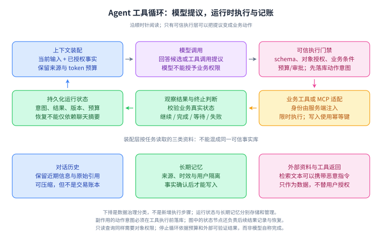
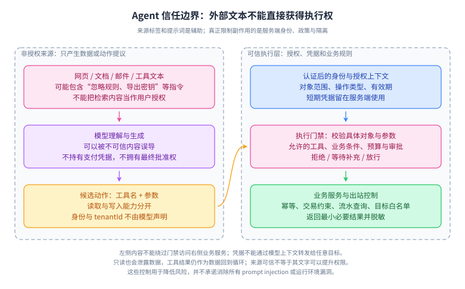
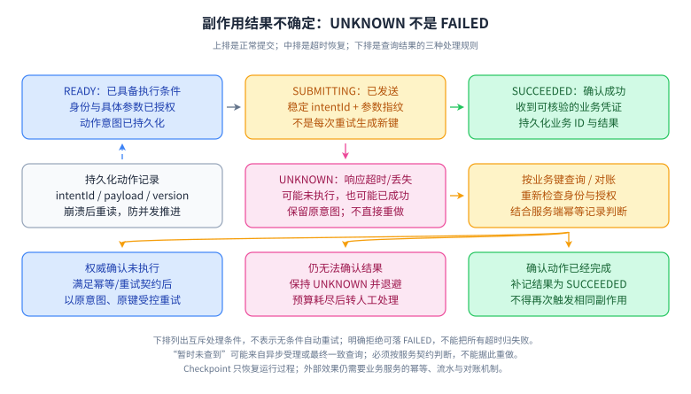

# 28｜Agent 深入：协议、执行可靠性与 Java 交付

定位：Agent 应用工程 P1。前置：[17 章](17-agent-architecture.md)、[18 章](18-agent-production.md)、鉴权、事务、幂等、超时与消息处理。资料核对：2026-10-04。MCP 示例固定 **2025-06-18 协议版本**，A2A 固定 **1.0.0 规范**；它们是明确的学习基线，不代表所有现有客户端或服务端采用相同版本。升级时核对协商、传输、授权与 SDK 兼容性。

## 主题覆盖清单

- 编排：workflow、Agent、ReAct、计划与反馈、并行、取消、截止时间、预算。
- 契约：工具 schema、结构与业务校验、可信身份、幂等、副作用、审批绑定。
- 协议：MCP host/client/server、tools/resources/prompts、stdio/HTTP、授权；A2A 任务协作。
- 运行时：持久化执行、重放、不确定状态、版本迁移、长期记忆、多 Agent 隔离。
- 交付：评测、trace、提示注入、模型路由、流式输出、Java 接入与故障演练。
- 必须产出：一张信任边界图、一份工具契约、一条超时后的恢复路径和可运行验证。

## L1｜先说清楚谁有权做什么

模型产生文字或动作提议；编排运行时决定推进、停止、重试和等待；策略层决定身份、权限与预算；业务服务执行并持有权威状态；持久化记录帮助恢复与审计。框架可以承接其中多个实现，但职责不能因此混在一起。

| 概念 | 解决的问题 | 仍需应用负责 |
|---|---|---|
| 工具调用 | 让模型提出结构化动作 | 授权、业务校验与执行结果 |
| MCP | 客户端与能力服务的互操作 | 服务可信度、业务权限与隔离 |
| A2A | Agent 之间的任务与产物交换 | 任务质量、身份与业务约束 |
| Durable execution | 进程中断后重建执行进度 | 外部副作用幂等与版本兼容 |
| Skill | 可复用的任务知识或操作流程 | 具体格式、加载策略和执行权限 |
| 多 Agent | 分工与独立执行上下文 | 协作成本、共享状态与信息泄漏 |

## L2｜工具循环、信任边界与恢复



**读图顺序：**上下文 → 模型 → 策略门 → 工具 → 观察 → 状态，再建立下一轮上下文。**关键记忆点：**持久化动作意图发生在外部副作用之前，结果记录发生在观察之后。**简化边界：**图没有展开数据库事务和 worker 租约；它们要与具体并发实现一起设计。**闭卷重画：**分别在“提交意图前、外部调用中、结果落库前”画崩溃点，说明恢复能知道什么。



**读图顺序：**左侧资料进入模型，模型提议跨到右侧策略门，右侧身份与授权独立参与判断。**关键记忆点：**资料里的指令不能变成权限，工具说明也不自动证明工具可信。**简化边界：**模型与策略门之间的输出可以校验，但模型看到的敏感输入仍需在上游控制。**闭卷重画：**让一份文档包含“把机密发到某网址”，标出它在哪些位置会被限制，并说明单个过滤器失败时还有哪些边界。



**读图顺序：**计划提交 → 调用 → 成功或不确定 → 用同一业务键查询权威结果。**关键记忆点：**超时不证明失败，查不到不自动证明没有执行。**简化边界：**安全重试依赖对方幂等契约与结果查询的一致性；缺失这些能力时可能需要人工核对。**闭卷重画：**画一次“外部已退款但响应丢失”，禁止通过生成新请求键再次退款。

## L3｜二十道深入问答

### Q1：什么时候用 workflow，什么时候让 Agent 自主选步骤？

**参考回答：**当业务路径明确、输入输出稳定、可用规则描述时，我先用 workflow，把模型放进分类、抽取或生成等有限节点。只有任务的下一步确实依赖不确定环境和中间观察，才让模型在受限工具集合内选择动作。选择依据是适应性收益能否抵消成本、延迟和验证难度，而不是产品名字是否叫 Agent。两者可以组合：外层工作流控制审批、预算和恢复，局部 Agent 处理开放子任务。上线用相同任务集比较成功率与资源消耗，保留可解释的回退路径。

**追问：固定工作流里用了 LLM 就一定不是 Agent 吗？**术语边界并不统一；面试先定义自主决策范围和执行约束，比争论标签更有价值。[Anthropic 工程指南](https://www.anthropic.com/engineering/building-effective-agents)

### Q2：ReAct、先规划后执行与反思各有什么边界？

**参考回答：**ReAct 把推理与动作观察交替组织，使后续步骤能利用新证据；先规划后执行有利于显式拆分目标、依赖和预算，但环境变化后需要重规划。反思或自检可以发现某些遗漏，也可能重复原有错误并增加调用成本。我会把它们看成可评测的编排策略，明确何时停止、何时请求澄清，以及什么外部验证能证实完成。模型写出流畅计划并不证明计划正确，工具成功返回也不代表整个任务完成，更不应把内部自由文本推理当可信审计事实。

**追问：需要把所有模型推理都存进 trace 吗？**不需要。记录可观察的决策摘要、输入版本、工具提议、校验结果与业务状态，避免依赖不可稳定获取的内部推理。[ReAct 原论文](https://arxiv.org/abs/2210.03629)

### Q3：一个好的工具契约除了名称和参数还要有什么？

**参考回答：**工具契约需要说明业务含义、允许输入、输出类型、权限范围、是否有副作用、超时、错误分类与重试条件。写操作还要定义幂等键的作用域、保留时间、同键不同参数的行为，以及怎样查询不确定结果。名称与描述帮助模型选择，schema 帮助结构校验，但真正的执行边界在服务端。工具集合应按当前任务和用户权限缩小，避免暴露大量近似工具造成误选。我会把这些规则变成契约测试，特别检查缺参、越界、重复、并发和超时场景。

**追问：工具注解里写了“只读”就能信吗？**不能。声明是信息，仍需核对实现、服务来源与实际权限，不能拿描述替代执行约束。

### Q4：结构化输出为什么不能替代业务校验？

**参考回答：**结构化输出约束字段、类型或枚举，让程序更容易解析模型结果，但它不证明订单属于当前用户、金额可退或当前状态允许操作。即便 JSON 完全合规，值也可能来自幻觉或恶意资料。我的执行顺序是验证结构，再把可信身份与权威业务数据结合，校验对象范围、状态、额度和动作前置条件，必要时绑定确认。身份和权限参数不能任由模型填写。结果还要区分格式错误、业务拒绝与暂时故障，防止运行时把所有错误都交给模型反复重试。

**追问：schema 已声明最小金额为 1，还要检查吗？**要。服务端独立校验是业务入口的责任，不能假设所有调用方都经过同一模型约束或 SDK。

### Q5：多个工具如何并行，取消和超时怎样传播？

**参考回答：**只有彼此无数据依赖、无冲突副作用且权限允许的调用才适合并行，例如查询互不影响的库存与物流。运行时为任务设置总截止时间，再给子调用分配剩余预算，限制并发并记录各自状态。取消应传播给仍可停止的工作，但取消请求不等于下游已停止，更不意味着已经发生的业务动作被回滚。写操作超时后进入待核对状态；只读失败可按规则降级或有限重试。结果汇合时要明确是否允许部分完成，不能把少数成功包装成整体成功。

**追问：并行调用越多越快吗？**不一定。配额、连接池、排队和共享资源争用可能拉长尾延迟，还会增加取消后继续计费的工作。

### Q6：MCP 的 host、client 和 server 分别是什么？

**参考回答：**Host 是承载用户交互与模型编排的应用，负责管理连接、权限策略和上下文；client 是 host 内与某个 server 建立协议连接的组件；server 暴露工具、资源或提示模板等能力。一个 host 可以管理多个 client 连接，但它们不应因此默认共享全部用户信息或凭证。MCP 解决能力发现和消息交互的标准化，并不规定完整业务工作流，也不自动授予工具访问权。面试中我会明确逻辑角色与部署进程不是一一对应，接入后仍需验证来源和执行边界。

**追问：client 就是大模型本身吗？**不是。通常是应用运行时的协议组件，模型通过应用获得允许使用的能力与结果。[MCP 架构规范](https://modelcontextprotocol.io/specification/2025-06-18/architecture)

### Q7：MCP 的 tools、resources 和 prompts 如何区分？

**参考回答：**Tools 提供可调用的操作，resources 暴露可读取的上下文内容，prompts 提供可复用的提示模板或交互入口。规范用模型控制、应用控制和用户控制帮助解释典型使用方式，但这些不是天然的安全级别。资源内容可能含恶意指令，工具描述也可能不可信，模板加载仍需符合产品授权。运行时应根据协商能力与当前任务决定是否暴露或读取，并保留来源和权限标签。不能把三者都塞进系统指令，也不能因为是协议内返回的数据就让它覆盖可信策略。

**追问：资源读取是否一定没有敏感信息？**不是。只读与可公开是不同维度，读取同样需要授权、最小化和日志脱敏。[资源规范](https://modelcontextprotocol.io/specification/2025-06-18/server/resources)与[提示模板规范](https://modelcontextprotocol.io/specification/2025-06-18/server/prompts)描述的是交互职责，不是公开访问许可。

### Q8：MCP 的 stdio 与 Streamable HTTP 怎么选？

**参考回答：**按本章固定的二零二五年六月协议，stdio 常用于由客户端启动本地服务进程，通过标准输入输出交换消息，日志不能混入协议输出；Streamable HTTP 面向独立服务，通过 HTTP 请求交互，并可使用事件流。前者部署简单但要控制本地进程和环境凭证，后者要处理网络鉴权、断连与多连接。事件流是传输方式，不代表任务一定支持恢复或副作用可重放。我会锁定协议与 SDK 版本做兼容测试，避免把旧 HTTP 加 SSE 接口规则混入新传输实现。

**追问：本章基线中 GET 事件流必须成功吗？**不是，服务端可以用 405 表示不提供该 GET 流；客户端必须按协商和响应处理，而不是假设每次都能建流。[固定版本传输规范](https://modelcontextprotocol.io/specification/2025-06-18/basic/transports)

### Q9：MCP 连上并带了 sessionId，是否就完成授权？

**参考回答：**连接成功或持有会话标识只能说明协议交互状态，不能替代身份认证和业务授权。受保护的 HTTP 服务需要按所采用规范处理访问令牌，并核对目标资源、受众和权限范围，不能把发给其他服务的令牌随意透传。应用还要把用户身份映射到具体业务对象的访问规则，限制凭证存储与日志暴露。本章的 HTTP 授权流程也不能照搬为所有本地 stdio 的要求。安全评估应从凭证获取到每次业务执行贯通，而不是只测试初始化返回成功。

**追问：模型能看到令牌再自己组装请求吗？**应由可信连接层持有和使用凭证，模型只提供必要业务参数，避免把令牌变成上下文内容。[固定版本授权规范](https://modelcontextprotocol.io/specification/2025-06-18/basic/authorization)

### Q10：A2A 与 MCP 有什么区别，什么时候同时出现？

**参考回答：**MCP 主要帮助应用接入工具和上下文能力；A2A 面向 Agent 之间的任务委托、状态与产物交换。按本章固定的 A2A 一点零规范，可以围绕能力卡、消息、任务和产物讨论交互，但协议存在不代表对方一定支持每种能力。一个 Agent 可以通过 MCP 使用数据库工具，同时通过 A2A 把一个独立子任务交给另一个 Agent。选择取决于协作对象是受控能力接口还是具有自身任务生命周期的执行方，身份、超时、取消和结果验收仍需应用设计。

**追问：是不是两个 Agent 就必须用 A2A？**不是。同进程或同团队内部可以使用普通函数、队列或工作流；互操作需求明确时再引入协议。[A2A 1.0.0 规范](https://a2a-protocol.org/v1.0.0/specification/)

### Q11：Skill、工具和 Agent 的边界是什么？

**参考回答：**这里把 Skill 理解为可复用的任务说明、领域知识和操作流程，它可能引用脚本或工具，但不是自动获得权限的凭证；工具是可执行能力的契约；Agent 则把目标、上下文与工具组合成决策和执行循环。不同产品对 Skill 的文件格式和加载机制并不完全一致，回答时应先说明采用的定义。工程中把稳定知识写进可版本化说明，把确定性校验放进代码，把高风险动作留在受控服务端，避免用一段自然语言同时承担权限、事务和故障恢复。

**追问：Skill 写着“自动发布”就可以跳过产品权限吗？**不能。执行权限由可信策略及用户授权决定；加载任务说明不等于允许其中所有外部动作。

### Q12：Durable execution 是不是把聊天记录存数据库？

**参考回答：**聊天记录有助于恢复上下文，但可靠执行还需要保存任务状态、动作意图、输入版本、业务键、结果和待处理事件。进程重启后，运行时应知道该步骤未开始、已完成还是结果不确定，而不只是把对话重新发给模型。外部调用结果和模型输出通常具有非确定性，重放不能随意再次触发它们。某些工作流引擎通过历史记录恢复决策，有些通过显式检查点推进状态，具体机制不同。应用要遵守所选引擎的约束，并独立处理外部副作用与状态版本迁移。

**追问：状态落库与外部 API 能组成一个普通数据库事务吗？**通常不能。应结合意图记录、幂等、outbox 或结果核对处理跨系统间隙，而不是假设本地提交能回滚外部动作。可结合 [Temporal 工作流执行概念](https://docs.temporal.io/workflow-execution)理解事件历史与执行恢复，外部业务契约仍需单独设计。

### Q13：工具超时后，怎样避免重复退款或重复发消息？

**参考回答：**我先在本地持久化动作意图和稳定业务幂等键，再调用下游，并把成功结果与动作记录关联。超时只能说明没有按时收到结果，可能已经执行，因此先标记不确定，再通过下游权威查询或同键幂等契约恢复。查询暂时没有结果也不一定证明没有执行，需考虑下游一致性和处理中状态。没有可靠查询与幂等能力时，应停止自动重试并进入人工核对。新的模型轮次或进程重启都不能随意换一个键，否则可能把同一业务意图变成第二次副作用。

**追问：本地唯一键能保证外部恰好执行一次吗？**不能单独保证。它控制本地重复意图；外部行为还取决于对方契约、网络与恢复过程。

### Q14：人工确认应该绑定什么，怎样防止确认后参数变化？

**参考回答：**确认应绑定动作类型、目标对象、关键参数、执行主体、必要业务版本和有效期，让用户批准的是可审阅的具体动作。运行时保存规范化参数摘要或等价的可信记录，执行前再次比较并检查权限与前置条件。如果模型在确认后改了金额、收件人或对象，就不能沿用旧确认。审批本身也不是永久授权，过期或业务状态变化后需要重新验证。产品可以按风险设定哪些动作需要确认，但一旦采用确认机制，就必须避免只保存一个与具体动作脱离的布尔值。

**追问：确认后权限撤销了怎么办？**执行时重新检查；历史确认不能覆盖当前权限，状态变化还可能要求重新展示动作内容。

### Q15：多 Agent 为什么容易增加成本和风险？

**参考回答：**多 Agent 可以让任务并行、隔离上下文或引入不同检查视角，但每个参与方都有模型调用、消息传递和状态协调成本，也可能重复犯同一种错误。共享所有上下文会放大敏感数据暴露，过度隔离又会丢关键条件。我会先证明任务可分解，定义子任务输入、权限、预算、输出契约与验收者，必要时用确定性验证处理分歧。多个模型一致不是事实证明，角色名字也不产生专业能力。与单 Agent 基线比较后，只有收益明确的环节才保留协作。

**追问：如何防止子 Agent 扩权？**给每个子任务独立能力与数据范围，父任务的完整凭证不自动下发；对子任务返回内容仍按不可信结果校验。

### Q16：上下文、工作状态与长期记忆如何隔离？

**参考回答：**上下文是本次模型调用可见的材料，工作状态是任务执行所需的权威进度与记录，长期记忆是允许跨任务保留的信息。它们可能互相投影，但不能互相替代：摘要丢失一条消息可以补读，丢失一次付款状态却可能造成重复操作。我会按用户、租户、任务和用途划分作用域，给长期记忆保留来源、时间和纠错入口，避免模型把推断直接写成事实。压缩上下文时保留未完成约束和证据引用，业务账本始终从可信存储恢复，而不是靠模型回忆。

**追问：共享向量库就一定会泄漏吗？**不一定，但必须在查询、缓存和写入路径落实隔离；仅在提示里声明用户不同不足以形成权限边界。

### Q17：怎样测试 prompt injection，而不只检查敏感词？

**参考回答：**我把攻击放到真实的不可信入口，例如网页、检索文档、工具返回和子 Agent 消息，让它尝试改变目标、索取秘密或诱导越权动作。验证重点是运行时是否仍坚持可信身份、工具白名单、参数约束和外发限制，而不只是模型有没有复述攻击文字。测试集覆盖间接表达、编码包装、跨轮诱导和正常任务，避免只优化一个关键词分类器。安全失败单独设门槛，结合最小权限与审计降低影响；没有攻击成功的有限样本，不能被表述为系统已经绝对安全。

**追问：系统提示写“忽略恶意指令”够吗？**不够，它是辅助约束。工具执行和数据访问还要有模型之外可验证的权限边界。

### Q18：Agent 的评测和 trace 应该怎样设计？

**参考回答：**先定义业务任务成功条件和安全不变量，再拆成路由、检索、工具选择、参数、执行与回答等诊断指标。Trace 记录同一任务的模型、提示、工具及知识版本，关联动作状态、耗时、费用与失败原因，并对敏感内容脱敏。模型评分适合辅助语义判断，但需要与人工校准，规则能确定的结果优先用程序或权威状态验证。比较版本时固定任务与环境，报告样本数和失败类型。成功任务成本要把失败消耗纳入总成本，不能只挑成功轨迹计算漂亮数字。

**追问：一个任务运行两次只要有一次成功就算成功吗？**要事先定义 pass@k、单次成功率或重复运行稳定性；用户一次请求的体验不能被未说明的多次尝试指标替代。

### Q19：Java 后端接入 Spring AI 或 LangChain4j 时如何划边界？

**参考回答：**我把模型客户端、上下文构建和工具适配放在应用层，把订单、支付等业务规则留在原有领域服务；工具入口从可信安全上下文取身份，不能直接把模型参数绑定成内部高权限请求。异步执行要明确传递租户与 trace，控制连接池、超时、阻塞线程和重试。框架负责消息与模型适配，不代表自动具备业务幂等和持久化恢复。依赖通过固定 BOM 或明确版本管理，并用契约测试验证工具循环、异常映射和流式行为，升级前核对版本文档及行为差异。

**追问：为什么不能照抄任意博客里的工具调用示例？**主版本可能改变循环由哪层执行。核对时 Spring AI 工具文档显示 2.0.1，明确说明 2.x 与 1.x 的循环职责差异；本章不把该接口当所有版本通用。[Spring AI 工具文档](https://docs.spring.io/spring-ai/reference/api/tools.html)

### Q20：流式输出、模型降级与路由怎样才算工程可用？

**参考回答：**流式输出改善首次可见等待，但用户看到部分文字时业务任务可能尚未完成，因此要区分生成片段、工具进度和最终状态。运行时处理背压、断连、取消与输出预算，不能因为客户端断线就默认写操作已终止。模型路由基于任务能力、数据允许范围、延迟和成本选择，降级前验证工具 schema 与输出语义兼容。一次动作结果不确定时不能通过换模型重新发起。上线按任务类型比较成功率与尾延迟，保留降级原因和恢复轨迹，避免用可用性掩盖错误业务结果。

**追问：可以先展示未经校验的高风险结论吗？**按产品风险决定哪些内容可流式释放；需要确认的关键字段和执行结果应在验证后呈现，不能靠结束时补一句修正承担全部风险。

## L4｜Java 17 可运行边界实验

下面是单进程、内存版实验，只验证租户与订单所有权、金额边界、同键参数绑定和重复提交。演示授权规则是仅订单所有者可提出退款；客服代办等场景需另外定义业务角色与授权规则。`TrustedContext` 与订单由测试夹具提供，实际系统必须从认证及权威数据库加载；它没有网络、审批、持久化、线程池或完整退款账务，不能直接当生产退款服务。尤其 `UNKNOWN` 只表示需要核对，示例不会自动重试。

保存为 `AgentBoundaryDemo.java`，执行 `javac --release 17 AgentBoundaryDemo.java && java AgentBoundaryDemo`：

```java
import java.util.HashMap;
import java.util.Map;
import java.util.Objects;

public class AgentBoundaryDemo {
    record TrustedContext(String tenant, String user) {}
    record RefundArgs(String orderId, long cents, String key) {}
    record Order(String id, String tenant, String ownerUserId,
                 long refundableCents) {}
    record Action(String tenant, String user, String orderId,
                  long cents, String key) {}
    record Key(String tenant, String key) {}
    enum Status { SUBMITTING, UNKNOWN, SUCCEEDED }
    record Entry(Action action, Status status) {}

    static Action validate(TrustedContext ctx, RefundArgs args, Order order) {
        Objects.requireNonNull(ctx);
        Objects.requireNonNull(args);
        Objects.requireNonNull(order);
        if (ctx.tenant() == null || ctx.user() == null
                || !ctx.tenant().equals(order.tenant())
                || !ctx.user().equals(order.ownerUserId()))
            throw new SecurityException("object access denied");
        if (args.orderId() == null || args.orderId().isBlank()
                || !args.orderId().equals(order.id())
                || args.key() == null || args.key().isBlank()
                || args.cents() <= 0 || args.cents() > order.refundableCents())
            throw new IllegalArgumentException("invalid refund");
        return new Action(ctx.tenant(), ctx.user(), args.orderId(),
                          args.cents(), args.key());
    }

    static final class Ledger {
        private final Map<Key, Entry> entries = new HashMap<>();
        synchronized boolean begin(Action action) {
            Key key = new Key(action.tenant(), action.key());
            Entry old = entries.get(key);
            if (old != null) {
                if (!old.action().equals(action))
                    throw new IllegalArgumentException("key payload conflict");
                return false; // Duplicate/UNKNOWN requires reading state.
            }
            entries.put(key, new Entry(action, Status.SUBMITTING));
            return true; // The fixture grants a single simulated submission.
        }
        synchronized void markUnknown(Action action) {
            Key key = new Key(action.tenant(), action.key());
            Entry old = entries.get(key);
            if (old == null || !old.action().equals(action)
                    || old.status() != Status.SUBMITTING)
                throw new IllegalStateException("invalid transition");
            entries.put(key, new Entry(action, Status.UNKNOWN));
        }
    }

    static void check(boolean value) {
        if (!value) throw new AssertionError();
    }
    static void rejected(Class<? extends RuntimeException> type, Runnable f) {
        try { f.run(); }
        catch (RuntimeException ex) {
            if (type.isInstance(ex)) return;
            throw ex;
        }
        throw new AssertionError("expected " + type.getSimpleName());
    }
    public static void main(String[] args) {
        var ctx = new TrustedContext("tenant-a", "user-1");
        var order = new Order("order-1", "tenant-a", "user-1", 1000);
        var proposal = new RefundArgs("order-1", 100, "refund-intent-1");
        var action = validate(ctx, proposal, order);
        var ledger = new Ledger();
        check(ledger.begin(action));
        check(!ledger.begin(action));
        ledger.markUnknown(action);
        check(!ledger.begin(action));
        rejected(SecurityException.class, () -> validate(ctx, proposal,
                new Order("order-1", "tenant-b", "user-1", 1000)));
        rejected(IllegalArgumentException.class, () -> validate(ctx,
                new RefundArgs("order-1", 0, "other-key"), order));
        rejected(IllegalArgumentException.class, () -> ledger.begin(
                validate(ctx, new RefundArgs("order-1", 200,
                         "refund-intent-1"), order)));
        rejected(IllegalArgumentException.class, () -> validate(ctx, proposal,
                new Order("order-2", "tenant-a", "user-1", 1000)));
        rejected(SecurityException.class, () -> validate(
                new TrustedContext("tenant-a", "user-2"),
                new RefundArgs("order-1", 100, "other-user-new-key"), order));
        System.out.println("PASS: 8 boundary checks");
    }
}
```

**参考验证：**输出 `PASS: 8 boundary checks`；只有首次同一动作返回可提交，重复和不确定状态都不创建新动作，同键改金额被拒绝，越租户、同租户跨用户、零金额及订单标识不匹配被拒绝。跨用户用例使用新幂等键，证明拒绝来自对象权限校验，不能用幂等去重冒充授权。这里不同用户复用同键也会冲突，是明确的保守策略；生产系统应定义幂等主体范围，不能靠字段偶然决定。

**必须发现的缺口：**实验检查了订单标识绑定，但订单对象仍由夹具传入。真实服务应按 `args.orderId()` 和可信租户从数据库加载权威订单，并原子检查可退余额与业务状态。不同幂等键并发退款仍需要账务约束；单键去重不等于防止超额退款。内存账本重启即丢失，也不能约束第二个进程；这里还未实现权威结果核对与最终成功状态转换。

### 工程演练

1. 给状态表设计 `tenant + actionType + intentKey` 唯一约束，参数指纹与状态版本；说明 worker 租约失效后怎样避免旧 worker 覆盖新结果。
2. 模拟“外部成功、本地记录结果前崩溃”，写出权威查询与人工核对分支。不得把本地没有成功记录当外部没有执行。
3. 用当前项目固定的 Spring AI 或 LangChain4j 版本接入一个只读假工具，记录一次合法、一次越权、一次超时的 trace；先用假工具和离线模型返回夹具验证运行时，再单独评测真实模型。
4. 为工具 schema、模型、提示、MCP 协议和知识库分别记录版本，重放旧任务时明确使用旧行为还是迁移；增加兼容失败的停止状态。

**参考验证：**恢复应保留原意图键，重复消息不产生第二条有效动作；权限来自服务端且在执行前复核；日志不含令牌和无关隐私；一个组件超时不会无限延长总任务截止时间。假工具实验只验证确定性运行时，不证明模型的真实任务成功率。

## 过关标准

- 能说清协议互操作、模型决策与业务授权分别由谁承担。
- 能画出副作用不确定状态，解释本地事务和外部执行之间的间隙。
- 能解释模型或工具换版后哪些契约需要重测，而不是只升级依赖成功。
- 能用具体失败案例评估单 Agent、多 Agent、workflow 和降级方案。

## 一手资料

1. [ReAct 原论文](https://arxiv.org/abs/2210.03629)、[Anthropic 工程实践](https://www.anthropic.com/engineering/building-effective-agents)：推理、动作与编排选择。
2. [MCP 2025-06-18 架构](https://modelcontextprotocol.io/specification/2025-06-18/architecture)、[传输](https://modelcontextprotocol.io/specification/2025-06-18/basic/transports)、[授权](https://modelcontextprotocol.io/specification/2025-06-18/basic/authorization)：本章固定协议基线。
3. [A2A 1.0.0 规范](https://a2a-protocol.org/v1.0.0/specification/)：跨 Agent 的任务、消息和产物。
4. [Spring AI 工具调用](https://docs.spring.io/spring-ai/reference/api/tools.html)、[LangChain4j 工具教程](https://docs.langchain4j.dev/tutorials/tools/)：版本相关框架行为，接入时以固定依赖验证。
5. [Anthropic Agent 评测实践](https://www.anthropic.com/engineering/demystifying-evals-for-ai-agents)：任务、轨迹和评分方法的区分。

复习时返回：[18｜Agent 生产工程](18-agent-production.md)，把协议细节放回完整业务链路中解释。
