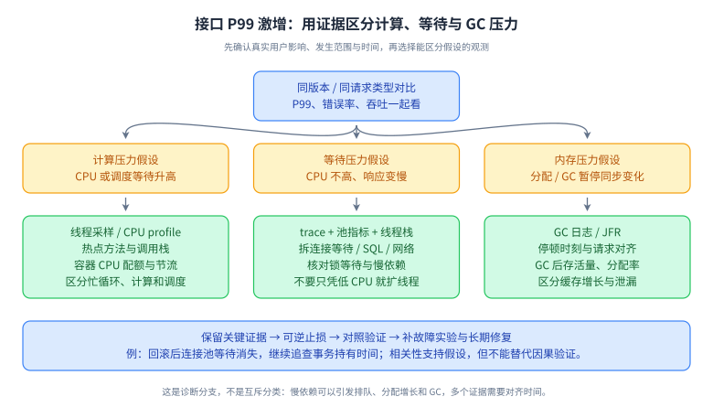

# 34｜资深工程师场景：诊断、决策与技术影响力

> P0。十年经验的区分点是能在不完整信息下形成可验证判断，承担设计结果并推动团队解决问题。配合 [12 排障](12-reliability.md)、[19 项目表达](19-project-interview.md)。以下为虚构练习数据，不可写成个人真实经历。

## L1｜面试官通常还在验证什么

| 能力 | 低质量表达 | 应给出的证据 |
|---|---|---|
| 问题定义 | “系统性能不好” | 哪类用户、哪个指标、起止时间和业务影响 |
| 技术判断 | “大厂都这么做” | 约束、备选、实测和失败边界 |
| 负责到底 | “代码上线就完成了” | 灰度、回滚、业务结果和长期修复 |
| 影响团队 | “我让大家照做” | 分歧依据、协作过程、决策记录与效果 |
| 学习能力 | “熟悉所有技术栈” | 明确未知、验证方法和迁移后的修正 |

## L2｜从信号到证据

读图：先固定时间和故障范围，再把请求、线程、运行时、资源和依赖关联起来，形成可证伪假设。记忆点：**先止损，保留证据，一次只改变能解释的变量**。限制：图不是所有事故的固定操作顺序，高风险采样要评估开销。闭卷重画：为 CPU 低但 P99 高的故障列三条不同证据路径。

读图：业务问题、约束、备选、个人行动、结果、反思相互连接。图中的指标需要你自己补真实基线与观察期，不能使用资料中的演算数字冒充经历。

## L3｜情景题与参考推理

### Q1：发布后 P99 从 200 ms 到 2 s，但平均延迟几乎没变，怎么查？

**参考回答：**先确认同一采样口径与窗口，按版本、接口、租户、区域和成功/失败请求分层，检查是否只有少量高成本流量受影响。定位关键路径 span 的排队与执行时间，再关联线程池、连接池、GC、锁等待和下游延迟。检查发布变更、流量与缓存命中，必要时按已设阈值暂停放量或回滚。平均值稳定只能说明多数请求未变，不能否认尾部问题；P99 也需足够样本。用可控复现验证假设，再做单因素调整。

**追问：某 SQL 的 P99 也升高，能直接断言数据库根因吗？**不能；连接池等待或应用排队可能被错误计入数据库 span，应拆分获取连接、发送、执行和读取时间。

### Q2：CPU 接近 100%，堆使用平稳，怎样区分热点计算与自旋？

**参考回答：**先看容器配额与节流，确认百分比的分母，再采样进程和线程 CPU，关联多次线程栈或低开销分析器。热点业务函数持续消耗 CPU 可能是流量或算法退化；CAS 循环、忙轮询、异常构造、序列化或日志也可能占用。多个时间点相同栈只是线索，不能单次 dump 就定论。比较发布前后热点占比、输入分布与每请求 CPU，重放代表流量验证。止损按来源限流、降级或回滚，保留分析证据。

**追问：增加线程会更快吗？**CPU 已饱和时通常增加切换和争用，应先削减工作、改算法或扩计算容量；除非证据显示存在可隐藏的等待。

### Q3：Java 堆没满，容器却被 OOMKilled，怎么解释？

**参考回答：**先区分 JVM 抛出的 OutOfMemoryError 与平台终止。容器内存包括堆、元空间、线程栈、直接内存、代码缓存、本地库及相关内存记账，堆不满并不排除总内存超限。对齐事件时间、RSS、cgroup limit、线程数、直接缓冲、NMT 等证据，NMT 也不是所有 native 分配的完整账本。检查 Xmx 与容器余量、连接和线程增长、文件映射及最近依赖变更。保留复现条件后调整真正增长源。

**追问：先把 Xmx 加大可以吗？**可能更快触及容器上限；应先识别内存组成，并给 native 与峰值留预算。

### Q4：线程池队列持续增长，但 CPU 不高，怎么处理？

**参考回答：**这提示任务可能在等待 I/O、锁或其他资源，也可能处理能力低于到达率。检查队列年龄、活动线程、任务耗时、拒绝率和下游池等待，采样线程栈寻找阻塞位置。先限制入口和无效重试，保护最慢依赖；调整并发必须受下游容量约束，不能无限加线程与队列。若同一线程池里父任务提交子任务并等待，还需检查线程饥饿死锁。给任务 deadline、取消和明确拒绝语义，并避免超时请求仍继续做昂贵工作。

**追问：加大队列能解决吗？**只吸收有限突发；持续超载会增加等待与内存。队列要按允许排队时间和处理速率设计。

### Q5：MySQL 偶发死锁，是否应该把隔离级别降为 RC？

**参考回答：**先拿到死锁报告和两个事务的完整 SQL 顺序、索引与锁范围，复现等待环。统一访问顺序、缩短事务、补合适索引、减少批量范围，通常比先改隔离级别更可解释。RC 可能改变某些锁行为，但不能消除行更新顺序造成的死锁，还改变读取语义。应用应把数据库死锁回滚视为可重试事务失败，在有限次数、退避和业务幂等条件下重做整个事务，不只重试最后一条 SQL。

**追问：重试事务里调用过支付怎么办？**外部效果不随数据库回滚，应移出或通过幂等编排管理；否则数据库重试可能重复付款。

### Q6：消息积压 500 万条，增加消费者一定有效吗？

**参考回答：**先按分区、消息年龄和错误类型定位瓶颈，区分到达率上升、处理变慢、毒消息重试与暂停消费。Kafka 消费并行度受分区分配约束，单热点分区扩实例不一定增吞吐；数据库或外部 API 饱和时扩消费反而放大故障。若稳定到达率 λ、可持续处理率 μ 且 μ>λ，粗估清空时间为 `积压/(μ-λ)`，要用同一单位和边界。分离失败重试与正常流量，保留顺序和位点正确性，必要时对非关键消息制定有审计的降级策略。

**追问：处理率 2 万/s、进入 1.5 万/s，500 万需多久？**稳定假设下约 1000 秒，不能用 500万/2万 忽略新流入；真实重平衡与热点会改变结果。

### Q7：缓存命中率 99%，数据库仍然过载，为什么？

**参考回答：**命中率是比例，绝对请求量足够大时 1% 回源仍可很高；平均命中也会掩盖少数热点 key 或昂贵查询。检查未命中 QPS、每次回源放大、并发重建、穿透和失效时间集中性，按成本看哪些 miss 最贵。写流量、后台任务、慢查询也可能与缓存无关。策略包括同键请求合并、错峰过期、受控降级、查询优化和回源预算；缓存预热需避免一次性打满数据库。

**追问：把 TTL 全调长就好了吗？**会增加陈旧和失效传播风险，也未必解决热点更新与非缓存流量；先约定业务可接受新鲜度。

### Q8：RAG 离线指标提高，上线投诉反而增加，怎么查？

**参考回答：**先确认评测集是否代表线上任务和权限分布，是否有训练/评测泄漏、标注歧义或 judge 偏差。分解检索召回、排序、上下文构造、生成引用和拒答，检查平均提升是否掩盖关键小类退化。上线还可能因延迟、陈旧文档、ACL过滤、语言分布、截断、缓存和模型版本漂移导致体验下降。抽样对齐输入、检索证据及版本，用人工裁定的失败分类补充回归集，按分层指标决定暂停或回退。

**追问：用户点踩就是答案错误吗？**不一定；可能慢、不完整或不符合预期。需要反馈原因与可复核样本，避免把主观反馈当唯一事实标签。

### Q9：Agent 执行了两次同一写操作，应该改 Prompt 吗？

**参考回答：**先检查 tool_call、任务重试、恢复与外部请求 ID 的完整轨迹，确认重复发生在模型规划、编排重放还是网络重试层。Prompt 可以降低重复建议，但业务必须在确定性执行层保护：同一意图的持久化操作 ID、参数摘要、唯一约束、幂等调用及结果查询。工具超时先标 UNKNOWN，恢复时确认结果；审批应绑定确切操作和参数，不能每次重放自动生成新操作身份。用断点注入验证跨进程重启后的效果次数。

**追问：模型输出两个不同调用 ID 但业务相同怎么办？**模型 ID 不是可靠业务幂等键；需结合任务意图与业务实体定义去重语义，不能一概按文本相似度合并合法重复操作。

### Q10：你和同事对技术选型有分歧，如何推动决策？

**参考回答：**先共同确认业务目标与约束，再把分歧转成可比较假设，例如维护成本、P99、迁移风险与故障恢复。列出现状、小改造和新方案，做有代表性的小实验，记录无法实验的假设与风险负责人。依据团队能力和期限选择可逆程度合适的方案，留下 ADR、成功标准和复查时点。讨论事实与取舍，不用资历压过证据；决定后明确分工，避免长期双轨消耗。

**追问：你的方案最后没被采用怎样回答？**说明对方方案在哪些约束下更合适，以及你如何帮助交付；若存在重大风险，说明升级和缓解过程，不贬低同事。

### Q11：如何讲一次失败、延期或事故，体现高级工程师能力？

**参考回答：**准确描述自己负责的边界、当时已知信息和错误判断，给出时间线、影响与止损；区分直接触发和系统性原因。解释为什么测试、评审或监控没发现，提出有负责人和验收标准的改进，并说明后续是否验证有效。避免把全部责任归给个人粗心，也不要用“团队问题”消解自己的责任。保留真实量级，不记得精确指标时说明可确认范围。

**追问：没有重大事故怎么办？**可以讲需求误解、设计返工或交付偏差，但不要编造故障经历；同样展示发现、纠正和预防闭环。

### Q12：如何证明自己具有技术影响力，而不是只写代码？

**参考回答：**用可核验的行为说明你如何让多人长期做得更好：澄清跨团队契约、建立诊断工具、减少重复事故、辅导同事独立承担模块、推动有证据的架构演进。说明自己的具体贡献和其他人的角色，比较改进前后同口径指标，讨论维护成本和未解决问题。影响力不等于会议多或掌握审批权，必须连接到交付质量、业务结果或团队能力。

**追问：如何衡量带人成果？**看对方是否能独立分析、设计与交付，以及反馈和评审返工是否改善；不要只报分享次数。

## L4｜带评分的模拟流程

| 环节 | 时间 | 面试官动作 | 候选人应交付 |
|---|---:|---|---|
| 背景与项目 | 10分钟 | 问个人负责边界 | 可验证业务问题和技术约束 |
| 主干深挖 | 15分钟 | 从机制追到反例 | 正确结论、条件与验证 |
| 故障场景 | 15分钟 | 每5分钟提供新证据 | 更新假设、止损与下一步检查 |
| 设计或编码 | 20分钟 | 改变一个约束 | 可解释的方案/代码与测试 |
| 反思与反问 | 5分钟 | 讨论未解决问题 | 判断边界、岗位相关反问 |

每项 0–4 分：0不理解，1会术语，2机制基本正确，3能推演失败与权衡，4有完整证据和可迁移经验。**过关标准：**连续两次模拟中主干、设计、编码均至少3分，没有把重试当幂等、把鉴权交给模型、把超时当失败等关键错误。分数只用于训练，不映射公司录用线。

反问可关注：岗位负责的业务边界、当前最难的技术约束、成功交付如何衡量、跨团队协作与值班机制。先听对方回答再追问，避免为了“显得资深”批评未知系统。

## 参考与方法边界

- [Google SRE：有效排障](https://sre.google/sre-book/effective-troubleshooting/)、[事故复盘文化](https://sre.google/sre-book/postmortem-culture/)：假设、证据与无责复盘方法。
- [Amazon SDE III 面试准备](https://www.amazon.jobs/content/en/how-we-hire/sde-iii-interview-prep)、[Microsoft 技术面试准备](https://careers.microsoft.com/v2/global/en/hiring-tips/technical-interviewing.html/)：用于校对编码、设计、沟通等能力范围；本章不是其面试题泄露或录用标准。
- 技术细节依据本资料对应主题章的一手文档；所有事故数字均为自设练习。
